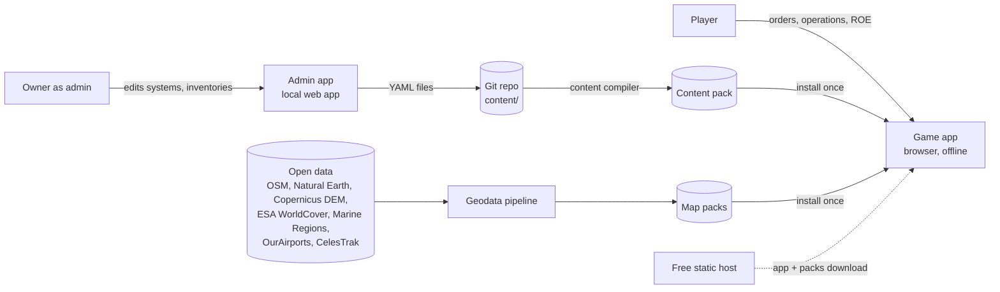
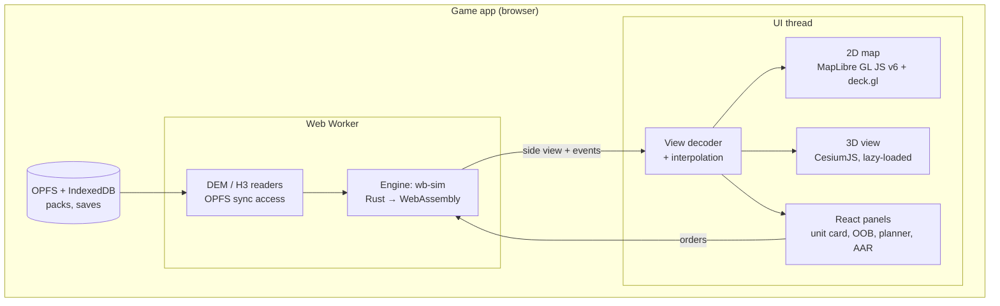

# 01 — Overview

## 1. Problem

Build a wargame that feels like real operational command: real countries, real weapon systems with open-source (OSINT) specifications, a real world map, and engagements decided by the factors that decide them in reality — who sees whom first, terrain, radar horizon, stealth, jamming, missile energy, magazine depth and coordination. It starts as an offline browser game against an AI and must later become an Android game without rewriting the simulation.

## 2. Functional requirements

Numbered to match the original brief.

1. **Offline play** vs AI. PvP later.
2. **Country and coalition selection.** Any countries, grouped into two coalitions.
3. **Two sides of the product.** *Game*: select countries, deploy, fight. *Admin*: define every country's systems, quantities and metadata.
4. **Real and custom systems.** Real systems (S-400, F-35A, AIM-120D, JDAM …) and admin-created custom systems, each with type-specific specs, assignable to one or many countries. Platforms carry **weapon stations** that accept compatible weapons.
5. **OSINT database** covering fighters, bombers, tankers, AEW, drones, helicopters, destroyers, frigates, corvettes, submarines, coastal defence, SAM systems, radars, missiles of all kinds, bombs, artillery, satellites, tanks, infantry, special forces, airborne and marines.
6. **Country inventories** with quantities; the game offers only what the chosen country owns.
7. **World map** with borders and environment (mountain, desert, forest, jungle, urban, arctic, sea) that affects combat.
8. **Bases** with placement rules (no destroyer at an airbase, no naval base inland). Deploy units to bases; patrol and attack from them. **Fog of war**: you see your own units; enemy units only through intel (satellites, drones, recon, radar, ESM).
9. **Realistic engagements** with terrain, integrated air defence, data links and electronic warfare.
10. **Missions**: e.g. satellite spots a tank column → drone confirms count → F-35s launch with a chosen loadout (2 × JDAM + 2 × AIM-120) and strike. All units share intel.
11. **Real-time clock** from war start with ×3, ×5, ×10 (plus ×30, ×60 for transits with auto-drop to ×1). Patrol a circle or a waypoint loop until bingo fuel, then return to base or refuel from a tanker. Patrolling units can be retasked to attack. **Loadout cannot change once a unit leaves base.**
12. **ROE Alpha / Bravo / Charlie** globally, per group or per unit. Click any unit for full status and to retask.
13. **Operations** with phases that run in sequence or in parallel (e.g. Operation Rising Sun, six phases). Start any time. Defenders prioritise their own defence, then protect friendlies.
14. **Visuals**: game-style icons per system type; missile launch, flight, intercepts and impacts drawn in real time at real speed.
15. **Close any time**, resume later. Every intel report, launch, intercept and hit is documented in detailed reports.

## 3. Non-functional requirements

| NFR | Target | How |
|---|---|---|
| Performance | ≤ 6 ms average tick, 2,000 units | Rust + WASM in a worker, adaptive tick, multi-rate systems, spatial grid, LOS cache |
| Smoothness | 60 fps 2D, ≥ 30 fps 3D | Engine off the main thread; GPU layers (deck.gl, Cesium primitives); interpolation |
| Determinism | Bit-identical across platforms | Fixed step, counter-based RNG, `libm`, ordered iteration, single-threaded schedule |
| Fair fog of war | UI and AI see only their side | Engine API returns side views only; contacts have their own IDs |
| Offline | Everything works without network | Installable web app + region packs in browser storage (OPFS) |
| Portability | Same engine in Unity later | Engine has no browser or UI dependencies; C ABI planned |
| Data integrity | Every spec traceable | Provenance and confidence on every content entry |
| Changeability | New system = new data | Component-based schema; no system-specific code |
| Cost | ₹0 / $0 tooling | Open-source stack and open data |

## 4. System context



## 5. Components



Inside the engine (one Rust crate per box below, see §7):

| Module | Owns | Does not own |
|---|---|---|
| `wb-core` | Geo math (WGS84 sphere, great circle, ENU), units, IDs, counter RNG, deterministic math (`libm`) | Game rules |
| `wb-content` | Schema types, YAML loading, validation, pack compiler, JSON Schema / TS generation | Runtime state |
| `wb-geo` | Territory lookup, H3 terrain classes, DEM sampling, line of sight | Units |
| `wb-sim` | ECS world, scheduler, movement, fuel, bases, sensors, fusion, EW, weapons, damage, ROE, operations, events, save/load | Rendering |
| `wb-ai` | Strategic / operational / tactical AI on the AI side's picture | Truth |
| `wb-wasm` | Browser API (wasm-bindgen) | — |
| `wb-ffi` | C ABI for Unity (phase 13) | — |
| `wb-cli` | Headless runs, golden tests, Monte Carlo, content build | — |

## 6. Tech stack (locked, free)

Versions verified 27 Oct 2026; Claude Code pins exact versions at bootstrap and records them in `docs/versions.md`.

| Layer | Choice | Licence | Notes |
|---|---|---|---|
| Engine language | Rust (stable, pinned with `rust-toolchain.toml`) | MIT/Apache-2.0 | One engine for browser, CLI, Unity |
| ECS | `bevy_ecs` 0.19.x, standalone | MIT/Apache-2.0 | Single-threaded executor for determinism |
| H3 grid | `h3o` 0.10.x | BSD-3 | Pure Rust, compiles to WASM |
| Serialization | `serde`, `postcard` (binary), `serde_yaml` | MIT/Apache-2.0 | Packs, saves, view format |
| Schema export | `schemars` → JSON Schema, `ts-rs` → TypeScript types | MIT | Admin forms and UI types generated from Rust |
| Satellites | `sgp4` crate + CelesTrak TLEs | MIT / free data | Real orbits where public |
| WASM bridge | `wasm-bindgen` | MIT/Apache-2.0 | Engine in a dedicated Web Worker |
| UI | TypeScript, React, Vite, Zustand, pnpm | MIT | Panels only; map layers are not React-rendered per frame |
| 2D map | MapLibre GL JS v6 (ESM-only, WebGL2) | BSD-3 | Dark vector style like the screenshots |
| 2D overlays | deck.gl 9.x via `@deck.gl/maplibre` `MapLibreOverlay` | MIT | Icons, trails, rings, labels on the GPU |
| 3D view | CesiumJS 1.14x, self-hosted, no Cesium ion account | Apache-2.0 | `CustomHeightmapTerrainProvider` fed from our DEM tiles |
| Basemap tiles | Protomaps basemap (OpenStreetMap) as PMTiles, cut with `pmtiles extract` | ODbL data, BSD-3 code, CC0 styles | Attribute © OpenStreetMap |
| Symbols | Custom SVG icon set (game style) + `milsymbol` 3.x for NATO mode | MIT | Packed into a texture atlas |
| Geodata tooling | Python 3.12, GDAL, `h3` (Python), `pmtiles` CLI | MIT/Apache/BSD | Runs on the owner's machine or CI |
| Offline | Service worker (Workbox), OPFS, IndexedDB | MIT / web standards | `navigator.storage.persist()` |
| Admin app | React + `@rjsf/core` schema forms + File System Access API | Apache-2.0 | Chromium browsers |
| Android step 1 | Capacitor 8.x | MIT | Wraps the same web app |
| Android step 2 | Unity 6 (Personal, free under $200K revenue), Cesium for Unity 1.25.x, `csbindgen` 1.9.x | Free tier / Apache-2.0 / MIT | Engine as native `.so` via C ABI |
| 3D models | Blender → glTF 2.0 | GPL tool, our assets | Low-poly, shared by Cesium and Unity |
| CI | GitHub Actions (free for public repos; free minutes for private) | — | Native + WASM determinism check |

## 7. Repository layout

```
warboard/
├── CLAUDE.md                      # rules for Claude Code (copy from docs)
├── rust-toolchain.toml
├── Cargo.toml                     # workspace
├── crates/
│   ├── wb-core/                   # geo math, units, ids, rng, deterministic math
│   ├── wb-content/                # schema, validation, compiler
│   ├── wb-geo/                    # territory, H3 terrain, DEM, LOS
│   ├── wb-sim/                    # engine
│   ├── wb-ai/                     # AI
│   ├── wb-wasm/                   # browser bindings
│   ├── wb-ffi/                    # C ABI (phase 13)
│   └── wb-cli/                    # headless runner, tests, content build
├── apps/
│   ├── game/                      # React + MapLibre + deck.gl + Cesium
│   └── admin/                     # content editor
├── packages/
│   ├── protocol/                  # generated TS types + SideView decoder
│   └── symbols/                   # icon SVGs, milsymbol adapter, atlas builder
├── content/                       # YAML source of truth (countries, platforms, weapons…)
├── geodata/                       # pipeline scripts and configs (outputs to build/packs/)
├── scenarios/                     # test + tutorial scenarios, golden expectations
└── docs/                          # this architecture package
```

## 8. Glossary

| Term | Meaning |
|---|---|
| Truth | The engine's complete, exact world state. Never sent to a UI |
| Side view | What one side knows: its own units (exact) + contacts (estimated) |
| Contact | A detected thing with its own ID, estimated position, uncertainty ellipse, classification level |
| COP | Common operational picture: a side's fused contacts |
| Classification level | Unknown → domain (air/surface/…) → class (fighter, frigate…) → type (Su-57) → precise (count, state) |
| TEWA | Threat evaluation and weapon assignment, how defenders pick threats and interceptors |
| EMCON | Emission control: whether a unit's radars and radios are on |
| Bingo | Fuel state at which a unit must return to base |
| Pk | Probability of kill for one weapon against one target in one engagement |
| Region pack | Downloadable map data for the world or one theatre |
| Content pack | Compiled database of systems, weapons, countries and inventories |
