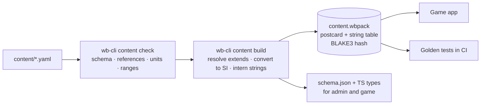

# 04 — Data model & admin

## 1. Content principles

1. **Data, not code.** A new system type (real or custom) is a YAML file. No system gets special-case code.
2. **Components.** A platform is assembled from signatures, mobility, fuel, stations, sensors, EW, data links and durability. Anything with the right components works: a drone with an ESM sensor and a jammer is a valid EW drone.
3. **Units in field names** (`range_km`, `speed_mach`, `rcs_m2`, `warhead_kg`). The compiler converts to SI.
4. **Provenance everywhere.** Every entry has sources and a confidence level; uncertain fields are listed as estimates.
5. **YAML in git is the source of truth.** The admin app edits those files; the compiler builds the pack the game loads.

## 2. Entity types

| Type | Folder | Purpose |
|---|---|---|
| `country` | `content/countries/` | Name, ISO code, flag, default doctrine, data link families |
| `platform` | `content/platforms/<category>/` | Aircraft, helicopters, drones, ships, submarines, ground vehicles, launchers, radars, satellites, infantry and SOF formations |
| `system` | `content/systems/` | Composite systems deployed as a site or group (S-400 battalion, Patriot battery, Iskander brigade) |
| `sensor` | `content/sensors/` | Radars, ESM, IRST, EO/IR, sonar, satellite payloads |
| `weapon` | `content/weapons/` | Missiles, bombs, shells, rockets, torpedoes, loitering munitions, decoys |
| `ew_suite` | `content/ew/` | Jammers (self-protection, escort, stand-off), comms and GPS jammers |
| `countermeasure` | `content/countermeasures/` | Chaff, flares, towed decoys, DIRCM |
| `datalink` | `content/datalinks/` | Latency, capacity, engage-on-remote support |
| `loadout` | `content/loadouts/` | Named loadout templates per platform |
| `base` | `content/bases/` | Real air bases and ports (generated from OurAirports + curated list), owner country, runway class, capacity |
| `inventory` | `content/inventories/` | Per country: quantities, munition stocks, peacetime basing, as-of date |
| `doctrine` | `content/doctrine/` | AI profile per country |
| `realism` | `content/realism/` | Global tuning constants (doc 02 §17) |

## 3. Examples (illustrative values)

Values below show the format. Real entries are filled from public sources during Phase 8 and every uncertain number is listed under `estimates`.

### 3.1 Sensor

```yaml
id: an-apg-81
kind: sensor
name: AN/APG-81 AESA
sensor_type: radar
role: [air_search, fire_control, ground_mapping]
radar:
  band: X
  r_ref_km: 150            # 50% detection range vs 1 m²
  sigma_ref_m2: 1.0
  scan_period_s: 2
  field_of_regard_deg: 120
  clutter_rejection: 0.85
  pulse_doppler: true
  eccm_db: 20
  erp_class_dbw: 75        # for enemy ESM
  fire_channels: 8
provenance:
  confidence: low
  estimates: [radar.r_ref_km, radar.eccm_db, radar.erp_class_dbw]
  sources:
    - { title: "Manufacturer fact sheet", url: "https://…", accessed: 2026-11-02 }
```

### 3.2 Weapon

```yaml
id: aim-120d
kind: weapon
name: AIM-120D AMRAAM
category: aam
targets: [air]
profile:
  boost_s: 6
  max_speed_mach: 4.0
  sustain_s: 0
  coast_tau_s: { sea_level: 18, high_alt: 60 }
  min_speed_mach: 1.1
  max_range_km: 160        # calibration target vs head-on, launch 12 km at Mach 1.2
  min_range_km: 1.5
  max_g: 40
guidance:
  midcourse: [inertial, datalink]
  terminal: active_radar
  seeker_range_km: 18
  seeker_eccm: 0.6
warhead_kg: 18
pk_base: { fighter: 0.75, bomber: 0.85, helicopter: 0.8, cruise_missile: 0.5, uav: 0.85 }
countermeasure_resistance: { chaff: 0.7, towed_decoy: 0.4 }
mass_kg: 161
station_category: [aam_medium]
internal_carriage: true
provenance: { confidence: medium, estimates: [profile.coast_tau_s, pk_base], sources: [ … ] }
```

### 3.3 Platform

```yaml
id: f-35a
kind: platform
category: aircraft/fighter
name: F-35A Lightning II
crew: 1
mobility:
  cruise_speed_mach: 0.9
  max_speed_mach: 1.6
  ceiling_m: 15000
  sustained_g: 5.5
  min_runway_m: 2400
signature:
  rcs_m2: { front: 0.005, side: 0.1, rear: 0.05, top: 0.05 }
  external_stores_rcs_multiplier: 8
  ir: { cruise: 1.0, afterburner: 3.0 }
fuel:
  internal_kg: 8278
  burn_kg_h: { cruise: 2600, military: 5200, afterburner: 14000 }
  aar: boom
stations:
  - { id: bay_l_out, kind: internal, categories: [aam_medium], max_kg: 160 }
  - { id: bay_l_in,  kind: internal, categories: [aam_medium, bomb_900kg, arm], max_kg: 1000 }
  - { id: bay_r_in,  kind: internal, categories: [aam_medium, bomb_900kg, arm], max_kg: 1000 }
  - { id: bay_r_out, kind: internal, categories: [aam_medium], max_kg: 160 }
  - { id: pylon_1,   kind: external, categories: [bomb_900kg, aam_short], max_kg: 1100 }
sensors: [an-apg-81, an-aaq-37-das, an-aaq-40-eots, asq-239-esm]
ew: [asq-239-self-protect]
countermeasures: { chaff: 60, flares: 60 }
datalinks: [link-16, mada]
durability: { model: aircraft, p_kill_on_hit: 0.8 }
turnaround_min: 60
provenance: { confidence: low, estimates: [signature.rcs_m2, signature.ir], sources: [ … ] }
```

### 3.4 Composite system

```yaml
id: s-400-battalion
kind: system
name: S-400 Triumf battalion
deploy_as: site
setup_min: 5
components:
  - { platform: 91n6e-big-bird, count: 1, role: surveillance }
  - { platform: 92n6e-grave-stone, count: 1, role: fire_control }
  - { platform: 55k6e-command-post, count: 1, role: c2 }
  - platform: 5p85te2-launcher
    count: 8
    magazine: { 48n6dm: 2, 40n6e: 1, 9m96e2: 4 }   # per launcher, illustrative mix
emcon_default: blink
iads_capable: true
```

Each component is its own damageable entity on the map; destroying the fire-control radar stops guided engagements even if launchers survive.

### 3.5 Custom system

```yaml
id: custom-f-35a-block-x
kind: platform
custom: true
extends: f-35a                  # resolved at compile time
name: F-35A Block X (custom)
overrides:
  mobility.max_speed_mach: 1.8
  signature.rcs_m2.front: 0.002
```

### 3.6 Inventory

```yaml
country: POL
as_of: 2026-10-01               # inventories are dated; all numbers here are illustrative
platforms:
  f-16c-block-52: 36
  patriot-battery: 4
munitions:
  aim-120c-7: 300
  agm-158-jassm: 40
basing:
  f-16c-block-52: { base: EPKS-krzesiny, count: 18 }
provenance: { confidence: medium, sources: [ … ] }
```

## 4. Provenance and data quality

| Field | Meaning |
|---|---|
| `confidence` | `high` (official), `medium` (consistent OSINT), `low` (single or disputed source), `estimate` (reasoned guess) |
| `estimates` | Field paths that are guesses even if the entry is otherwise solid (RCS values almost always) |
| `sources` | Title, URL, access date |
| `as_of` | For inventories, which change over time |

Rules: public sources only; when sources disagree, record the range in a comment and pick the median; every guessed value goes into `estimates`; the game shows confidence on the unit card ("specs: medium confidence").

## 5. Admin app

A local web app (`apps/admin`) for the owner. No server.

| Feature | How |
|---|---|
| Open the content folder | File System Access API (Chrome/Edge), reads and writes YAML directly in the repo |
| Browse and search | By kind, category, country, confidence |
| Edit | Forms generated from the JSON Schema (`@rjsf/core`) with custom widgets (RCS by aspect, station editor, magazine mix) |
| Validate live | `wb-content` compiled to WASM: same rules as the compiler (references, units, ranges) |
| Inventories | Per country table: quantity, munitions, basing, as-of |
| Compare | Two systems side by side |
| Test bench | Runs Monte Carlo engagements in the browser via `wb-wasm` (e.g. 1,000 × "AIM-120D vs Su-35S at 60 km, beaming") and shows outcome distributions |
| Diff and commit | Shows changed files; the owner commits with git |

## 6. Content pipeline



- The pack carries `schema_version`, `content_version` (semver) and its hash. Saves record the hash.
- Breaking schema changes need a migration in `wb-content` and a test.

## 7. Runtime data

### 7.1 Save file (`.wbsave`)

| Part | Content |
|---|---|
| Header | Magic, save version, content hash, map pack versions, created, war name |
| Setup | Coalitions, sides, difficulty, start mode, start time, seed |
| Snapshot | Serialized ECS world + side pictures + operations + RNG seed + tick (postcard, zstd) |
| Command log | All orders since war start (for replay) |
| Event log | All events (compressed) |
| Checkpoints | Snapshots every 10 sim minutes for replay seeking (optional, pruned) |

### 7.2 Orders (commands)

Orders are typed, validated by the engine, and logged with the tick they apply at.

```json
{ "type": "AssignTask", "tick": 184230,
  "units": [1203, 1204],
  "task": { "kind": "PatrolRoute", "waypoints": [[19.10, 54.40], [20.05, 55.12]],
            "alt_m": 9000, "speed": "cruise", "loop": true } }
```

Rejections carry a reason the UI can show ("Loadout locked: unit is airborne").

### 7.3 Events

| Event | Key payload |
|---|---|
| `ContactNew` / `ContactUpgraded` / `ContactLost` | side, contact id, level, source, position, ellipse |
| `IntelReport` | side, source (satellite, drone, recon), area, contacts |
| `Launch` | shooter, weapon type, salvo id, target (contact), range, count |
| `WeaponTerminated` | weapon id, salvo id, outcome, factors (Pk, f_energy, f_cm, …), interceptor if any |
| `Damage` / `UnitDestroyed` | target, cause, damage %, subsystems lost |
| `BaseComponentDamaged` | base, component, repair time |
| `TaskChanged` / `PhaseStarted` / `PhaseEnded` | unit or operation, phase, reason |
| `RoeRequest` / `RoeDecision` | unit, target, weapon, Pk estimate, window |
| `BorderCrossing` | unit or contact, territory, direction |
| `EmconChanged` / `JammerChanged` | unit, state |
| `Refuelled` / `BingoRtb` / `Landed` | unit, fuel, base |
| `AutoSlow` | reason |

Every event has `tick`, `sim_time`, and a visibility mask with per-side reveal times.
