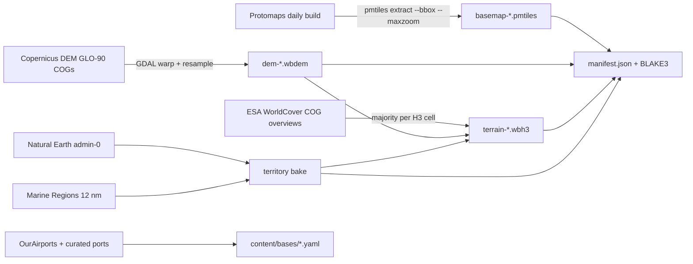

# 05 — Map & geodata

## 1. Open data sources

All free for a personal project. Licences checked 27 Oct 2026; the in-game credits screen must carry every attribution below.

| Data | Source | Licence | Used for |
|---|---|---|---|
| Basemap (land, water, coastlines, labels, cities) | Protomaps basemap, built from OpenStreetMap + Natural Earth, PMTiles | ODbL (tiles), CC0 (styles), BSD-3 (code) | 2D map. **Attribute "© OpenStreetMap"** |
| Country borders | Natural Earth admin-0 (1:10m) | Public domain | Borders, territory |
| Territorial seas (12 nm) | Marine Regions — Maritime Boundaries Geodatabase, current version | CC-BY 4.0 | Sea territory for ROE Bravo |
| Elevation | Copernicus DEM GLO-90 | Free licence with attribution ("produced using Copernicus WorldDEM-90 © DLR e.V.") | Line of sight, terrain classes, 3D terrain |
| Land cover | ESA WorldCover 10 m | CC-BY 4.0 ("© ESA WorldCover project / contains modified Copernicus Sentinel data") | Terrain classes |
| Airfields | OurAirports | Public domain | Real air bases (filtered to military and suitable civil runways) |
| Ports and naval bases | Curated list (public sources) | Our data | Real naval bases |
| Satellite orbits | CelesTrak TLEs | Free | Real satellite orbits where published |
| 3D imagery | Natural Earth II / NASA Blue Marble rasters, low resolution | Public domain | Globe texture in the 3D view |

## 2. Region packs

A war needs the **world pack** plus the **theatre pack** where fighting happens. Packs are downloaded once, verified by hash, stored in OPFS, and work offline.

| Pack | Extent | Contents | Size (*estimate*) |
|---|---|---|---|
| `world` | Whole Earth | Basemap z0–6, borders, territorial seas, DEM ~3.7 km (2′), H3 terrain at resolution 5 (~250 km² cells), bases index | ≈ 200 MB |
| `europe` | 25°W–62°E, 34°N–75°N (Atlantic to the Urals, Barents to the Mediterranean, incl. Iceland and the GIUK gap) | Basemap z7–9, DEM ~450 m (15″), H3 terrain at resolution 7 (~5 km² cells), coastline detail | ≈ 0.5–0.7 GB |
| Later | `middle-east`, `south-asia`, `east-asia`, … | Same as `europe` | — |

Beyond zoom 9 the map over-zooms; strategic play does not need street detail. Sizes are measured in Phase 2 and recorded in `docs/versions.md`.

### 2.1 Pack file formats

| File | Format | Read by |
|---|---|---|
| `basemap-<region>.pmtiles` | Vector tiles (Protomaps schema) | MapLibre (PMTiles protocol, from OPFS) |
| `borders.fgb` / layers in basemap | Polygons and lines | MapLibre (display), pipeline (territory bake) |
| `dem-<region>.wbdem` | 1°×1° tiles, int16 metres, zstd, tile index | Engine (LOS), Cesium (`CustomHeightmapTerrainProvider`) |
| `terrain-<region>.wbh3` | Sorted H3 cell array: class u8, mean elevation i16, slope u8, flags (coast, border, urban), country u16 | Engine |
| `territory-<region>.bin` | Border-cell polygon refs for exact point-in-polygon near borders | Engine |
| `manifest.json` | Pack id, version, extent, file hashes (BLAKE3), sizes, attribution | Pack manager |

## 3. Terrain classes

Derived per H3 cell from WorldCover majority class + DEM slope and roughness.

| Class | Rule | Effects |
|---|---|---|
| Water | Permanent water / sea | Ships only; sea clutter for radars |
| Open | Grassland, cropland | Fast ground movement; long visual range |
| Forest | Tree cover | Slow movement; concealment; low-level LOS blocked inside cell |
| Jungle | Tree cover within 23.5° of the equator | As forest, stronger |
| Urban | Built-up | Strong defence bonus; concealment; slow movement; clutter |
| Desert | Bare / sparse vegetation | Fast movement; poor concealment; IR contrast at night |
| Mountain | Slope or roughness above thresholds | Very slow; defence bonus; terrain masking |
| Marsh | Herbaceous wetland, mangroves | Very slow; no heavy vehicles |
| Arctic | Snow/ice, moss/lichen | Slow; cold-weather equipment flag |

The multipliers live in the realism profile, not in code.

## 4. Elevation and line of sight

- Theatre DEM at 15″ (~450 m) is enough for radar masking and long-range line of sight; ground engagements inside a cell use the terrain class instead.
- The engine samples elevation along the great circle between sensor and target, adds Earth curvature (4/3 radius for radio), and checks clearance.
- **In the browser** the worker reads DEM tiles **synchronously** from OPFS (`FileSystemSyncAccessHandle`, available in dedicated workers) with an LRU cache. **Natively** (CLI, Unity) it memory-maps the same file. Results are pure functions of position, so cache state never changes an outcome.
- The 3D view feeds Cesium the same tiles through `CustomHeightmapTerrainProvider`; no separate terrain build or Cesium ion account is needed.

## 5. Territory

- **Land:** Natural Earth admin-0 polygons. **Sea:** Marine Regions 12 nm territorial seas. Airspace above both belongs to the same country.
- The pipeline bakes country ownership into each H3 cell; cells crossed by a border are flagged and point-in-polygon is done exactly for them.
- **Coalition territory** = union of member countries' territory; neutrals are neither friendly nor hostile.
- **Disputed or occupied areas** are not hard-coded: war setup lets the player choose who controls each listed disputed area. Default follows the Natural Earth default worldview.
- Used by ROE Bravo, base placement, border-crossing events and the territory tint on the map.

## 6. 2D map style

Dark theme matching the reference screenshots (exact colour tokens in [10-ui-style-guide.md](10-ui-style-guide.md) §2):

| Layer | Style |
|---|---|
| Sea | Dark slate blue |
| Land | Near-black |
| Coalition territory | Tint over land **and** 12 nm waters with an outline: own coalition purple, enemy blue (swappable; "friendly blue / enemy red" option) |
| Borders | Thin light lines; territorial-sea limit dashed |
| Labels | Countries, seas, major cities in muted italic |
| Overlays | Terrain classes (toggle), graticule (toggle), scale bar |

Zoom range 1–9 with over-zoom to 12. A credits control shows the attributions from §1.

## 7. Geodata pipeline

Runs once per pack version on the owner's machine or a CI runner. Scripts live in `geodata/`, are deterministic, and write to `build/packs/`.

- Copernicus DEM and WorldCover are Cloud-Optimised GeoTIFFs: read them through GDAL's `/vsis3/` or `/vsicurl/` and use **overview levels** so the build never downloads full-resolution tiles it does not need.
- `pmtiles extract` cuts the region and zoom range from the Protomaps build instead of building tiles from the whole planet.
- Tools: Python 3.12, GDAL, `h3` (Python), `pmtiles` CLI, `zstd`. All free.
- Each pack's manifest records source versions and download dates.