# 08 — Roadmap, metrics & risks

Sizes are weeks of focused work for one person with Claude Code (*estimates*). Each phase ends with acceptance tests that must pass in CI before the next starts. Phase prompts for Claude Code are in [09-claude-code-handoff.md](09-claude-code-handoff.md).

## 1. Phases

| # | Phase | Size | Builds | Exit criteria |
|---|---|---|---|---|
| P0 | Foundations | 1–2 wk | Monorepo, toolchains, CI, crate skeletons, counter RNG, determinism lints, WASM worker "hello tick", TS type generation | Same state hash natively and in WASM (Node) for 10,000 empty ticks; CI green |
| P1 | Content schema & seed data | 1–2 wk | `wb-content` types, YAML loader, validation, compiler, JSON Schema/TS export; ~25 seed systems for the Baltic test set | Bad references and units rejected with clear errors; pack round-trips; stable hash |
| P2 | Geodata & 2D map | 2–3 wk | `world` and `europe` packs (basemap, borders, 12 nm seas, DEM, H3 terrain, bases); pack manager; MapLibre + deck.gl dark map; territory lookup | Map works with network off; territory tests pass; pack sizes measured |
| P3 | Engine core | 2–3 wk | ECS world, adaptive scheduler, aircraft/ship movement, fuel, bases and placement rules, stationing, tasks (move, patrol circle/route, RTB, land, tanker refuel), time controls, side view, unit card, waypoint drawing, save/load | Patrol until bingo then RTB; tanker extends patrol; 2,000 dummy units ≤ 6 ms/tick at ×10; save/load mid-flight resumes with identical hash |
| P4 | Sensors & fog of war | 2–3 wk | Radar, ESM, IRST, EO/IR, visual, satellites (SGP4, EO/SAR, tasking), contacts, classification, ellipses, data links, EMCON, intel log | Golden G1–G5 pass; no code path from UI to truth (API test) |
| P5 | Weapons, air combat & ROE | 3 wk | Stations and loadouts (locked airborne), launch doctrine, missile flyout, seekers, endgame, countermeasures, damage, ROE + approval queue + self-defence, weapon visuals | G6, G8, G9 pass; every termination event carries factors |
| P6 | Naval, IADS & EW | 3 wk | Ships, VLS magazines, AShM salvos, TEWA layers and fire channels, CIWS, decoys, IADS with C2, jamming (self-screen, stand-off, escort), burn-through, comms/GPS jamming, ARMs, SEAD/DEAD | G10–G12 pass |
| P7 | Operations & reports | 2–3 wk | Operation model and triggers, planner UI with timeline, validation, salvo/loss/munitions/sortie/operation reports, export, replay with seeking | G13 passes; report totals equal event counts; replay hash matches |
| P8 | Admin app & Tier-1 content | 3–4 wk | Admin editor, schema forms, provenance, inventories, test bench; Tier-1 content (~200 systems, ~150 weapons) with sources | Every entry has sources and confidence; test-bench sanity suite passes |
| P9 | Enemy AI v1 & war setup | 2–3 wk | Coalition setup, garrisoned start on real bases, AI posture, CAP, IADS, intercepts, retaliation, difficulty | 24 h sim-time AI-vs-AI soak without errors; AI never reads truth (test); AI reacts to incursions within its doctrine time |
| P10 | 3D tactical view | 2 wk | CesiumJS lazy chunk, DEM terrain, globe texture, billboards, trajectories, orbits, glTF placeholders, camera modes | 2D↔3D keeps state; ≥ 30 fps with 500 visible units; works offline |
| P11 | Ground forces | 3–4 wk | Formations, H3 pathfinding, combat resolution, artillery and rockets, SOF and recon, strikes on columns, FOBs | Strike-chain scenario (doc 03 §8.2) passes; terrain modifier tests |
| P12 | AI v2, Android wrapper, polish | 3 wk | AI-planned operations, Capacitor 8 build, touch UI, performance pass, credits screen | AI launches a multi-phase operation; APK runs a 500-unit war at ×5 on a mid-range phone |
| P13 | Unity client (later) | 6–10 wk | `wb-ffi`, C# bindings, Cesium for Unity, Blender models, UI Toolkit | Browser save loads in Unity and continues identically |

**Milestones:** M1 *Map & flight* (P3) · M2 *First blood* — air combat with fog and ROE (P5) · M3 *Rising Sun* — full operation with naval, IADS, EW and reports (P7) · M4 *Playable war* vs AI with Tier-1 data (P9) · M5 *3D + ground* (P11) · M6 *Android* (P12).

```mermaid
gantt
  dateFormat X
  axisFormat %s
  title Weeks (upper estimate)
  section Core
  P0 Foundations        :0, 2
  P1 Content schema     :2, 4
  P2 Geodata + 2D map   :4, 7
  P3 Engine core        :7, 10
  section Combat
  P4 Sensors + fog      :10, 13
  P5 Weapons + ROE      :13, 16
  P6 Naval, IADS, EW    :16, 19
  P7 Operations + AAR   :19, 22
  section Game
  P8 Admin + content    :22, 26
  P9 AI v1 + setup      :26, 29
  P10 3D view           :29, 31
  P11 Ground forces     :31, 35
  P12 AI v2 + Android   :35, 38
```

Content work (P8) can start in parallel from P4 onwards: YAML entries need only the P1 schema.

## 2. Success metrics

| Metric | Target | Measured by |
|---|---|---|
| Engine step | ≤ 6 ms average per tick, 2,000 units, 300 weapons | CI benchmark scenario |
| 2D frame rate | 60 fps with 2,000 icons + 300 weapons | Browser profiler, benchmark scene |
| 3D frame rate | ≥ 30 fps, 500 visible units | Benchmark scene |
| Determinism | Equal state hash native vs WASM after 1 h sim time | CI |
| Fog of war | Zero truth fields in any view or details response | API test with a truth-canary unit |
| Offline | Full war with network disabled | Manual test per release |
| Save/load | < 2 s, 2,000 units | Benchmark |
| Content quality | 100% of shipped entries with sources and confidence | `wb-cli content check` |
| Realism | All golden scenarios within bands | CI |

## 3. Golden scenarios

Stored in `scenarios/golden/` with expected bands; Monte Carlo ones run 500 seeds in CI (native). Bands are first estimates; changing one is an explicit decision recorded in the scenario file.

| ID | Scenario | Expected |
|---|---|---|
| G1 | Frigate radar at 30 m vs sea-skimmer at 5 m | First detection 28–36 km |
| G2 | Same fighter radar vs Su-35S and vs F-35A, head-on | Detection range ratio within 20% of (σ₁/σ₂)^¼ |
| G3 | Aircraft at 100 m behind a ridge vs ground radar | Undetected until line of sight clears |
| G4 | ESM aircraft vs emitting S-400 radar | ESM detects the radar beyond the range at which the S-400 detects the aircraft |
| G5 | Satellite pass over a target at night | EO: no report; SAR: report |
| G6 | AIM-120D vs aware fighter | At max range, beaming: ≥ 70% out of energy or miss. At 50% range head-on: Pk 0.6–0.85 |
| G7 | F-35A patrol with and without tanker | Tanker doubles time on station; without, lands with ≥ reserve fuel |
| G8 | ROE Bravo, hostile flight along the border | Never engaged outside; engaged within 60 s after crossing; return fire allowed |
| G9 | ROE Charlie under missile attack | Self-defence intercepts without approval; other shots queued |
| G10 | 12 × JSM vs 2 × FREMM | 60–95% of missiles intercepted or decoyed; each FREMM engages threats to itself first |
| G11 | Stand-off jammer vs S-400 tracking a Rafale | Detection range reduced 20–50%; burn-through at short range |
| G12 | AARGM-ER vs S-400 radar that shuts down | Pk drops by ≥ 40% |
| G13 | Operation Rising Sun | Runs end to end; phases 4 and 5 start on the same tick |
| G14 | G13 native vs WASM | Identical state hash |
| G15 | 2,000-unit benchmark | ≤ 6 ms average tick |

## 4. Risk register

| # | Risk | Likelihood | Impact | Mitigation |
|---|---|---|---|---|
| R1 | OSINT specs missing, inconsistent or classified (RCS, Pk, ECCM) | High | High | Provenance and confidence fields; estimates flagged; test bench; golden bands; values in data not code |
| R2 | Engine too slow at ×10 with 2,000 units | Medium | High | Adaptive tick, staggered scans, spatial index, LOS memo, CI benchmark from P3 |
| R3 | Determinism breaks silently | Medium | High | Lints (`disallowed-methods`, no hash iteration), counter RNG, native-vs-WASM hash check in CI |
| R4 | Scope creep across all domains | High | High | Phase gates; air, naval and air defence first; ground in P11 |
| R5 | Browser storage eviction or quota limits | Medium | Medium | `storage.persist()`, pack re-download, quota UI; a desktop wrapper later if needed |
| R6 | 2D and 3D views drift apart | Medium | Medium | One decoder and atlas package; parity tests on a fixed view |
| R7 | Realism makes play slow or opaque | Medium | Medium | ×30/×60 with auto-slow; explanations on outcomes; sensible defaults |
| R8 | Map data licence duties missed | Low | Medium | Credits screen from pack manifests; ODbL and CC-BY notes |
| R9 | Claude Code drifts from the architecture | Medium | High | `CLAUDE.md` rules, ADRs, plan-first per phase, acceptance tests, review checklist |
| R10 | Third-party breaking changes (MapLibre v6 ESM-only, Cesium releases) | Medium | Low | Pinned versions, `docs/versions.md`, upgrade only between phases |
| R11 | Real, ongoing conflicts make inventories go stale | High | Low | `as_of` dates, low-confidence flags, easy edits in admin |
| R12 | Large geodata builds on a personal machine | Medium | Low | COG overviews and `pmtiles extract`; build once per pack version |
