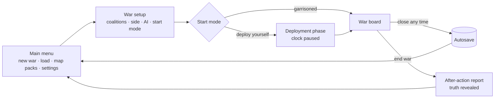
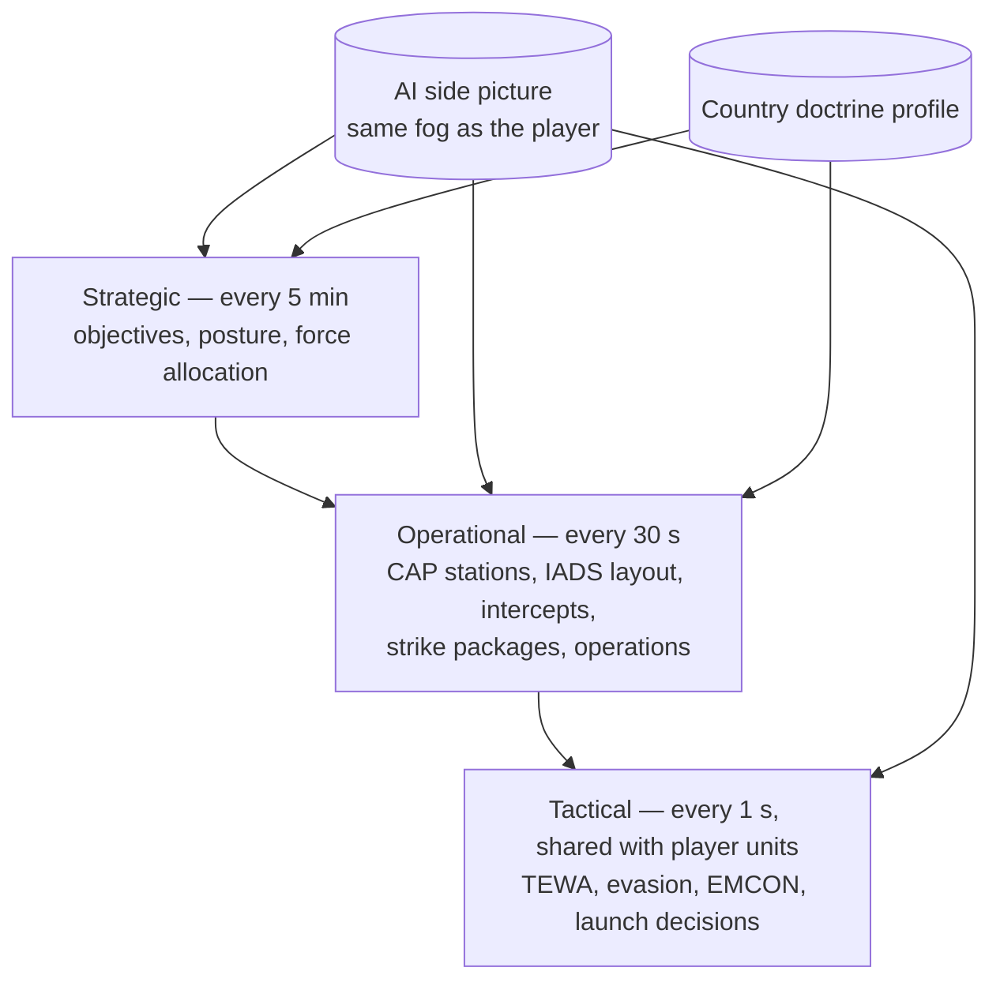

# 03 — Gameplay, operations & ROE

## 1. Game flow

## 2. War setup

| Setting | Options |
|---|---|
| Coalitions | Drag any countries into Coalition A or B; all others are neutral |
| Player side | A or B (the other is AI). Hot-seat and PvP come later |
| AI difficulty | Easy / Normal / Hard (reaction time and planning depth, never extra information) |
| Start mode | **Garrisoned**: inventories start at real bases. **Deploy yourself**: empty bases, place everything with the clock paused |
| Start time | Now (real UTC) or a chosen date and time (affects day/night and satellite positions) |
| Default ROE | Alpha / Bravo / Charlie for the whole side |
| Packs | Checks the required region packs are installed; offers download if not |

Countries without content yet can be selected, but have nothing to deploy.

## 3. Bases

| Base type | Where it can go | Capacity | Setup time |
|---|---|---|---|
| Air base | Real airfields only (OurAirports). Runway length class limits which aircraft can use it | Parking and shelters from data | Activation 1 h if not garrisoned |
| Road strip | Flat open land in own territory | ≤ 6 aircraft flagged *road-capable* (e.g. Gripen) | 6 h |
| Heliport / FARP | Land, slope < 10%, not water or wetland | Helicopters, small drones | 2 h |
| Naval base | Real ports only (curated list) | Berths by ship size; VLS reload only here | Activation 1 h |
| Expeditionary anchorage | Sea cell inside own territorial waters | Small craft up to corvettes; no VLS reload | 2 h |
| Army base / FOB | Land in own territory, not water or wetland | Ground formations by size | 6 h |
| SAM / radar site | Any land cell | One battery or radar | From content (e.g. S-400 ~5 min after arrival) |
| Missile launch site | Land | Launchers (Iskander-M, HIMARS) | From content |
| HQ / C2 node | Land | IADS and C2 node | 1 h |

The placement validator checks terrain class (H3), territory, coast adjacency for naval bases, runway class against aircraft, and capacity. It explains rejections ("Naval base must be at a port"). The rules of the table above are data: one row per base kind in the realism profile (`bases`: site rule `real_airfield` / `real_port` / `terrain`, match radius, allowed terrain classes, own territory, coast, slope, setup time, capacity). Real airfields and ports are checked from content alone; terrain rules need the region packs and are refused without them (P3). Territory means the coalition's land plus 12 nm territorial waters; captured ground arrives with Phase 11.

Every base has damageable components (runway, shelters, fuel, munitions store, radar, C2) and a **munitions stock** drawn from the country inventory.

## 4. Inventory and deployment

1. The country inventory is a pool of quantities per system type (from content).
2. **Station** units at a base. Moving between bases takes real time (ferry flight, road march, sea transit).
3. From a base, units take **tasks**. Aircraft leave as a **flight** (1–4 aircraft, more for packages) with a chosen loadout.
4. Losses are permanent. Munitions used are gone.

## 5. Tasks

| Domain | Tasks |
|---|---|
| Air | Patrol (circle, racetrack, waypoint loop), CAP, Intercept, Strike (contact or point), SEAD/DEAD, Escort, AEW orbit, Tanker track, Recon (area, point, route), Jam (stand-off orbit or escort), Transfer, RTB |
| Sea | Move, Patrol (area or route), Strike (anti-ship, land attack), Escort / screen, Station-keep, ASW hunt (simplified), RTB |
| Ground (Phase 11) | Move, Attack, Defend, Hold, Withdraw, Recon, Raid, Designate |
| Sites | EMCON on / off / blink, Engage (manual), Relocate (mobile systems) |
| Space | Task imaging on an area (next pass), SIGINT is automatic |

**Patrol** units fly their circle or waypoint loop until bingo, then refuel from a tanker on their side if one is reachable, otherwise return to base, turn around, and (optionally) resume.

**Standing behaviours** on every task: bingo → RTB, winchester → RTB, threat reaction (beam/notch, chaff and flares, terrain masking for low fliers), self-defence under ROE, opportunistic refuelling.

**Launch doctrine** per unit or group: *max range*, *no-escape zone*, or *close (≤ 50% range)*; shots per target; salvo size.

**Retasking:** any unit can be retasked at any time from its card or the map (right-click: Move here, Patrol here, Attack this). Patrolling units can be sent to attack, keeping their loadout.

## 6. Loadouts

- Platforms have **stations** (internal bay, pylon, VLS cell, launcher rail). Each accepts weapon categories with weight limits.
- **Loadout templates** per platform from content (e.g. *F-35A — strike, stealth*: 2 × GBU-31 JDAM + 2 × AIM-120D, all internal). Players can build custom loadouts from base stock.
- Validation: station compatibility, weight, total payload, base stock. External stores raise RCS (shown on the card: "stealth: internal only ✓").
- **Locked once the unit leaves base.** Changing it requires landing at a base with stock and a turnaround.

## 7. Rules of engagement

| ROE | Meaning |
|---|---|
| **Alpha — weapons free** | Engage any contact identified as hostile within weapon range |
| **Bravo — weapons tight (territorial)** | Engage hostile contacts inside friendly territory: coalition land, 12 nm territorial waters, and the airspace above. Always return fire against a contact that has launched at our forces |
| **Charlie — weapons hold** | No engagements except self-defence against incoming weapons (on by default, per-unit toggle to hold even that). Every other opportunity becomes an **approval request** |

- **Inheritance:** side default → group → unit override. The unit card shows the effective ROE and where it comes from.
- **Identification:** only contacts identified *hostile* are engaged; unknowns never are.
- **Approval queue:** each request shows unit, target, weapon, estimated Pk and the time window before the shot is lost. Optional auto-pause on a new request. One approval = one engagement.
- **Operations:** strike tasks inside an operation count as approval for their designated targets only.
- **Defender priority** is not ROE but TEWA (doc 02 §12): defend self first, then defended assets, then other friendlies.

## 8. Operations

An operation is a **graph of phases**. Each phase has tasks, a start trigger, an end condition and optional abort conditions. Phases whose triggers fire together run in parallel.

| Trigger | Example |
|---|---|
| On operation start (+ delay) | H+0, H+15 min |
| At time | 04:30 UTC |
| After phase X completes / starts | "after Phase 1", "with Phase 4" |
| On event | contact classified in area, target destroyed, unit arrives at waypoint, satellite report received |
| Manual | player presses "Go" |

| End / abort | Example |
|---|---|
| End | all tasks done, objective destroyed, time limit, manual |
| Abort | losses > X%, detected before H-hour, fuel state |

**Planner validation before start:** units free and at the right base, loadouts available in base stock, fuel to reach targets and return (with tanker plan), no trigger cycles, ROE conflicts flagged. The planner shows a **timeline** (phases as bars, dependencies as arrows) and draws each phase's routes on the map. Operations can start at any time.

### 8.1 Worked example — Operation Rising Sun (Baltic)

| Phase | Tasks | Trigger | Ends when |
|---|---|---|---|
| 1. Eyes on | MQ-9A Reaper flies a recon route off Kaliningrad | H+0 | Both enemy corvettes classified to type and the SAM site located, or 90 min |
| 2. Blind them | 2 × EA-18G Growler (US) stand-off jamming orbit | After Phase 1 | Manual or bingo |
| 3. Take station | FREMM *Carlo Bergamini* moves to a patrol box | H+0 (parallel with 1) | Arrives, then patrols |
| 4. Strike ship 1 | FREMM launches 3 × Teseo Mk2/A at corvette 1 | After Phase 3 arrival **and** Phase 2 started | Weapons terminate |
| 5. Strike ship 2 | Same FREMM launches 3 × Teseo Mk2/A at corvette 2 | **With Phase 4** | Weapons terminate |
| 6. Kill the SAM | 2 × F-35A, 4 × AGM-88G AARGM-ER on the S-400 site | Phase 2 started + 10 min | Site destroyed or weapons gone |

The defending corvettes run TEWA: each engages missiles aimed at itself first, then those aimed at the other corvette, with Redut SAMs, then guns and decoys. The S-400 site defends itself and the ships if its envelope covers them, and may switch off its radar when anti-radiation missiles are detected (EMCON), sending AARGM-ERs into memory mode.

### 8.2 Worked example — the brief's strike chain

1. **Satellite pass** reports an armour column (contact level: *Class*, count unknown).
2. Event trigger → MQ-9A retasked to the area; its EO/IR camera upgrades the contact to *Type: T-90M, count 12*.
3. Event trigger → 2 × F-35A launch from an air base with 2 × GBU-31 JDAM + 2 × AIM-120D each, Strike task on the contact; nearby HIMARS can be added as a parallel phase if in range.
4. Intel is shared over the data link: the F-35s receive the drone's track in flight; the JDAMs fly to the latest coordinates.

## 9. Time control and alerts

- Top bar: clock (UTC and local), pause, ×1, ×3, ×5, ×10, ×30, ×60, achieved speed, auto-slow toggle.
- **Auto-slow** to ×1 (or pause) on: new hostile contact, launch against own forces, ROE request, phase start, unit lost.
- Alert feed with click-to-locate.

## 10. Intel

- Sources: radar, ESM, IRST, EO/IR, satellites (tasked or routine), drones, recon teams, AEW, ships, data links.
- **Intel log:** every new contact, classification upgrade and report, with source and time.
- Estimated enemy positions are drawn with dashed outlines, an uncertainty ellipse and "(our estimate)" when their level is below *Precise* or their position is stale.
- Known enemy SAM and radar sites show **estimated threat rings** (from the contact type's known ranges).

## 11. Enemy AI

- Lives inside the engine (deterministic, portable) and reads **only its side's picture**.
- **Doctrine profile** per country (content): aggression, risk tolerance, EMCON discipline, missile conservation, IADS layering template, CAP rotation, strike package template (SEAD + escort + strikers + jammer), defended asset priorities.
- **Technique:** utility scoring with doctrine weights + templates. Tactical behaviours are the same code that drives the player's units.
- **v1 (Phase 9):** garrisons or deploys, maintains CAP and SAM coverage, scrambles interceptors, responds to incursions, retaliates against detected shooters and bases.
- **v2 (Phase 12):** plans its own multi-phase operations with the same operation model, including decoys and timing.
- **Difficulty** changes reaction delay (Easy 60–120 s, Normal 30 s, Hard 10 s) and coordination depth, never information.

## 12. Reports (after-action)

| Report | Content |
|---|---|
| Intel log | Every detection, upgrade and report, with source |
| Salvo report | Shooter, weapon, count, target, launch range; per weapon: intercepted (by what), decoyed, jammed, out of energy, hit; interceptors expended; damage done |
| Losses and kills | By side, type, cause |
| Munitions | Expended vs remaining, by type and base |
| Sorties | Take-off, landing, fuel, refuels, loadouts |
| Operation report | Per phase: start, end, task outcomes, losses |
| Truth review (after war) | Both sides revealed; "what we thought vs what was there" overlay of contacts against truth |

During the war, reports show only what your side knows. After the war, truth is unlocked. Export to JSON and CSV, plus a printable HTML report. **Replay:** scrub the timeline (snapshots every 10 sim minutes, re-simulation in between).

Example salvo line: *"Salvo S-17 · FREMM-1 · 3 × Teseo Mk2/A → corvette 1 (Steregushchiy class) at 142 km · 1 intercepted by Redut 9M96, 1 decoyed (chaff), 1 hit · target damaged 46%, radar out of action."*

## 13. Closing and resuming

- Close any time: autosave on close and every 5 sim minutes; several save slots.
- A save records the content pack hash and map pack versions. Loading with different content warns and offers migration or refuses.
- **Sandbox by default:** no forced winner. Ending a war produces the after-action report and a scorecard (losses, value destroyed, objectives held). Scenario objectives come later.
