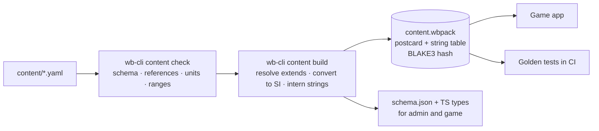

# 04 — Data model & admin

## 1. Content principles

1. **Data, not code.** A new system type (catalogue or custom) is a YAML file. No system gets special-case code.
2. **Components.** A platform is assembled from signatures, mobility, fuel, stations, sensors, EW, data links and durability. Anything with the right components works: a drone with an ESM sensor and a jammer is a valid EW drone.
3. **Units in field names** (`range_km`, `speed_mach`, `rcs_m2`, `warhead_kg`). The compiler converts to SI.
4. **Fictional setting** (doc 11, ADR-036). Nations, bases, places and systems are invented. Every entry names its **class archetype** and carries a short **balance note**; key stats sit inside the archetype's bands (§4).
5. **YAML in git is the source of truth.** The admin app edits those files; the compiler builds the pack the game loads.

## 2. Entity types

| Type | Folder | Purpose |
|---|---|---|
| `nation` | `content/nations/` | Name, id, generated flag (colours and a simple pattern), map colour, capital, default doctrine, data link families |
| `world` | `content/world/` | Theatre definitions (`kind: world`): window, reach, nation seeds and weights, border overrides (cell lists). Map labels (`kind: places`, `places.yaml`): nations, capitals, cities, seas, gulfs, straits, islands, regions; compiled into the pack for the label layer (ADR-042) |
| `archetype` | `content/archetypes/` | Class bands for key stats (§4), shared by many systems |
| `platform` | `content/platforms/<category>/` | Aircraft, helicopters, drones, ships, submarines, ground vehicles, launchers, radars, satellites, infantry and special forces formations |
| `system` | `content/systems/` | Composite systems deployed as a site or group (long-range SAM battalion, medium-range SAM battery, rocket artillery battalion) |
| `sensor` | `content/sensors/` | Radars, ESM, IRST, EO/IR, sonar, satellite payloads |
| `weapon` | `content/weapons/` | Missiles, bombs, shells, rockets, torpedoes, loitering munitions, decoys |
| `ew_suite` | `content/ew/` | Jammer modes as game stats (self-protection, escort, stand-off; data link and navigation disruption), doc 02 §9 |
| `countermeasure` | `content/countermeasures/` | Chaff, flares, towed decoys, DIRCM |
| `datalink` | `content/datalinks/` | Latency, capacity, engage-on-remote support |
| `loadout` | `content/loadouts/` | Named loadout templates per platform |
| `base` | `content/bases/<nation>/<id>.yaml` | Each nation's air and naval bases, one per file (proposed by `geodata bases`, kept or moved by the owner), runway, berths, capacity |
| `inventory` | `content/inventories/` | Per nation: quantities, munition stocks, basing |
| `doctrine` | `content/doctrine/` | AI profile per nation |
| `realism` | `content/realism/` | Global tuning constants (doc 02 §17) |
| — | `content/denylist.txt` | Real names refused by the content check and CI (doc 11 §3.1) |

## 3. Examples (illustrative values)

### 3.0 Nation and theatre

```yaml
id: ALD
kind: nation
name: Aldmark
colour: "#5C7FA8"                # map tint when neutral; coalition colours override
flag: { pattern: nordic_cross, colours: ["#1F3B5C", "#E8C547"] }
capital: Aldvik
doctrine: ald-maritime
datalinks: [weave]
```

```yaml
id: theatre-north
kind: world
terrain_pack: europe
seed: 4711                       # fixes the border growth
nations:
  - { nation: ALD, seed_at: [11.8, 57.4], weight: 1.0 }
  - { nation: VSM, seed_at: [27.5, 58.9], weight: 1.6 }
  # … six more
overrides: []                    # hand-edits as H3 cell lists
```

### 3.1 Sensor

```yaml
id: vr-81
kind: sensor
name: VR-81 AESA
sensor_type: radar
role: [air_search, fire_control, ground_mapping]
radar:
  band: X
  r_ref_km: 150            # 50% detection range vs 1 m²
  sigma_ref_m2: 1.0
  scan_period_s: 2
  field_of_regard_deg: 120
  clutter_rejection: 0.85
  pulse_doppler: true
  jam_resistance: 6       # 0–10 game stat, doc 02 §9 (replaces eccm_db in P6b)
  erp_class_dbw: 75        # for enemy ESM
  fire_channels: 8
design: { archetype: radar-fighter-aesa, note: "Top of the fighter AESA band; pairs with the VF-5's low signature" }
```

### 3.2 Weapon

```yaml
id: ar-7
kind: weapon
name: AR-7
category: aam
targets: [air]
profile:
  boost_s: 6
  max_speed_mach: 4.0
  sustain_s: 0
  coast_tau_s: { sea_level: 18, high_alt: 60 }
  min_speed_mach: 1.1
  max_range_km: 160        # calibration target vs head-on, launch 12 km at Mach 1.2
  min_range_km: 1.5
  max_g: 40
guidance:
  midcourse: [inertial, datalink]
  terminal: active_radar
  seeker_range_km: 18
  seeker_resistance: 0.6   # 0–1 game stat, doc 02 §9 (replaces seeker_eccm in P6b)
warhead_kg: 18
pk_base: { fighter: 0.75, bomber: 0.85, helicopter: 0.8, cruise_missile: 0.5, uav: 0.85 }
countermeasure_resistance: { chaff: 0.7, towed_decoy: 0.4 }
mass_kg: 161
station_category: [aam_medium]
internal_carriage: true
design: { archetype: aam-medium-radar, note: "Long end of the band; Aldmark and Morvel only" }
```

### 3.3 Platform

```yaml
id: vf-5
kind: platform
category: aircraft/fighter
name: VF-5 Vantor
crew: 1
mobility:
  cruise_speed_mach: 0.9
  max_speed_mach: 1.6
  ceiling_m: 15000
  sustained_g: 5.5
  min_runway_m: 2400
signature:
  rcs_m2: { front: 0.005, side: 0.1, rear: 0.05, top: 0.05 }
  external_stores_rcs_multiplier: 8
  ir: { cruise: 1.0, afterburner: 3.0 }
fuel:
  internal_kg: 8300
  burn_kg_h: { cruise: 2600, military: 5200, afterburner: 14000 }
  aar: boom
stations:
  - { id: bay_l_out, kind: internal, categories: [aam_medium], max_kg: 160 }
  - { id: bay_l_in,  kind: internal, categories: [aam_medium, bomb_900kg, emitter_homing], max_kg: 1000 }
  - { id: bay_r_in,  kind: internal, categories: [aam_medium, bomb_900kg, emitter_homing], max_kg: 1000 }
  - { id: bay_r_out, kind: internal, categories: [aam_medium], max_kg: 160 }
  - { id: pylon_1,   kind: external, categories: [bomb_900kg, aam_short], max_kg: 1100 }
sensors: [vr-81, das-6, eo-40, esm-39]
ew: [sp-39]
countermeasures: { chaff: 60, flares: 60 }
datalinks: [weave]
durability: { model: aircraft, p_kill_on_hit: 0.8 }
turnaround_min: 60
design: { archetype: fighter-stealth, note: "Low frontal RCS, modest speed; strong in the first look" }
```

### 3.4 Jammer (EW suite)

```yaml
id: example-escort-jammer
kind: ew_suite
name: Escort jamming pods (example)
modes:                           # 0–10 game stats, doc 02 §9
  self_protect: { jam_strength: 5 }
  escort:       { jam_strength: 6, coverage_km: 150, sector_deg: 60 }
  stand_off:    { jam_strength: 7, coverage_km: 250, sector_deg: 60 }
effects: [radar, datalink]       # optional: navigation
design: { archetype: jammer-escort, note: "Strengths set by balance and the test bench" }
```

### 3.5 Composite system

```yaml
id: lr-sam-bastra
kind: system
name: LR-SAM Bastra battalion
deploy_as: site
setup_min: 5
components:
  - { platform: bastra-surveillance-radar, count: 1, role: surveillance }
  - { platform: bastra-fire-control-radar, count: 1, role: fire_control }
  - { platform: bastra-command-post, count: 1, role: c2 }
  - platform: bastra-launcher
    count: 8
    magazine: { sl-40: 2, sl-20: 4 }   # per launcher, illustrative mix
emcon_default: blink
iads_capable: true
design: { archetype: sam-long-range, note: "Vessmar's main air-defence system" }
```

Each component is its own damageable entity on the map; destroying the fire-control radar stops guided engagements even if launchers survive.

### 3.6 Custom system

```yaml
id: custom-vf-5-block-x
kind: platform
custom: true
extends: vf-5                   # resolved at compile time
name: VF-5 Vantor Block X (custom)
overrides:
  mobility.max_speed_mach: 1.8
  signature.rcs_m2.front: 0.002
```

### 3.7 Inventory

```yaml
nation: ALD
platforms:
  mf-4: 36
  mr-sam-tolven: 4
munitions:
  ar-7: 300
  as-4-tarn: 40
basing:
  mf-4: { base: ald-ab-hollin, count: 18 }
design: { note: "Maritime nation: strong navy, small air force" }
```

## 4. Archetypes and balance

Each archetype gives bands for the stats that decide engagements. The content check warns when a value falls outside its band, and the admin app shows where a system sits within it.

```yaml
id: fighter-stealth
kind: archetype
bands:
  signature.rcs_m2.front: [0.001, 0.05]
  mobility.max_speed_mach: [1.5, 2.0]
  mobility.sustained_g: [5.0, 7.5]
  fuel.combat_radius_km: [900, 1300]
```

| Field | Meaning |
|---|---|
| `design.archetype` | The class the entry belongs to (required) |
| `design.note` | One or two lines on its role and balance (required) |
| Archetype `bands` | Plausible class range, set from general knowledge of the class, never from one real system |

Rules: stay inside the bands unless the note says why; give nations different mixes rather than better copies of the same thing; check new systems with the test bench before they ship. No sources, confidence or `as_of` fields: the content is fiction (ADR-036).

## 5. Admin app

A local web app (`apps/admin`) for the owner. No server.

| Feature | How |
|---|---|
| Open the content folder | File System Access API (Chrome/Edge), reads and writes YAML directly in the repo |
| Browse and search | By kind, category, nation, archetype |
| Edit | Forms generated from the JSON Schema (`@rjsf/core`) with custom widgets (RCS by aspect, station editor, magazine mix, archetype band bars) |
| Validate live | `wb-content` compiled to WASM: same rules as the compiler (references, units, bands, denylist) |
| Nations and world | Nation list, seeds and weights, regenerate borders preview, place names, base list per nation |
| Inventories | Per nation table: quantity, munitions, basing |
| Compare | Two systems side by side |
| Test bench | Runs Monte Carlo engagements in the browser via `wb-wasm` (e.g. 1,000 × "AR-7 vs HF-4 Corvan at 60 km, beaming") and shows outcome distributions |
| Diff and commit | Shows changed files; the owner commits with git |

## 6. Content pipeline



- The pack carries `schema_version`, `content_version` (semver) and its hash. Saves record the hash.
- Breaking schema changes need a migration in `wb-content` and a test.

## 7. Runtime data

### 7.1 Save file (`.wbsave`)

| Part | Content |
|---|---|
| Header | Magic, save version, content hash, map pack versions, created, war name |
| Setup | Coalitions, sides, controllers (Human/AI per side), mode, difficulty per AI side, start mode, start time, seed |
| Session | Active side, hot-seat settings, PIN hashes, `umpire_used` (P9, doc 12). Client state, not part of the state hash |
| Snapshot | Serialized ECS world + side pictures + operations + RNG seed + tick (postcard, zstd) |
| Command log | All orders since war start (for replay) |
| Event log | All events (compressed) |
| Checkpoints | Snapshots every 10 sim minutes for replay seeking (optional, pruned) |

As built in P3 (`wb-sim/src/save.rs`): `"WBSG"`, save version u16 LE, postcard header (war name, content hash, region pack `id@version` list, wall-clock creation time recorded by the client, tick, sim time, start time), then a zstd-compressed postcard body holding the snapshot (setup lives in it: sides, seed, clock), the command log and the event log. Loading with a different content hash is refused with a message naming both hashes. P7 (ADR-043, save version 3): the snapshot holds the operations and the war state; the body adds replay checkpoints (zstd snapshot, state hash and event count every 10 sim minutes, at most 144, the older half thinned); each logged order records the tick it was submitted, so a replay queues it again then (`wb-sim/src/replay.rs`). P9 (ADR-044, save version 4): setup gains `controllers` and `mode`; the session section is stored beside the snapshot and left out of the state hash.

### 7.2 Orders (commands)

Orders are typed, validated by the engine, and logged with the tick they apply at.

```json
{ "type": "AssignTask", "tick": 184230,
  "units": [1203, 1204],
  "task": { "kind": "PatrolRoute", "waypoints": [[19.10, 54.40], [20.05, 55.12]],
            "alt_m": 9000, "speed": "cruise", "loop": true } }
```

Rejections carry a reason the UI can show ("Loadout locked: unit is airborne").

From P9 (ADR-044) every order carries `side` (`"side": 0`). Unit, base and contact ids resolve within that side, since contact ids are per-side; an order naming another side's unit, base or contact is rejected ("Order rejected: unit 1203 belongs to the other side"). The browser sends the active side; the command log stores it.

As built in P3 (`wb-sim/src/orders.rs`): points are `[lon, lat]` in degrees as above; commands are `AssignTask` (tasks `move`, `patrol_circle`, `patrol_route`, `rtb`, `land`, `tanker_track`, `transfer`), `SetBehaviour` (bingo, winchester, resume after turnaround), `PlaceBase` and `TestAutoSlow` (client plumbing until P4). `units` may name groups or members; members alone split off into a new group. Validation turns an order into a resolved command (ids expanded, bases resolved, radians); the queue and the command log store that form, and replays apply it without validating again, so a replay never depends on the region packs. The browser sends orders without a tick; the worker stamps the next tick. P7 adds `CreateOperation` (an `OperationSpec`, optional `replace` and `start`; the operation's id is the order's `seq`), `StartOperation`, `PauseOperation`, `ResumeOperation`, `AbortOperation`, `PhaseGo`, `EndPhase` and `EndWar` (ADR-043). Events are externally tagged in JSON (`{"Landed": {...}}`) because saves store them with postcard.

### 7.3 Events

| Event | Key payload |
|---|---|
| `ContactNew` / `ContactUpgraded` / `ContactLost` | side, contact id, level, source, position, ellipse |
| `IntelReport` | side, source (satellite, drone, recon), area, contacts |
| `Launch` | shooter, weapon type, salvo id, target (contact), range, count |
| `WeaponTerminated` | weapon id, salvo id, outcome, factors (Pk, f_energy, f_cm, …), interceptor if any |
| `Damage` / `UnitDestroyed` | target, cause, damage %, subsystems lost |
| `BaseComponentDamaged` | base, component, repair time |
| `TaskChanged` / `PhaseStarted` / `PhaseEnded` | unit or operation, phase, reason |
| `RoeRequest` / `RoeDecision` | unit, target, weapon, Pk estimate, window |
| `BorderCrossing` | unit or contact, territory, direction |
| `EmconChanged` / `JammerChanged` | unit, state |
| `Refuelled` / `BingoRtb` / `Landed` | unit, fuel, base |
| `AutoSlow` | reason |

Every event has `tick`, `sim_time`, and a visibility mask with per-side reveal times.

## P11 additions: ground forces (ADR-048)

- **Platform `ground` block** (required for `ground/armour`, `ground/artillery`, `ground/infantry`): `combat_value`, `protection`, and optionally `support_value` with `support_range_km`, `heavy`, `night_capable`, `sabotage_skill`, `designate_km`. Game balance values in the range of the class.
- **System `deploy_as: formation`**: the components are the formation's equipment lines (role `combat` or any other); only the first line may carry a `magazine` (its rounds per vehicle). Every component platform needs a `ground` block.
- **Realism `ground`**: speed factors by terrain class, posture rules, the attrition, morale, supply, fatigue, strike and special-forces constants. Base rules gain `ground_supply`.
- Pack schema 7.
