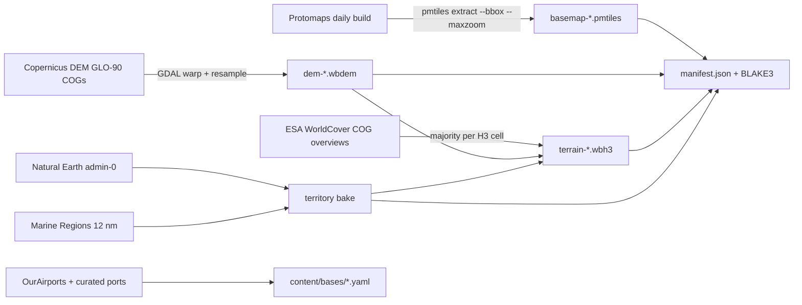

# 05 — Map & geodata

## 1. Open data sources

All free for a personal project. Licences checked 27 Oct 2026; the in-game credits screen must carry every attribution below.

| Data | Source | Licence | Used for |
|---|---|---|---|
| Basemap (land, water, coastlines, labels, cities) | Protomaps basemap, built from OpenStreetMap + Natural Earth, PMTiles | ODbL (tiles), CC0 (styles), BSD-3 (code) | 2D map. **Attribute "© OpenStreetMap"** |
| Country borders | Natural Earth admin-0 (1:10m) | Public domain | Borders, territory |
| Territorial seas (12 nm) | Marine Regions — Maritime Boundaries Geodatabase, current version | CC-BY 4.0 | Sea territory for ROE Bravo |
| Elevation | Copernicus DEM GLO-90 | Free licence with attribution ("produced using Copernicus WorldDEM-90 © DLR e.V.") | Line of sight, terrain classes, 3D terrain |
| Land cover | ESA WorldCover 10 m | CC-BY 4.0 ("© ESA WorldCover project / contains modified Copernicus Sentinel data") | Terrain classes |
| Airfields | OurAirports | Public domain | Real air bases (filtered to military and suitable civil runways) |
| Ports and naval bases | Curated list (public sources) | Our data | Real naval bases |
| Satellite orbits | CelesTrak TLEs | Free | Real satellite orbits where published |
| 3D imagery | Natural Earth II / NASA Blue Marble rasters, low resolution | Public domain | Globe texture in the 3D view |

## 2. Region packs

A war needs the **world pack** plus the **theatre pack** where fighting happens. Packs are downloaded once, verified by hash, stored in OPFS, and work offline.

| Pack | Extent | Contents | Size (*estimate*) |
|---|---|---|---|
| `world` | Whole Earth | Basemap z0–6, borders, territorial seas, DEM ~3.7 km (2′), H3 terrain at resolution 5 (~250 km² cells), bases index | ≈ 200 MB |
| `europe` | 25°W–62°E, 34°N–75°N (Atlantic to the Urals, Barents to the Mediterranean, incl. Iceland and the GIUK gap) | Basemap z7–9, DEM ~450 m (15″), H3 terrain at resolution 7 (~5 km² cells), coastline detail | ≈ 0.5–0.7 GB |
| Later | `middle-east`, `south-asia`, `east-asia`, … | Same as `europe` | — |

Beyond zoom 9 the map over-zooms; strategic play does not need street detail. Sizes are measured in Phase 2 and recorded in `docs/versions.md`.

### 2.1 Pack file formats

| File | Format | Read by |
|---|---|---|
| `basemap-<region>.pmtiles` | Vector tiles (Protomaps schema) | MapLibre (PMTiles protocol, from OPFS) |
| `territory-<region>.pmtiles` | Country territory polygons (land + 12 nm sea), layer `territory`, field `code` | MapLibre (territory tint and outlines) |
| `dem-<region>.wbdem` | 1°×1° tiles, int16 metres, zstd, tile index | Engine (LOS), Cesium (`CustomHeightmapTerrainProvider`) |
| `terrain-<region>.wbh3` | Sorted H3 cell array: class u8, mean elevation i16, slope u8, flags (coast, border, urban), country u16 | Engine; terrain overlay |
| `territory-<region>.bin` | Border-cell polygon refs for exact point-in-polygon near borders | Engine |
| `manifest.json` | Pack id, version, extent, file hashes (BLAKE3), sizes, sources, attribution | Pack manager, credits |

`build/packs/index.json` lists the packs a client can install, with each manifest's BLAKE3 hash.

### 2.2 Engine file layouts

Little-endian throughout. Each file starts with a 32-byte header; readers check the magic and version. Writers: `geodata/formats.py`; readers: `crates/wb-geo`. Change both together and bump the version.

**`.wbdem` (`WBDM`, version 1).** Header: magic, version u16, `res_arcsec` u16, `samples` u16 (= 3600 / res + 1), reserved u16, `lon0` i16, `lat0` i16 (south-west corner of the tile grid), `cols` u16, `rows` u16. Then `rows × cols` index entries of 16 bytes (row-major from the south-west): offset u64, length u32, min_m i16, max_m i16; length 0 means no data (sea level). Each tile is one zstd frame of `samples × samples` i16 metres, row 0 at the tile's south edge, column 0 at its west edge. Sample (i, j) sits exactly at (lat0 + row + i/n, lon0 + col + j/n) with n = samples − 1, so neighbouring tiles share their edge samples and a bilinear lookup never needs a second tile.

**`.wbh3` (`WBH3`) and `territory-*.bin` (`WBTR`), version 1.** Header: magic, version u16, H3 resolution u8, reserved u8, cell count u64, block count u32, block size u32, country count u16 (including index 0 = no country). Then the country table (4 bytes per code, lower-case ASCII padded with zeros; index 0 is empty), then one 24-byte index entry per block: first cell u64, offset u64, length u32, cell count u32. Cells are sorted by H3 index, so a lookup is two binary searches. Each block is one zstd frame:
- `.wbh3` (4,096 cells per block), structure of arrays: cells u64, class u8 (§3 order: water, open, forest, jungle, urban, desert, mountain, marsh, arctic), mean elevation i16 m, mean slope u8 (0.5° units), flags u8 (1 coast, 2 border, 4 urban), country u16 (owner at the cell centre). A cell that is not stored is open sea outside every territory.
- `territory-*.bin` (256 cells per block, border cells only): cells u64, record offsets u32, then records. A record is piece count u16, flags u16 (1 = rings shifted east past 180°), then per piece: country u16, ring count u16, and per ring a point count u32 and that many (lon, lat) i32 pairs in 1e-7 degrees. Rings are the country territory clipped to the cell's bounding box grown by 15 %; the owner is the first piece whose rings contain the point by the even-odd rule, computed in integers.

## 3. Terrain classes

Derived per H3 cell from WorldCover majority class + DEM slope and roughness.

| Class | Rule | Effects |
|---|---|---|
| Water | Permanent water / sea | Ships only; sea clutter for radars |
| Open | Grassland, cropland | Fast ground movement; long visual range |
| Forest | Tree cover | Slow movement; concealment; low-level LOS blocked inside cell |
| Jungle | Tree cover within 23.5° of the equator | As forest, stronger |
| Urban | Built-up | Strong defence bonus; concealment; slow movement; clutter |
| Desert | Bare / sparse vegetation | Fast movement; poor concealment; IR contrast at night |
| Mountain | Slope or roughness above thresholds | Very slow; defence bonus; terrain masking |
| Marsh | Herbaceous wetland, mangroves | Very slow; no heavy vehicles |
| Arctic | Snow/ice, moss/lichen | Slow; cold-weather equipment flag |

The multipliers live in the realism profile, not in code.

## 4. Elevation and line of sight

- Theatre DEM at 15″ (~450 m) is enough for radar masking and long-range line of sight; ground engagements inside a cell use the terrain class instead.
- The engine samples elevation along the great circle between sensor and target, adds Earth curvature (4/3 radius for radio), and checks clearance.
- **In the browser** the worker reads DEM tiles **synchronously** from OPFS (`FileSystemSyncAccessHandle`, available in dedicated workers) with an LRU cache. **Natively** (CLI, Unity) it reads the same file with positional I/O and the same cache (ADR-019; no memory map, so no `unsafe`). Results are pure functions of position, so cache state never changes an outcome.
- The 3D view feeds Cesium the same tiles through `CustomHeightmapTerrainProvider`; no separate terrain build or Cesium ion account is needed.

## 5. Territory

- **Land:** Natural Earth admin-0 polygons. **Sea:** Marine Regions 12 nm territorial seas. Airspace above both belongs to the same country.
- The pipeline bakes country ownership into each H3 cell; cells crossed by a border are flagged and point-in-polygon is done exactly for them.
- **Coalition territory** = union of member countries' territory; neutrals are neither friendly nor hostile.
- **Disputed or occupied areas** are not hard-coded: war setup lets the player choose who controls each listed disputed area. Default follows the Natural Earth default worldview.
- Used by ROE Bravo, base placement, border-crossing events and the territory tint on the map.

## 6. 2D map style

Dark theme matching the reference screenshots (exact colour tokens in [10-ui-style-guide.md](10-ui-style-guide.md) §2):

| Layer | Style |
|---|---|
| Sea | Dark slate blue |
| Land | Near-black |
| Coalition territory | Tint over land **and** 12 nm waters with an outline: own coalition purple, enemy blue (swappable; "friendly blue / enemy red" option) |
| Borders | Thin light lines; territorial-sea limit dashed |
| Labels | Countries, seas, major cities in muted italic |
| Overlays | Terrain classes (toggle), graticule (toggle), scale bar |

Zoom range 1–9 with over-zoom to 12. A credits control shows the attributions from §1.

## 7. Geodata pipeline

Runs once per pack version on the owner's machine or a CI runner. Scripts live in `geodata/`, are deterministic, and write to `build/packs/`.

- Copernicus DEM and WorldCover are Cloud-Optimised GeoTIFFs: read them through GDAL's `/vsis3/` or `/vsicurl/` and use **overview levels** so the build never downloads full-resolution tiles it does not need.
- `pmtiles extract` cuts the region and zoom range from the Protomaps build instead of building tiles from the whole planet.
- Tools: GDAL 3.13.3 with its Python 3.14 bindings, `h3`, `shapely`, `zstandard`, `blake3` (Python) and the `pmtiles` CLI, all pinned in `geodata/Dockerfile`; `bash geodata/run.sh build <pack>` runs a pack build in that image. All free. (The phase prompt said Python 3.12; the pinned GDAL image ships 3.14.)
- Marine Regions layers come through the VLIZ WFS in pages of 10 features, because whole-layer responses are cut off by the server.
- Countries with no territorial sea in Marine Regions v4 and listed under `territory.derived_territorial_sea` in `geodata/packs.yaml` (P2: Ukraine, Western Sahara, Falklands, British Indian Ocean Territory) get a 12 nm belt derived from their Natural Earth coast. Countries under `derived_territorial_sea_first` (P2: Taiwan, whose waters Marine Regions codes as Chinese) get the same belt with precedence over another state's Marine Regions sea. The manifest lists all of them under `notes.estimated_territorial_seas`. Narrow gaps between the Natural Earth and Marine Regions coastlines (under 0.03°) go to the country whose land they touch.
- Each pack's manifest records source versions and download dates.