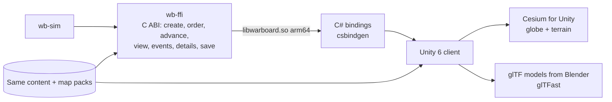

# 06 — Clients & platforms

## 1. Browser app structure (`apps/game`)

| Module | Responsibility |
|---|---|
| `shell` | Routing (menu, setup, war board, AAR), settings, credits |
| `packs` | Pack manager: download, verify (BLAKE3), store in OPFS, quota checks, updates |
| `bridge` | Starts the engine worker, sends orders, receives views and events, measures achieved speed |
| `map2d` | MapLibre GL JS v6 + deck.gl overlay layers (`MapboxOverlay` from `@deck.gl/mapbox`, which also drives MapLibre) |
| `map3d` | CesiumJS view, loaded with dynamic `import()` only when opened |
| `panels` | React: top bar, OOB tree, unit card, approval queue, alerts, event log, operation planner, AAR |
| `store` | Zustand slices: selection, camera, clock, alerts, panel state (not the simulation) |
| `saves` | Save slots (IndexedDB metadata + OPFS blobs), autosave, export/import |

Rule: React renders panels only. Map layers update from the decoded view buffer each frame without going through React state.

## 2. Worker bridge

```mermaid
sequenceDiagram
  participant UI as UI thread
  participant W as Engine worker (WASM)
  UI->>W: init(contentPack, packManifest, setup | save)
  W-->>UI: ready(sides, clock)
  loop every animation frame (~16 ms)
    UI->>W: advance(real_dt_ms, speed)  [batched with pending orders]
    W->>W: run whole ticks; emit events
  end
  W-->>UI: view(SideView ArrayBuffer, transferred) at 10 Hz real time
  W-->>UI: events(batch) when any
  UI->>W: order(command) → W-->>UI: ack | reject(reason)
  UI->>W: details(unitRef | contactRef) → W-->>UI: JSON for the unit card
```

- **Transferable `ArrayBuffer`s**, double-buffered: zero copy, and no need for cross-origin isolation headers.
- The UI interpolates positions between the last two views using velocity, so motion is smooth at 60 fps even though views arrive at 10 Hz.
- If the engine cannot keep up, it reports achieved speed; the top bar shows it.
- Engine panics are caught, the last autosave is offered, and the error is logged with the tick and state hash.

## 3. Side view format (`SideView v1`, little-endian)

| Section | Fields (structure of arrays) |
|---|---|
| Header | magic `WBSV`, version u16, side u8, tick u64, sim_time_ms i64, counts |
| Own units (N) | id u32, symbol u16, flags u32 (selected-able, damaged, emitting, jamming, landed…), lon f64, lat f64, alt_m f32, heading_deg f32, speed_mps f32, fuel_pct u8, group u32 |
| Contacts (M) | contact_id u32, symbol u16, identity u8, level u8, lon f64, lat f64, alt_m f32, heading f32, speed f32, ellipse_a_m f32, ellipse_b_m f32, ellipse_rot f32, age_s f32, count_min u16, count_max u16 |
| Weapons visible (K) | id u32, symbol u16, relation u8 (ours / theirs / interceptor), lon f64, lat f64, alt_m f32, heading f32, speed f32, salvo u32 |
| Effects (E) | kind u8 (launch, intercept, impact, splash), lon, lat, alt, age_ms |
| Strings delta | New or changed labels only (names, salvo labels) |

Full detail for the selected unit or contact (task, loadout, sensors, magazines, ROE source) comes from `details()` on demand, keeping the view small (≈ 150 KB at 2,000 units).

## 4. 2D map rendering

| deck.gl layer | Draws |
|---|---|
| `IconLayer` (atlas) | Own units and contacts; badges for counts ("3 ×", "SQN") |
| `PathLayer` / `TripsLayer` | Missile and interceptor trails, waypoint routes, patrol loops |
| `ScatterplotLayer` | Launch flashes, intercept bursts, impact flashes, selection halo |
| `PolygonLayer` / stroked `ScatterplotLayer` | Range rings (sensor horizon, max engagement, combat radius), uncertainty ellipses, patrol circles, threat rings of known enemy SAMs |
| `TextLayer` | Unit and salvo labels with collision handling |
| `LineLayer` | Shooter-to-target lines while weapons are in flight |

- **Aggregation by zoom:** zoomed out, groups collapse to one icon with a count; zoomed in, individual units and weapons ("M-8", "INT-3") appear.
- **Drawing tools:** waypoint routes, circles and polygons via `@deck.gl-community/editable-layers` or a small custom tool.
- **Interaction:** click selects; right-click opens context actions (Move here, Patrol here, Attack this, Recon here); shift-click adds to selection; box select.

## 5. 3D view

- **CesiumJS self-hosted:** static assets served from the app; `CESIUM_BASE_URL` set; no Cesium ion token, geocoder or default imagery.
- **Terrain:** `CustomHeightmapTerrainProvider` reading the same DEM tiles as the engine. **Imagery:** low-resolution public-domain globe texture plus vector borders as polylines.
- **Objects:** `BillboardCollection` for icons (same atlas), `PolylineCollection` for trails and trajectories in true altitude, glTF models (Blender, low-poly) when zoomed in with ≤ 200 on screen; satellites with orbit paths.
- **Cameras:** free, follow unit, watch engagement (frames shooter and target).
- **Switching:** 2D ↔ 3D keeps selection, time and the camera centre. Only one view renders at a time.

## 6. Symbology

Game-style by default (as in the reference screenshots), NATO APP-6 as a setting. Exact shapes, colours, label formats and the unit card layout are in [10-ui-style-guide.md](10-ui-style-guide.md).

| Element | Meaning |
|---|---|
| Frame shape | Domain: hexagon = ship/sub, rounded tile = aircraft/squadron, rounded hexagon = site/battery, chevron = ground formation, diamond = satellite |
| Glyph | Type: fighter, bomber, tanker, AEW, drone, helicopter, destroyer, frigate, corvette, submarine, SAM, radar, launcher, artillery, tank, infantry, SOF, airborne, marines, air base, naval base, FOB, HQ |
| Colour | Own coalition, enemy coalition, neutral, unknown (amber) |
| Badge | Count ("3 ×"), "SQN", "BN", "SITE" prefix labels |
| Dashed outline + ellipse | Estimated position or type ("our estimate") |
| Weapons | Offensive weapons amber with trails, interceptors cyan, impact and intercept flashes |

Icons are SVG in `packages/symbols`, packed into a texture atlas at build time; `milsymbol` generates the NATO set into the same atlas format.

## 7. War board layout

```
┌──────────────────────────────────────────────────────────────────────────────┐
│ ⏸ ×1 ×3 ×5 ×10 ×30 ×60  2026-10-27 14:05:12Z (achieved ×10)  ROE: Bravo ▾  ⚠3 │
├───────────────┬──────────────────────────────────────────────┬───────────────┤
│ Forces (OOB)  │                                              │ Unit card     │
│ ▸ Bases       │                 2D / 3D map                  │ 12 × Typhoon  │
│ ▸ Air groups  │                                              │ ON STATION    │
│ ▸ Naval       │      range rings · trails · contacts         │ fuel 95%      │
│ ▸ Sites       │                                              │ speed · alt   │
│ Inventory     │                                [2D | 3D]     │ rings ☑☑☑     │
│               │                                              │ weapons · ROE │
│               │                                              │ [RTB][Retask] │
├───────────────┴──────────────────────────────────────────────┴───────────────┤
│ Alerts · Approval queue (2) · Intel log · Event log · Operations timeline     │
└──────────────────────────────────────────────────────────────────────────────┘
```

**Unit card** (matches the reference screenshot and extends it): name and count, formation, status and task, speed, altitude, heading, fuel; ring toggles for sensor horizon, max engagement range and combat radius; weapons by station; sensors and EMCON; jammer; effective ROE and its source; spec confidence; actions (Retask, RTB, Patrol, Strike, Hold fire, EMCON, Jam).

**Operation planner:** phases as rows on a timeline with trigger arrows; selecting a phase shows its tasks and draws its routes on the map; validation messages inline; Start / Pause / Abort.

## 8. Storage

| Store | Holds |
|---|---|
| OPFS | Packs (content, basemap, DEM, terrain), save blobs, replay checkpoints |
| IndexedDB | Save slot metadata, settings, pack registry |
| Cache Storage | App shell (service worker) |

Request `navigator.storage.persist()` at first pack install; show quota and usage in the pack manager; re-download a pack if the browser evicted it.

## 9. Offline app and hosting

- A small hand-written service worker (`apps/game/sw/sw.js`, filled in at build time with the list of built and public files) precaches the app shell; packs are downloaded explicitly from the pack manager with progress and hash checks. (Workbox was the original plan; dropped in P2 to avoid its dependency tree.)
- Hosting: any free static host (e.g. GitHub Pages or Cloudflare Pages) for the app; packs as release assets. Personal use can also run from a local dev server.
- Updates: new app versions install in the background; packs update only when their manifest version changes.

## 10. Browser support

Current Chrome, Edge and Firefox on desktop; Safari best-effort. Requires WebGL2 (MapLibre v6), Web Workers with OPFS sync access handles, and WebAssembly. Performance targets assume a mid-range laptop (4-core CPU, integrated GPU, 16 GB RAM).

## 11. Android, step 1 — Capacitor wrapper

- Capacitor 8 wraps the same production build into an Android app (sideloaded APK; no store needed).
- Packs are downloaded inside the app like in the browser.
- Touch adaptations: long-press for context actions, bottom sheet for the unit card, larger hit targets.
- Expected limits: lower unit counts at ×10 on mid-range phones; 3D view at reduced detail.

## 12. Android, step 2 — Unity client (Phase 13)



- Same engine, same packs, same saves: a war started in the browser can continue in Unity.
- Terrain for Cesium for Unity is converted from the DEM pack to quantized-mesh tiles with an open-source tiler at that phase (it can also run against a Cesium ion free account if the owner chooses).
- UI rebuilt with Unity UI Toolkit; the side view decoder is ported to C#.

## 13. PvP later

The deterministic engine allows two options:

| Option | How | Trade-off |
|---|---|---|
| Lockstep | Both clients run the engine, exchange orders with tick numbers, compare state hashes | No server; but each client holds full truth, so fog of war can be cheated. Fine between friends |
| Server-authoritative | Headless engine (`wb-cli serve`) runs the war; clients receive side views only | Cheat-proof fog; needs a host |
