# 08 — Roadmap, metrics & risks

Sizes are weeks of focused work for one person with Claude Code (*estimates*). Each phase ends with acceptance tests that must pass in CI before the next starts. Phase prompts for Claude Code are in [09-claude-code-handoff.md](09-claude-code-handoff.md).

## 1. Phases

| # | Phase | Size | Builds | Exit criteria |
|---|---|---|---|---|
| P0 | Foundations | 1–2 wk | Monorepo, toolchains, CI, crate skeletons, counter RNG, determinism lints, WASM worker "hello tick", TS type generation | Same state hash natively and in WASM (Node) for 10,000 empty ticks; CI green |
| P1 | Content schema & seed data | 1–2 wk | `wb-content` types, YAML loader, validation, compiler, JSON Schema/TS export; ~25 seed systems (replaced by the fictional starter catalogue in PF) | Bad references and units rejected with clear errors; pack round-trips; stable hash |
| P2 | Geodata & 2D map | 2–3 wk | `world` and `europe` packs (basemap, borders, 12 nm seas, DEM, H3 terrain, bases; borders, seas and bases regenerated in PF); pack manager; MapLibre + deck.gl dark map; territory lookup | Map works with network off; territory tests pass; pack sizes measured |
| P3 | Engine core | 2–3 wk | ECS world, adaptive scheduler, aircraft/ship movement, fuel, bases and placement rules, stationing, tasks (move, patrol circle/route, RTB, land, tanker refuel), time controls, side view, unit card, waypoint drawing, save/load | Patrol until bingo then RTB; tanker extends patrol; 2,000 dummy units ≤ 6 ms/tick at ×10; save/load mid-flight resumes with identical hash |
| P4 | Sensors & fog of war | 2–3 wk | Radar, ESM, IRST, EO/IR, visual, satellites (SGP4, EO/SAR, tasking), contacts, classification, ellipses, data links, EMCON, intel log | Golden G1–G5 pass; no code path from UI to truth (API test) |
| P5 | Weapons, air combat & ROE | 3 wk | Stations and loadouts (locked airborne), launch doctrine, missile flyout, seekers, endgame, countermeasures, damage, ROE + approval queue + self-defence, weapon visuals | G6, G8, G9 pass; every termination event carries factors |
| PF | Fictional setting | 2–3 wk | Doc 11 §4: nations, generated borders and 12 nm belts, place names, base proposals, starter catalogue and archetypes, denylist, fixtures, G1–G9 rebuilt on fixtures, basemap without real labels | Denylist clean over content, scenarios, code and docs; G1–G9 pass on fixtures with their bands; border overlap check ≤ 15%; Theatre North renders with fictional labels only |
| P6a | Naval combat & layered air defence | 2 wk | Ships, VLS magazines, anti-ship salvos, defence assignment layers and fire channels, close-in guns, chaff and flares, air-defence networks with command posts; weapon effects, targeted halo and red enemy-weapon labels (moved from P5) | G10 passes |
| P6b | Electronic warfare (game stats) | 1–1.5 wk | Jamming stats and effects (doc 02 §9, ADR-034), data link and navigation disruption, EMCON tactics, emitter-homing weapons, air-defence suppression task | G11, G12 pass |
| P7 | Operations & reports | 2–3 wk | Operation model and triggers, planner UI with timeline, validation, salvo/loss/munitions/sortie/operation reports, export, replay with seeking | G13 passes; report totals equal event counts; replay hash matches |
| P8 | Admin app & Theatre North content | 3–4 wk | Admin editor, schema forms, archetype bands, nations and world editor, inventories, test bench; catalogue grown to ~120 systems and ~90 weapons; inventories and doctrines for the eight nations | Every entry has an archetype and note; bands respected or explained; test-bench sanity suite passes; denylist clean |
| P9 | Enemy AI v1 & war setup | 2–3 wk | Coalition setup from any nations, garrisoned start on each nation's bases, AI posture, CAP, IADS, intercepts, retaliation, difficulty | 24 h sim-time AI-vs-AI soak without errors; AI never reads truth (test); AI reacts to incursions within its doctrine time |
| P10 | 3D tactical view | 2 wk | CesiumJS lazy chunk, DEM terrain, globe texture, billboards, trajectories, orbits, glTF placeholders, camera modes | 2D↔3D keeps state; ≥ 30 fps with 500 visible units; works offline |
| P11 | Ground forces | 3–4 wk | Formations, H3 pathfinding, combat resolution, artillery and rockets, SOF and recon, strikes on columns, FOBs | Strike-chain scenario (doc 03 §8.2) passes; terrain modifier tests |
| P12 | AI v2, Android wrapper, polish | 3 wk | AI-planned operations, Capacitor 8 build, touch UI, performance pass, credits screen | AI launches a multi-phase operation; APK runs a 500-unit war at ×5 on a mid-range phone |
| P13 | Unity client (later) | 6–10 wk | `wb-ffi`, C# bindings, Cesium for Unity, Blender models, UI Toolkit | Browser save loads in Unity and continues identically |

**Milestones:** M1 *Map & flight* (P3) · M2 *First blood* — air combat with fog and ROE (P5) · M3 *Rising Sun* — full operation with naval, IADS, EW and reports (P7) · M4 *Playable war* vs AI in Theatre North (P9) · M5 *3D + ground* (P11) · M6 *Android* (P12).

```mermaid
gantt
  dateFormat X
  axisFormat %s
  title Weeks (upper estimate)
  section Core
  P0 Foundations        :0, 2
  P1 Content schema     :2, 4
  P2 Geodata + 2D map   :4, 7
  P3 Engine core        :7, 10
  section Combat
  P4 Sensors + fog      :10, 13
  P5 Weapons + ROE      :13, 16
  PF Fictional setting  :16, 19
  P6a Naval + air defence :19, 21
  P6b EW game stats     :21, 22
  P7 Operations + AAR   :22, 25
  section Game
  P8 Admin + content    :25, 29
  P9 AI v1 + setup      :29, 32
  P10 3D view           :32, 34
  P11 Ground forces     :34, 38
  P12 AI v2 + Android   :38, 41
```

Content work (P8) can start in parallel after PF: YAML entries need only the schema and archetypes.

## 2. Success metrics

| Metric | Target | Measured by |
|---|---|---|
| Engine step | ≤ 6 ms average per tick, 2,000 units, 300 weapons | CI benchmark scenario |
| 2D frame rate | 60 fps with 2,000 icons + 300 weapons | Browser profiler, benchmark scene |
| 3D frame rate | ≥ 30 fps, 500 visible units | Benchmark scene |
| Determinism | Equal state hash native vs WASM after 1 h sim time | CI |
| Fog of war | Zero truth fields in any view or details response | API test with a truth-canary unit |
| Offline | Full war with network disabled | Manual test per release |
| Save/load | < 2 s, 2,000 units | Benchmark |
| Content quality | 100% of entries with archetype and note; bands respected or explained; denylist clean | `wb-cli content check`, CI denylist step |
| Realism | All golden scenarios within bands | CI |

## 3. Golden scenarios

Stored in `scenarios/golden/` with expected bands. All of them use **generic test fixtures** (ADR-035): units and weapons in `scenarios/fixtures/` at a neutral test sea area (G1–G9 are rebuilt on fixtures in PF with the same bands). Catalogue systems are checked against the same behaviours with the P8 test bench. Monte Carlo ones run 500 seeds in CI (native). Bands are first estimates; changing one is an explicit decision recorded in the scenario file.

| ID | Scenario | Expected |
|---|---|---|
| G1 | Frigate radar at 30 m vs sea-skimmer at 5 m | First detection 28–36 km |
| G2 | Same fighter radar vs a test 4.5-gen fighter and a test stealth fighter, head-on | Detection range ratio within 20% of (σ₁/σ₂)^¼ |
| G3 | Aircraft at 100 m behind a ridge vs ground radar | Undetected until line of sight clears |
| G4 | ESM aircraft vs emitting test SAM radar | ESM detects the radar beyond the range at which the SAM detects the aircraft |
| G5 | Satellite pass over a target at night | EO: no report; SAR: report |
| G6 | Test medium-range air-to-air missile vs aware fighter | At max range, beaming: ≥ 70% out of energy or miss. At 50% range head-on: Pk 0.6–0.85 |
| G7 | Test fighter patrol with and without tanker | Tanker doubles time on station; without, lands with ≥ reserve fuel |
| G8 | ROE Bravo, hostile flight along the border | Never engaged outside; engaged within 60 s after crossing; return fire allowed |
| G9 | ROE Charlie under missile attack | Self-defence intercepts without approval; other shots queued |
| G10 | 12 test anti-ship missiles vs 2 test frigates (fixtures) | 60–95% of missiles intercepted or decoyed; each frigate engages threats to itself first |
| G11 | Test stand-off jammer vs test SAM radar tracking a test fighter (fixtures) | Detection range reduced 20–50%; burn-through at short range |
| G12 | Test emitter-homing missile vs test SAM radar that shuts down (fixtures) | Pk drops by ≥ 40% |
| G13 | Six-phase test operation shaped like Rising Sun, on fixtures in the test sea area | Runs end to end; phases 4 and 5 start on the same tick |
| G14 | G13 native vs WASM | Identical state hash |
| G15 | 2,000-unit benchmark | ≤ 6 ms average tick |
| G17 | Strike chain of doc 03 §8.2 on fixtures and test land (`strike-chain.yaml`) | Satellite report (class), drone upgrade (precise, count 12), strike and rockets on the shared track, in that order; the column loses vehicles while moving |
| G18 | The same ground attack on open, mountain and urban cells | Attacker-to-defender loss ratio rises open < mountain < urban, each step by ≥ 20% |

## 4. Risk register

| # | Risk | Likelihood | Impact | Mitigation |
|---|---|---|---|---|
| R1 | Fictional stats feel arbitrary or unbalanced | Medium | Medium | Archetype bands; balance notes; test bench; golden bands; values in data not code |
| R2 | Engine too slow at ×10 with 2,000 units | Medium | High | Adaptive tick, staggered scans, spatial index, LOS memo, CI benchmark from P3 |
| R3 | Determinism breaks silently | Medium | High | Lints (`disallowed-methods`, no hash iteration), counter RNG, native-vs-WASM hash check in CI |
| R4 | Scope creep across all domains | High | High | Phase gates; air, naval and air defence first; ground in P11 |
| R5 | Browser storage eviction or quota limits | Medium | Medium | `storage.persist()`, pack re-download, quota UI; a desktop wrapper later if needed |
| R6 | 2D and 3D views drift apart | Medium | Medium | One decoder and atlas package; parity tests on a fixed view |
| R7 | Realism makes play slow or opaque | Medium | Medium | ×30/×60 with auto-slow; explanations on outcomes; sensible defaults |
| R8 | Map data licence duties missed | Low | Medium | Credits screen from pack manifests; ODbL and CC-BY notes |
| R9 | Claude Code drifts from the architecture | Medium | High | `CLAUDE.md` rules, ADRs, plan-first per phase, acceptance tests, review checklist |
| R10 | Third-party breaking changes (MapLibre v6 ESM-only, Cesium releases) | Medium | Low | Pinned versions, `docs/versions.md`, upgrade only between phases |
| R11 | Real names slip back into content, code or docs | Medium | Medium | `content/denylist.txt` in the content check and CI over content, scenarios, crates, apps and docs |
| R12 | Large geodata builds on a personal machine | Medium | Low | COG overviews and `pmtiles extract`; build once per pack version |
| R13 | Coding-assistant safety checks stop a phase | Medium | Medium | Fictional setting (ADR-036); game-stat EW (ADR-034); fixtures for tests (ADR-035); project context in `CLAUDE.md`; report clear false positives with `/feedback`; don't reword to work around a block |
