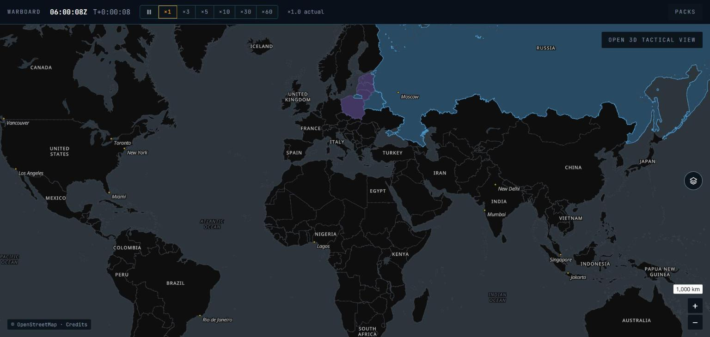
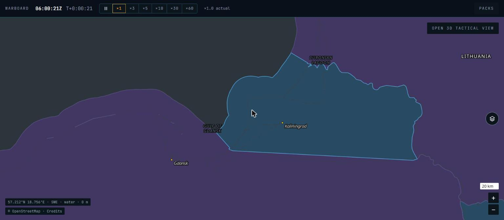
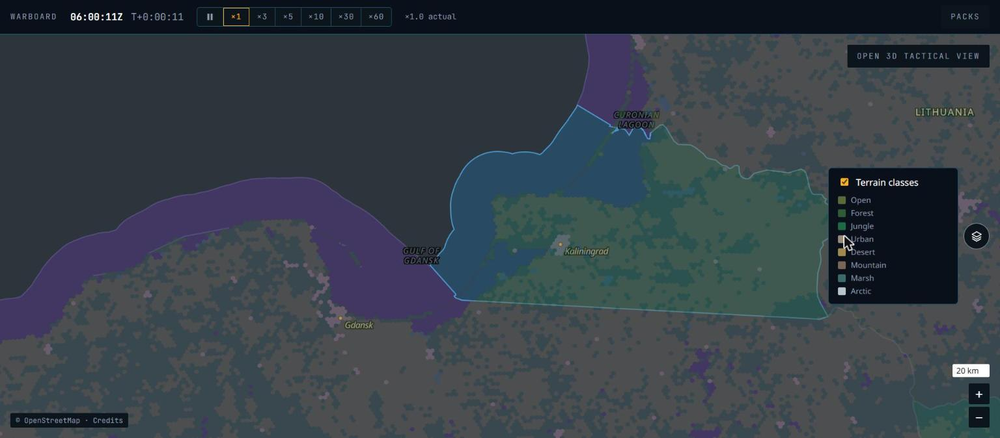
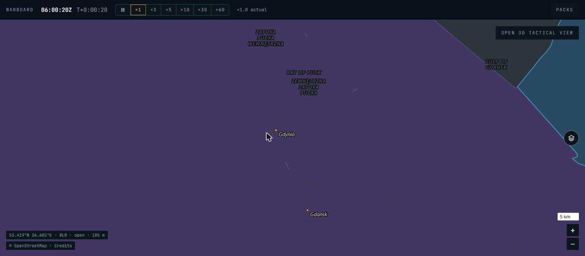

# P2 — Geodata pipeline and 2D map: phase report

Date: 28 Oct 2026. Status: **done locally; CI to be confirmed on the next push** (no commits or pushes are made by Claude Code, per CLAUDE.md rule 10). The region packs are build output (`build/packs/`, gitignored); rebuild them with `geodata/run.sh`.

## What was built

| Area | Result |
|---|---|
| Pipeline (`geodata/`) | Python package run in a pinned Docker image (GDAL 3.13.3, `geodata/Dockerfile`). `bash geodata/run.sh build <pack>` runs basemap → territory → dem → terrain → manifest; `… bases` imports bases. Packs and thresholds are in `geodata/packs.yaml`, source versions and access dates in `geodata/sources.lock.yaml`. Downloads are cached in `build/geodata/cache/` and per-tile results in `build/geodata/work/`, so interrupted runs resume. Nothing reads the clock. |
| Basemap | `pmtiles extract` from the Protomaps build of 20261027: world z0–6, europe 25°W–62°E × 34°N–75°N z7–9. The extract retries whole on a dropped transfer. |
| Territory | Natural Earth 5.1.1 admin-0 land ∪ Marine Regions v4 12 nm seas, internal and archipelagic waters (VLIZ WFS, paged), per sovereign. Land wins overlaps; coastline gaps under 0.03° go to the adjacent country; derived 12 nm belts for listed countries (below). Outputs: `territory-<pack>.pmtiles` (tint polygons), `territory-<pack>.bin` (exact rings for border cells). |
| DEM | Copernicus GLO-90: each source COG read once at its 4× overview through `/vsis3/`, cached, then averaged onto the pack grid (world 2′, europe 15″) offline → `.wbdem`. |
| Terrain | ESA WorldCover 2021 pixel counts per H3 cell at a COG overview (≈300 m europe, ≈600 m world) + mean elevation, mean slope and elevation spread per cell from the pack DEM + owner and border flag from the territory step → `.wbh3`. Rules (doc 05 §3): water if ≥ 50 % water; urban if built-up ≥ 30 %; else the largest of open/forest/urban/desert/marsh/arctic, forest becoming jungle within 23.5° of the equator; mountain overrides land classes when slope or spread exceeds the pack thresholds. |
| Bases | 312 generated files in `content/bases/`: 137 military airfields (by name or keywords), 167 civil airfields with a hard runway ≥ 2,400 m, 8 curated naval bases (`geodata/curated/ports.yaml`, coordinates from the Wikipedia API). Only countries in `content/countries/` (6) inside the europe extent. Each file starts with a `# Generated` line; re-runs rewrite only those, never hand-written bases (Malbork's EPMB was skipped). `wb content check` passes: 379 entries. |
| Manifest | `manifest.json` per pack (BLAKE3 per file, sizes, sources, attributions, estimated territorial seas, terrain class counts) and `build/packs/index.json`. |
| `wb-geo` | Readers for `.wbdem`, `.wbh3` and territory files behind a `PackSource` trait (positional reads, ADR-019) with LRU caches. `Geo`: `elevation_m`, `terrain_class`, `cell_info`, `territory_owner`, `is_friendly`, `line_of_sight` (great-circle samples, ray vs terrain + d₁d₂/2kR bulge), `cells_in_box` (overlay). Finest covering pack wins. Ring tests are integer-only. `h3o` without `std` (all `libm`). |
| `wb-core` | `geo::intermediate_point` (great-circle interpolation, `libm`), with a unit test. |
| `wb-cli` | `wb geo info | query | los`. Output lines are produced by `wb_geo::{info_lines, query_line, los_line}`, shared with WASM. |
| `wb-wasm` | `GeoQuery` over JS file objects (`{name, size(), readAt(buf, at)}`): OPFS sync handles in the engine worker, `fs.readSync` in `node/geo-query.mjs`. `Blake3Hasher` for the pack manager. |
| Determinism check | `scripts/determinism-check.sh` also compares `wb geo` with `geo-query.mjs` on `geodata/probes.txt` and a Tatra LOS when packs exist. |
| Pack manager (`apps/game/src/packs`) | Catalogue from `packs/index.json`; manifest hash checked against it; a pack worker streams each file into OPFS through a sync handle while hashing it with BLAKE3 (WASM); a mismatch deletes the file; files already present with the right hash are kept (resume). Registry in IndexedDB; eviction detected by file presence and size (Re-download); update when the catalogue version differs; `navigator.storage.persist()` on first install; quota and usage shown. The engine worker releases its handles before any change and reopens after. A Vite plugin serves `build/packs/` at `/packs/` in dev and preview. |
| 2D map (`apps/game/src/map2d`) | MapLibre 6.16.0 ESM with `setWorkerUrl`; `pmtiles` `FileSource` over OPFS `File`s; style built from tokens only (doc 05 §6, doc 10 §3); coalition tint (land and 12 nm, outline); territorial-sea limits dashed; deck.gl `MapboxOverlay` mounted (interleaved); terrain-class overlay (H3 cells from the engine worker, `SolidPolygonLayer`); custom chrome: zoom buttons, scale bar, round layers button, OPEN 3D TACTICAL VIEW, toasts ("Simulation paused" while paused), credits from the installed manifests, cursor readout (position, owner, class, elevation from the engine worker). No MapLibre controls. |
| Offline | Hand-written service worker (`apps/game/sw/sw.js`), filled with every built and public file at build time; network-first for the page, cache-first for assets, never caches packs. |
| Tokens and fonts | `packages/symbols` (`@warboard/symbols`): every doc 10 §2 token as hex, RGBA and CSS variables (`tokenCss()` injected at start-up). Noto Sans glyph PBFs (Regular, Italic, Medium; Latin, Greek, Cyrillic) and Noto Sans / JetBrains Mono woff2 in `apps/game/public/fonts/` with OFL texts and a README of sources. |
| Docs | doc 05 §2.1 table, new §2.2 byte layouts, §4 (positional reads), §7 (tools, WFS paging, derived seas); doc 06 §1 and §9; doc 07 ADR-019 (Proposed); doc 10 §2 (terrain, halo and scale tokens; names of second colours); `docs/versions.md`; CLAUDE.md commands. |

## Acceptance results (local, Windows 11, Chrome, Rust 1.99.1, Node 24.15.0, Docker 29.6.2)

| Criterion | Result |
|---|---|
| Map works offline after install | **Pass.** Production build under `vite preview`; installed `world` and `europe` through the pack manager (hash-checked into OPFS); stopped the server (`localhost:4173` refused connections, `/packs/index.json` unreachable); reloaded. The service worker served the shell, and the world view and the Baltic down to z9 rendered and panned/zoomed from OPFS (`P2-offline-gdansk-z9.jpg`). |
| Territory: Kaliningrad, Gotland | **Pass** (`cargo test -p wb-geo --test packs -- --ignored`): Kaliningrad city and Chkalovsk → `rus`; Visby and inland Gotland → `swe`; Vistula Spit either side of the border → `pol` / `rus`. |
| Territory: 10 nm and 14 nm off the Polish coast | **Pass**: 54.914°N 17.30°E (9.98 nm from the Natural Earth coast) → `pol`; 54.981°N 17.30°E (13.94 nm) → no owner (open sea). |
| Territory: Finland–Russia border | **Pass**: 1 km either side of the border vertex 60.8594°N 28.3359°E → `fin` / `rus`; both are border cells resolved by the exact ring test. `is_friendly` agrees. |
| LOS: a ridge blocks a low path, not a high one | **Pass**: Zakopane (49.30°N 20.10°E) → Poprad (49.06°N 20.30°E). At 1,500 m at both ends the path first meets terrain on the High Tatras' north slope (49.218°N 20.169°E) and the crest stands 895 m above the ray; at 4,000 m the path is clear by 1,605 m. Always-run synthetic tests cover the same with a made-up ridge, plus Earth curvature over 400 km of sea. |
| Pack sizes in `docs/versions.md` | **Done**: world 112,733,100 bytes (108 MiB), europe 714,819,005 bytes (682 MiB); per-file table there. |
| Native = WASM | **Pass**: `scripts/determinism-check.sh` matches the two P0 scenarios (hashes unchanged: `ea604e03…6e288`, `4e95c309…664cf`) and 32 lines of geo probes and LOS between `wb geo` and `geo-query.mjs`. |
| `cargo fmt --check`, `clippy -D warnings`, `cargo test --workspace` | Pass: 35 tests (+5 pack tests, ignored without packs) |
| `cargo deny check`, lint canaries | Pass |
| `wb content check` / `build` | Pass: 379 entries; pack 85,086 bytes, hash `30ea5fae…06f5d4` (changed by the bases import) |
| `pnpm gen`, `pnpm -r typecheck`, `pnpm -r lint`, `pnpm -r build` | Pass |

Query cost: `wb geo query` answers the 32 probes, including opening both packs, in about 0.1 s.

Pipeline run times on this machine (12 threads, 7 GB Docker VM, home connection), roughly: europe basemap 10 min, DEM 25 min, territory 25 min, terrain 10 min; world DEM 45 min, territory 35 min, terrain 5 min. Reruns reuse the caches.

## Pack sizes

| Pack | Basemap | Territory tiles | DEM | Terrain | Territory rings | Total |
|---|---|---|---|---|---|---|
| world | 45.1 MB | 6.5 MB | 26.2 MB | 2.2 MB | 32.8 MB | **112.7 MB** |
| europe | 601.8 MB | 3.1 MB | 92.0 MB | 10.1 MB | 7.9 MB | **714.8 MB** |

Doc 05 estimated ≈ 200 MB and 0.5–0.7 GB. Terrain classes (cells): europe: water 466,893, open 1,312,494, forest 980,703, urban 29,799, desert 266,142 (North Africa, the Levant, the Caspian steppe), mountain 146,579, marsh 38,554, arctic 42,917. World: water 152,360, open 210,951, forest 102,443, jungle 71,892, urban 1,535, desert 77,797, mountain 29,122, marsh 7,080, arctic 18,836.

## Screenshots and differences from the references

| Screenshot | Compare with |
|---|---|
|  `P2-world.jpg` | `06-world-satellites.png` |
|  `P2-baltic-z7.jpg` | `01-strike-route-baltic.png` |
|  `P2-baltic-z7-terrain.jpg` | no reference (terrain overlay) |
|  `P2-offline-gdansk-z9.jpg` | offline acceptance |

**World view vs 06**
1. Same: near-black land, slate sea, thin grey borders, uppercase country labels with halo, italic ocean labels, italic city labels with gold dots, enemy tint with light-blue outline over land and 12 nm waters, OPEN 3D TACTICAL VIEW top right, white scale bar above square `+`/`−` buttons.
2. Fewer cities at this zoom: Protomaps ranks most European capitals (London, Paris, Stockholm) one zoom later than the ones shown (Moscow, Mumbai, New York); 06 labels them already.
3. Fewer sea names (06: Norwegian Sea, Hudson Bay, Black Sea, Caspian Sea); Protomaps gives them a later `min_zoom`.
4. Own coalition is tinted (Poland, Baltic states); 06 shows only the enemy. This follows the placeholder coalition, not the style.
5. Country labels are Noto Sans Medium upright; 06's look lighter. Doc 10 §3 (bold uppercase) wins; the glyph set has no Bold, so Medium.
6. Scale bar reads `1,000 km` (thousands separator); 06 has `1000 km`.
7. Not in P2 scope: satellites, ground tracks, the enemy missile label. The "Simulation paused" toast shows bottom centre while paused, as doc 10 §9 says.

**Baltic at zoom 7 vs 01**
1. Same: Kaliningrad enemy blue with its light-blue outline over land, the lagoons and the 12 nm sea; Poland and Lithuania own purple over land and the 12 nm band; open Baltic beyond 12 nm in slate.
2. **Coastline inside tinted territory is almost invisible.** `map.coast` (`#3A4048`) on the tints has very little contrast, so the Hel peninsula and the Vistula Spit do not read (worst at z9, `P2-offline-gdansk-z9.jpg`). In 01 the spit is visible. See open question 7.
3. The own-territory outline (`terr.own.line`, `#544C7C`) is darker than the outline in 01, which looks lighter purple; the token decides.
4. Labels: ours shows Gdańsk, Kaliningrad, Gulf of Gdańsk, Curonian Lagoon; 01 shows no place names.
5. 01 shows black land slivers along the coast outside the tint; ours has none because coastline gaps are assigned to the country.
6. Not in P2 scope: units, routes, salvo labels.

**Terrain overlay**: the class colours at 45 % over the tints come out muted and greyish (open and forest are hard to tell apart). See open question 8.

**Chrome not in the references**: the cursor readout (bottom left) and the credits button, both in `chrome.bg` and `text.secondary`.

## Decisions and deviations

- **Docker for GDAL** (your decision). The pinned image ships **Python 3.14**, not the 3.12 the prompt names; the GDAL bindings are built for it. Python 3.14 forks no longer by default (`forkserver`), so the pipeline asks for a fork pool explicitly.
- **Positional reads instead of mmap** natively, recorded as **ADR-019** (your decision; accepted after P2). `Geo` uses `RefCell` caches, so it is single-threaded; P3 should hold it as a non-`Send` resource or wrap it.
- **Hand-written service worker** instead of Workbox (your decision); doc 06 §9 updated.
- **Marine Regions through the WFS in pages of 10 features.** Whole-layer downloads (shapefile or GeoJSON) were cut off by the server at about 20 MB.
- **Territorial seas Marine Regions does not give** (`geodata/packs.yaml`, flagged in each manifest as estimates):
  - Ukraine, Western Sahara, Falklands, British Indian Ocean Territory: no feature in Marine Regions v4 12 nm → 12 nm belt derived from the Natural Earth coast.
  - **Taiwan**: Marine Regions v4 has no Taiwanese feature and its waters fall inside "Chinese 12 NM". Taiwan gets a derived belt with precedence over another state's sea; otherwise Taiwan's land would be `twn` and its waters `chn`.
- **Natural Earth default worldview**: 5.1.1 puts **Crimea in Russia** (probe `45.0 34.0 → rus`). Doc 05 §5 leaves disputed areas to war setup (P9), which needs a list of NE dispute polygons to offer.
- **Owners are sovereigns.** Natural Earth units map to their sovereign's ISO3 (Åland → `fin`, Greenland and Faroes → `dnk`); units Natural Earth types as Disputed or Indeterminate keep their own code (`kos`, `pse`, `kas`). Codes match content country ids (`pol`, `rus`).
- **Coastline gap fill.** Natural Earth 1:10m and Marine Regions coastlines differ by up to a few hundred metres; unowned slivers within 0.03° of a country's land go to that country (sorted by code where two touch).
- **World and theatre layers.** Inside the europe extent the europe layers take over from z7. Polygon layers (tint, coast, borders) cannot be cut to an extent in MapLibre, so world tints and borders stop at z7 everywhere once a theatre pack is installed; outside Europe beyond z7 the map shows world land and sea without tints. Point labels use a `within` filter and stay on outside Europe.
- **`MapboxOverlay`.** deck.gl 9.4 exports the overlay as `MapboxOverlay` (it drives MapLibre too); doc 06 called it `MapLibreOverlay`.
- **Bold labels use Noto Sans Medium.** The Protomaps glyph set has no Bold; doc 10 §3 asks for bold country names.
- **Coalition is a placeholder** (`map2d/coalitions.ts`: own POL, LTU, LVA, EST; enemy RUS, BLR) until war setup in P9.
- **Cursor readout** (bottom left) is not in doc 10; it is how the territory and terrain lookups were checked by eye. Remove or restyle it as you prefer.
- **Pipeline thresholds are estimates** (mountain slope 12°/8°, spread 120 m/250 m, urban 30 %, water 50 %, gap fill 0.03°, cell margin 15 %).
- **Protomaps daily builds expire** after a few weeks; the packs are then the only copy of build 20261027.
- **Persistence**: `persist()` is requested on first install. In this test Chrome did not grant it (`navigator.storage.persisted()` stayed false on localhost); the panel says "the browser may clear it when space runs low". Chrome grants it to sites with more engagement or that are installed.
- **deck.gl overlay is not interleaved.** deck.gl 9.4's interleaved mode crashed under MapLibre 6 (it reads custom-layer render arguments that v6 no longer passes), so the overlay draws on its own canvas above the map. Game layers will sit above map labels; revisit when deck.gl supports MapLibre 6 interleaving.
- **Bugs found while testing, fixed**: two `openPacks` requests raced in the engine worker under React StrictMode (OPFS sync handles are exclusive), now serialised; the service worker missed module scripts offline because the host sends `Vary: Origin`, now matched with `ignoreVary`; GDAL needed `OGR_GEOJSON_MAX_OBJ_SIZE=0` for the large Marine Regions features; the gap-fill buffer spilled past ±180° and the pole, now clipped; Antarctica is clipped to the Web Mercator range for the tint tiles.
- **No land cover for Antarctica**: WorldCover stops at 60°S, so Antarctic cells come out as water (owner `ata`).

## Open questions

1. **ADR-019**: accepted after P2.
2. **`tslib` 2.8.1 (0BSD)**: 0BSD added to the licence allowlist after P2 (CLAUDE.md rule 7, `deny.toml`).
3. **GEOS (LGPL-2.1)** is inside the GDAL image and the shapely wheel, used at build time only and never shipped. OK as is?
4. **Taiwan and the other derived seas**: keep the precedence rule, or make territorial-sea claims a war-setup choice like other disputes?
5. **Crimea and other NE defaults**: P9 needs the dispute list; fine to defer?
6. **Generated bases**: 312 files at `confidence: medium` with capacity estimates. P8 curates; should P8 also prune civil airfields?
7. **Coastline inside tinted territory**: add a token for it (for example a dark coast line drawn over the tints), or keep `map.coast` and accept that coasts fade inside own and enemy territory?
8. **Terrain overlay**: raise its opacity above 45 %, or draw it below the territory tint?
