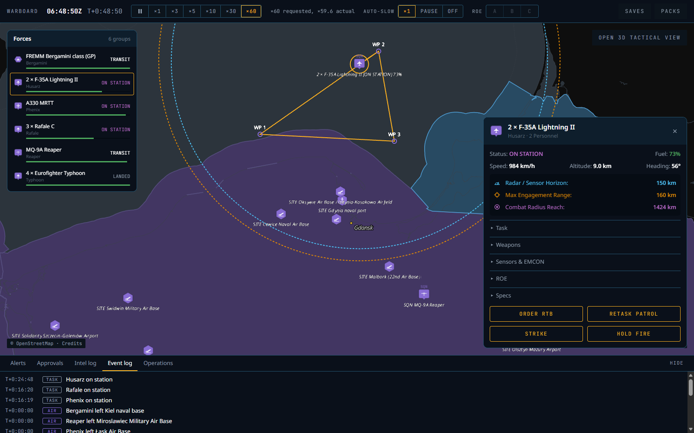
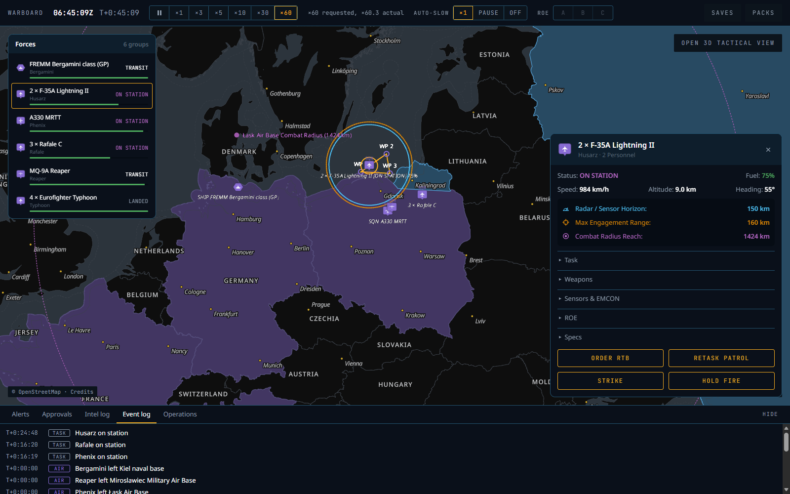
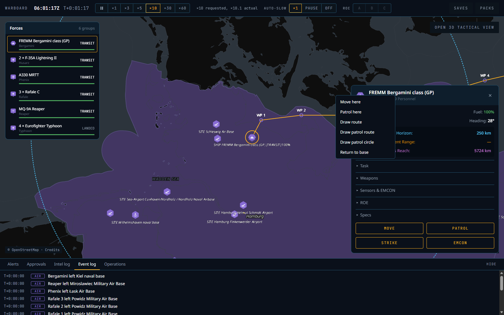
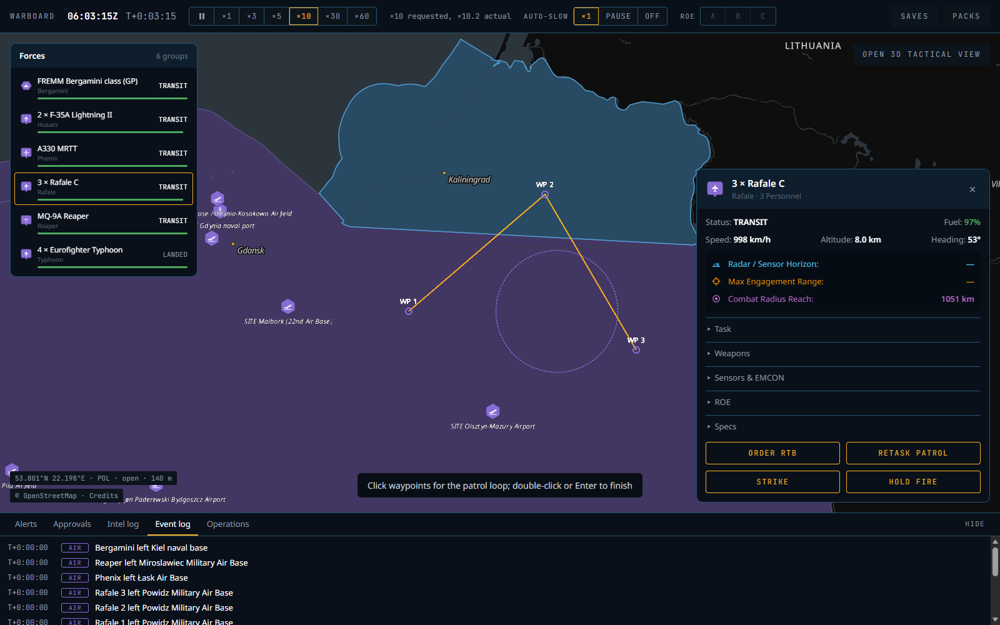
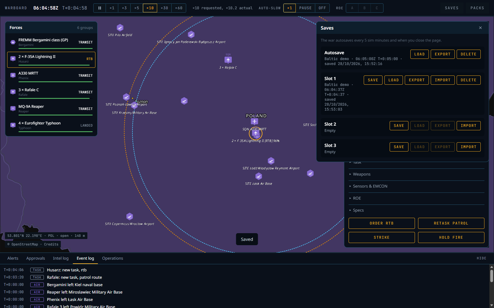

# P3 — Engine core: phase report

Date: 28 Oct 2026. Status: **done locally; CI to be confirmed on the next push** (Claude Code makes no commits or pushes, CLAUDE.md rule 10).

## What was built

| Area | Result |
|---|---|
| Content schema (`wb-content`) | Realism profile gains `movement` (ISA atmosphere for Mach → m/s, default climb, descent, acceleration, sustained G, cruise altitude by category, formation spacing, waypoint radius), `fuel` (burn × altitude band, descent burn fraction, ship burn exponent), extended `logistics` (tanker join distance, landing radius and pattern height, berth radius, default turnaround) and `bases` (one placement rule per doc 03 §3 base kind). Platforms gain `road_capable`. Every new value is listed under `provenance.estimates` except the ISA constants, which cite their source. Pack schema 1 → 2 (P3 is the first consumer, so no migration). `Entry::Realism` is boxed (clippy, size). |
| ECS world (`wb-sim`) | Components and resources from doc 02 §2 for movement, fuel, groups, tasks and bases (doc 02 §2 "As built"). Every aircraft and ship is an entity; a group entity carries the task, and members keep formation slots behind the lead. References between components are `UnitId`s, with a `UnitIndex` resource and a saved `UnitIdAlloc`. |
| Scheduler | Eleven exclusive stages on one thread (`STAGES` in `lib.rs`), multi-rate through `SimClock::due` / `due_staggered`, adaptive 100 ms / 1 s tick (P3 always runs 1 s; nothing engages), `step_with` for per-stage timing in the CLI (no clock in the engine), state-hash checkpoints every 600 ticks. Speeds pause…×60 and achieved-speed reporting stay in the worker loop. AutoSlow: event, worker forward and UI drop to ×1 or pause; the only trigger before P4 is a `TestAutoSlow` command. |
| Kinematics and fuel | Aircraft: turn rate `g·√(n²−1)/V` from sustained G, acceleration, climb and descent, great-circle step, Mach at altitude. Ships: turn rate `V/r`, speeds in knots. Rigid formation slots. Burn: cruise / military (climbing) / afterburner (fast) × altitude band; descent at half cruise; ships by distance. Bingo to the nearest suitable friendly base plus a half-turn and 10% reserve, checked every second, refreshed every 30 s per unit (staggered). |
| Tanker | Tanker track (racetrack), AAR system matching (boom/probe), offload limit, transfer rate, one receiver at a time, receivers ride 300 m behind. Groups head for a reachable tanker before bingo (ADR-021, Proposed). Tankers bingo like anyone else. |
| Bases | Garrisoned start activates every real base of the side countries (316 content bases, 6 countries). Landing and berthing with a descent profile, stationing lists, turnaround (refuel, rearm, tanker offload) on the 10 s logistics rate, transfers change the home base. Placement validator (`placement.rs`) applies the realism `bases` rules and explains rejections. |
| Tasks | Move, PatrolCircle, PatrolRoute (loop or once), RTB (nearest suitable base if none named), Land, TankerTrack, Transfer; standing behaviours bingo → tanker or RTB, winchester → RTB, resume the patrol after turnaround. ON STATION is tracked per group and evented. |
| Orders | `Order { tick, side, command }` in JSON/YAML (`[lon, lat]` points, doc 04 §7.2), validated into a resolved form that the queue and command log store and replays apply. Rejections are plain English ("Leg 1 crosses land near 54.31°N 10.24°E", "Runway at … is too short for the F-35A …", "Only tankers fly a tanker track …"). Unknown and enemy ids give the same answer. Members alone split off into a new group. |
| Events | `TaskChanged`, `StationChanged`, `BingoRtb` (with the reserve to land with), `Return`, `ToTanker`, `Refuelled`, `TookOff`, `Landed`, `TurnaroundDone`, `BaseActivated`, `AutoSlow`; tick, sim time and a side mask on each. |
| Saves | `.wbsave` (doc 04 §7.1 "As built"): header + zstd(postcard(snapshot, command log, event log)). The state hash is BLAKE3 over the same snapshot, so a load restores exactly what is hashed. Loading with other content is refused. |
| Side view and details | `SideView` v1 encoder (doc 06 §3 "As built"): own platforms and bases, flags with status bits, string deltas; empty contact, weapon and effect sections. `details()` JSON for group and base cards (status, task with route or circle, fuel, speed, altitude, heading, Mach, three ranges, members, weapons, confidence). ts-rs types for orders, events, details and saves; `symbols.ts` (icon codes, flag bits, statuses) generated from Rust. |
| WASM and worker | `Engine.create(scenario, contentPack)`, `Engine.load(save, contentPack)`, `set_geo`, `encode_view` / `view_ptr` (read in place), `details`, `order`, `take_events`, `save`, `save_header`. The worker loads `build/content.wbpack` (bundled asset) and `scenarios/demo-baltic.yaml`, double-buffers views, autosaves every 5 sim minutes and on page hide, and writes save slots to OPFS (metadata in IndexedDB v2). |
| CLI | `wb run` takes `--content`, `--packs`, `--load`, `--save-at` (save, reload, continue), `--save-out`, `--events`. New `wb golden` (variants and bands in the scenario's `golden:` block, metrics from the event log) and `wb bench` (per-stage timings, side view every 10 ticks, fails above 6 ms). Node runner: `--content`, `--load`, `--save-at`. |
| UI (`apps/game`, `packages/symbols`, `packages/protocol`) | Original SVG icon set (aircraft tile with point, flat-top ship hexagon, pointy site hexagon; glyphs per type) rasterised into one atlas at start (ADR-020, Proposed). Label grammar (`3 × Rafale C`, `SQN MQ-9A Reaper`, `SHIP …`, `SITE …`), `SQN` mark. Unit layers with 60 fps dead reckoning, groups collapsed to one icon below zoom 11, labels decluttered by priority, 2 px amber selection ring, three dashed geodesic rings (`@deck.gl/extensions` `PathStyleExtension`), combat-radius label with dot, amber route with hollow `WP n` markers, dashed patrol circles. Click to select; right-click menu (Move here, Patrol here, Draw route, Draw patrol route, Draw patrol circle, Return to base; Land/Berth here and Transfer here on a base); waypoint and circle tools. Unit card and base card (doc 10 §7), top bar (§8: clock, speeds, achieved speed, auto-slow ×1/PAUSE/OFF, ROE shown disabled), bottom dock (Alerts and Event log live, click-to-locate; other tabs say which phase brings them), Forces panel, Saves panel (autosave + 3 slots, save, load, export, import, delete). The territory tint follows the scenario's sides. |
| Scenarios | `scenarios/golden/g7-f35a-patrol.yaml`, `scenarios/save-load.yaml`, `scenarios/bench/patrol-2000.yaml`, `scenarios/demo-baltic.yaml` (the app's war until P9). |
| CI | Rust job runs `wb golden` and `wb bench`; the determinism check builds the content pack and adds save/reload and native save → WASM load; the content pack travels to the web job in the artifact. |

## Acceptance results (local: Windows 11, AMD Ryzen 7 7445HS, 6 cores, 15 GB RAM, Rust 1.99.1 release, Node 24.15.0)

| Criterion | Result |
|---|---|
| F-35A patrols a waypoint loop until bingo, returns, lands with reserve ≥ configured; with a tanker on track it refuels and stays ≥ 2× longer (G7) | **Pass** (`wb golden scenarios/golden/g7-f35a-patrol.yaml`). Without the tanker: on station 2.65 h, 2 bingo calls, both aircraft land with 25.1 kg more than the reserve recorded at bingo. With the A330 MRTT on its track: 6 refuellings (3 contacts × 2 aircraft), time on station **3.88×**. See open question 1 on the size of the reserve. |
| Save mid-flight, reload, run 1 sim hour: hash equals an uninterrupted run | **Pass**: `scenarios/save-load.yaml` saved at tick 900 and run to 3,600 gives `916c02d3…7e7993`: natively, in WASM, and from a native save continued in WASM. Also checked on G7 at ticks 900, 10,500 (heading for the tanker) and 10,950 (refuelling): all equal to the uninterrupted 4 h run. |
| Benchmark ≤ 6 ms average per 100 ms tick at ×10 | **Pass: 0.74–0.77 ms** (three runs, 6,000 ticks of 100 ms, 2,000 platforms in 500 groups + 316 bases, side view every 10 ticks, 93,880 bytes). Per tick: tasks 0.34 ms, formation 0.28 ms, movement 0.04 ms, fuel 0.02 ms, view 0.05 ms. CI runner class: GitHub-hosted `ubuntu-24.04` standard runner (4 vCPU); its number arrives with the first push (the CI step fails above 6 ms). Note: with headless Edge rendering the app and the dev server running, the same benchmark gave 2.2–2.6 ms; every stage slowed equally. |
| Placement validator rejects a naval base inland and an air base without a real airfield | **Pass** (`cargo test -p wb-sim --test placement`): Warsaw → "Naval base must be at a port (none within 5 km)"; open country near Bydgoszcz → "Air base must be at a real airfield (none within 3 km)". Also: own real sites accepted and active after an hour, a duplicate rejected (including one still queued), an enemy airfield rejected. On the real packs (`--include-ignored`): anchorage on land, road strip at sea and army base in Kaliningrad rejected, anchorage off Hel accepted, ship route over land rejected. |
| Screenshots next to references 01 and 05, differences listed | Below. |
| Native = WASM | **Pass** (`scripts/determinism-check.sh`, 10,000 ticks): empty `1a5445cb…`, determinism probe `2982aa92…`, G7 `e7246587…`, save-load `76d8427c…`, demo `1974d7bd…`, plus the three save legs and the 32 geo probes. All hashes changed from P2 (hash format v2; expected). |
| `cargo fmt --check`, `clippy -D warnings`, `cargo test --workspace` | Pass: 40 tests, 7 ignored (pack tests; all 12 pass with the packs present) |
| `cargo deny check`, lint canaries, `wb content check/build` | Pass; pack 86,607 bytes, hash `b9d13074…2621b`, identical on two builds |
| `pnpm gen`, `pnpm -r typecheck`, `pnpm -r lint`, `pnpm -r build` | Pass |

### Browser run (headless Edge, software WebGL)

The Claude in Chrome extension was disconnected, so the app was driven by a small DevTools-protocol script outside the repo against `pnpm --filter game dev`. A fresh profile installed both packs through the pack manager, then:

- the demo war started, with groups taking off and events in the dock;
- ×60 ran at ×60.2 actual;
- selecting from the Forces panel located and selected the group, and opened the card with live values;
- the ring rows toggled the rings;
- right-click → Patrol here sent the FREMM on a circle, and an inland Move here was rejected with "Leg 1 crosses land near 54.31°N 10.24°E";
- RETASK PATROL → three clicks → Enter gave the Rafales a patrol route;
- ORDER RTB sent the F-35As home;
- the autosave appeared at T+0:05:00;
- Slot 1 saved, and loading it restored T+0:04:37 with units, states and the event log.

The first right-click attempt never reached the page from the driver, so the menu was opened with a real `contextmenu` DOM event at the same point.

Bugs found this way and fixed:

1. The `CollisionFilterExtension` (deck.gl 9.4) made the whole label layer vanish, with a luma.gl uniform-block error. It is replaced by a small screen-space declutter.
2. The label font atlas was built before Noto Sans Italic loaded (serif fallback); fonts now load first.
3. deck.gl's `outlineWidth` is relative to the font size, so a value of 2 hid the glyphs.
4. A page parked in the back/forward cache kept the exclusive OPFS pack handles and locked the next page out of its packs. The app now releases them on `pagehide` (persisted), reopens them on `pageshow`, and retries handle creation briefly.

## Screenshots and differences from the references

| Screenshot | Compare with |
|---|---|
|  `P3-baltic-z7-route.png` | `01-strike-route-baltic.png` |
|  `P3-unit-card-rings.png` | `05-unit-card-rings.png` |
|  `P3-context-menu.png`,  `P3-route-tool.png`,  `P3-saves.png` | no reference (doc 10 §6, §8 panels) |

All screenshots come from headless Edge with SwiftShader at 1600 × 1000, device pixel ratio 1; a real GPU at DPR 2 renders the deck.gl text more crisply.

**Baltic at zoom 7 vs 01**
1. Same:
   - dark map with own purple land and 12 nm tint, and the enemy blue Kaliningrad with its light outline;
   - amber 2 px route through hollow purple `WP 1`–`WP 3` markers with white bold labels;
   - rounded aircraft tile with a bottom point and `SQN` above;
   - italic light-grey labels with a dark halo under the icons;
   - `SITE` hexagons with an aircraft-over-runway glyph (air bases) and an anchor (ports).
2. Many more `SITE` icons: a garrisoned start activates every real airfield and port of the side's countries (the Gdańsk area alone has five). 01 shows three. P9's war setup decides which bases a side uses.
3. Not in P3: enemy units, the battalion stack with `II`, salvos, the dashed strike lines and the salvo label (P4–P6). Enemy units are not drawn at all, because without sensors there are no contacts (CLAUDE.md rule 1).
4. Our route starts at the unit and closes the loop back to WP 1 (a patrol loop); 01's route is an open strike route from a ship.
5. The selected group's label carries `[ON STATION] 73%` (the 05 form) and a 2 px amber selection ring; 01 has no selection.
6. Our label text is thinner and fainter than 01's (deck.gl SDF text at 11 px in software WebGL).
7. Ours adds the Forces panel, the top bar and the bottom dock (doc 10 §8).

**Unit card and rings vs 05**
1. Same:
   - floating card bottom right on `panel.bg` with a 1 px border and 10 px radius;
   - header band with the type icon, title `2 × F-35A Lightning II` and a muted subtitle;
   - `Status: ON STATION` in `state.station`, fuel in `state.ok`, and the speed, altitude and heading row;
   - inset box with the three coloured rows, each with an SVG glyph (not emoji) and a value, each toggling its ring;
   - outlined amber mono buttons `ORDER RTB` / `RETASK PATROL`;
   - dashed blue sensor ring and dashed orange engagement ring around the unit, and the dashed purple combat-radius ring around the home base, labelled `Łask Air Base Combat Radius (1424 km)` with a purple dot.
2. Our card is taller: collapsible Task · Weapons · Sensors & EMCON · ROE · Specs and a second button row (`STRIKE`, `HOLD FIRE`) as doc 10 §7 asks. STRIKE and HOLD FIRE answer with the phase that brings them.
3. Subtitle `Husarz · 2 Personnel` (group name, crew × aircraft); 05 shows a formation name.
4. The combat-radius label sits inside the ring north-west of the base; in 05 it sits near the ring's edge. The ring is centred on Łask while the flight patrols the Baltic, so in this view the flight is off-centre; in 05 the unit sits near its base.
5. The map has coalition tints (05 has none) and the forces panel at the top left.
6. The unit label is one line, `2 × F-35A Lightning II [ON STATION] 75%`; 05 wraps it over three lines.
7. The values come from content: sensor 150 km (AN/APG-81 reference range), engagement 160 km (AIM-120D in the loadout), combat radius 1,424 km (internal fuel at cruise, out and back with the reserve).

## Decisions and deviations

- **Your decisions**: aircraft and group entities (not one flight entity with a count); `@deck.gl/extensions@9.4.0` added (MIT, no new transitive packages).
- **ADR-020 (Proposed)**: the icon atlas is rasterised at app start, not at build time (no SVG-rasteriser dependency).
- **ADR-021 (Proposed)**: groups head for a reachable tanker before bingo. Doc 02 §6's rule ("at bingo, unless a tanker is reachable") never uses the tanker when the patrol is near any airfield: G7's patrol is 30 km from Gdańsk, so bingo comes with fuel for 30 km.
- **Tuning constants** in the realism profile, listed as estimates: climb 60 m/s, descent 30 m/s, acceleration 4 m/s², sustained G 2.5, cruise altitudes, formation spacing 1.5 km, waypoint radius 2 km, burn × 1.6 / 1.3 / 1.1 / 1.0 below 1 / 4 / 8 / 20 km, descent burn 0.5, ship exponent 2, tanker join 1.5 km, landing radius 4 km at 500 m, berth 3 km, default turnaround 60 min, base match radius 3 km (air) and 5 km (port), base setup times from doc 03 §3.
- **Geo is read only to validate orders**, never per tick; accepted orders are logged in resolved form and replayed without validation. CI has no packs: the port and airfield rules work from content alone, and terrain rules refuse without packs.
- **Benchmark-only scenario fields**: `force_fine_tick` and `generated_units` (doc 02 §3 "As built").
- **Events are externally tagged in JSON** (`{"Landed": {...}}`): saves store them with postcard, which cannot read internally tagged enums.
- **Hash format v2**: BLAKE3 of the postcard snapshot replaces the hand-written encoding. Every P0/P2 hash changed; native == WASM still holds.
- **Demo war** (`scenarios/demo-baltic.yaml`): NATO (pol, deu, fra, ita, usa) against Russia. It has two F-35As, three Rafales, an MRTT, an MQ-9A, a FREMM out of Kiel, and four Typhoons left at Hohn without a task.
- **Forces panel and Saves panel** were added: doc 10 §8 lists the forces panel, and save slots need a UI. The prompt asked only for the top bar and the dock.
- **Label declutter in JS** instead of deck.gl's collision filter (see Browser run).

## Known gaps

- **Winchester** has the logic but no test: nothing fires before P5.
- **AutoSlow** has no real trigger before P4 (`TestAutoSlow` exercises the plumbing).
- **No content platform sets `road_capable` yet**, so road strips take no aircraft.
- **Flight model simplifications:**
  - take-off is instant (speed builds from zero over the base) and there are no runway queues;
  - followers sit rigidly in their slots;
  - a holding aircraft circles 5 km out;
  - ships stop at the end of a Move.
- **Ship routes are checked but not planned**: a route over land is rejected, there is no pathfinding.
- **Rendering details:**
  - the bundled Noto Sans Italic has no latin-ext file, so `ę` and `ł` in italic labels are synthesised by the browser;
  - the deck.gl text looks thinner than MapLibre's labels in software WebGL;
  - the event log has no cap in the engine (the UI keeps the last 500 lines).

## Open questions

1. **Landing reserve**: 10% of the fuel to the nearest base is tiny near a base (G7 lands with 39 kg, reserve 14 kg). Add a minimum landing reserve to the realism profile (for example 20 minutes at cruise), or keep doc 02 §6 as written?
2. **ADR-020 and ADR-021**: accept as written?
3. **Garrisoned bases**: every real airfield of a side's countries is a base (about 90 in Poland and Germany). Should P9 war setup choose them, or should civil airports be left out by default?
4. **Fonts**: add `noto-sans-latin-ext-400-italic.woff2` (OFL, same source as the others) for Polish and Czech names in labels?
5. **Real-GPU check**: please look at the map labels once in your Chrome at DPR 2. If they still look thin, I would raise the label size to 12 px.
