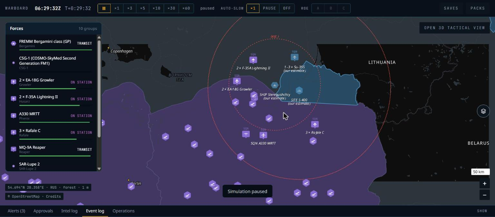
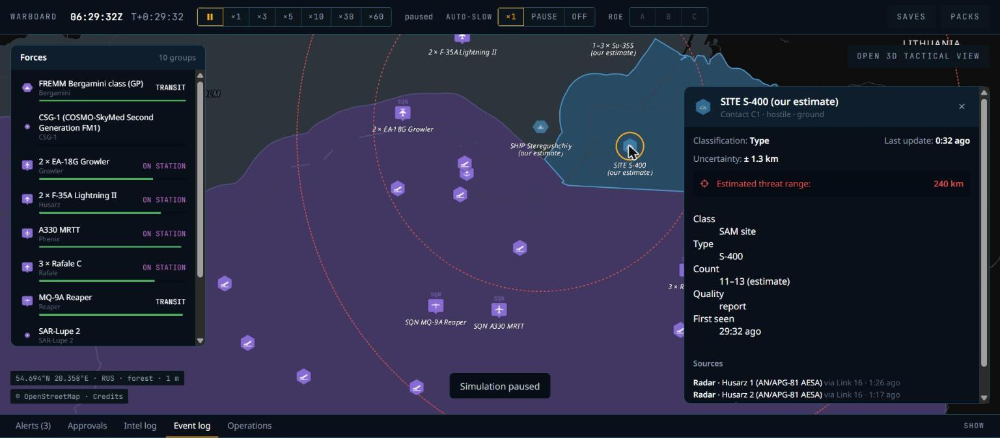
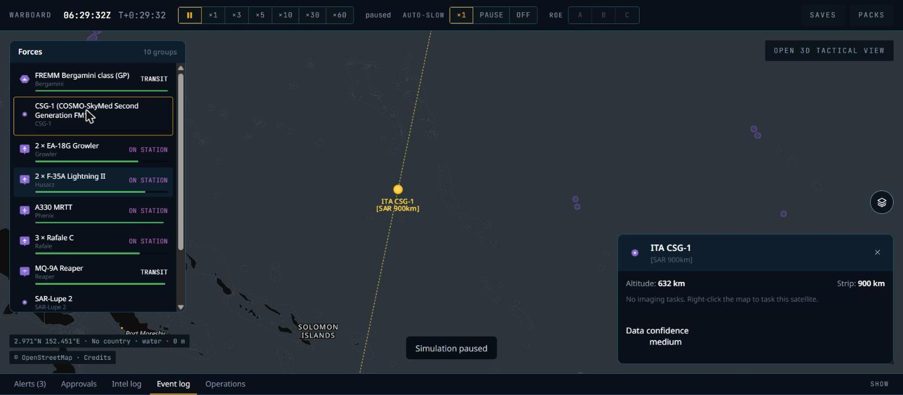
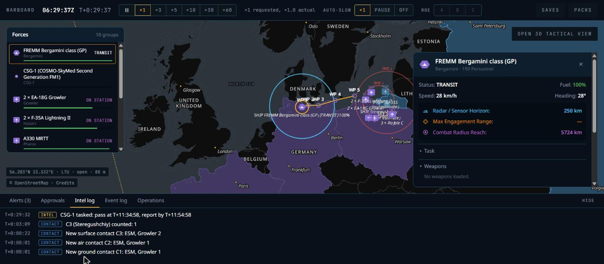

# P4 — Sensors, contacts and fog of war: phase report

Date: 29 Oct 2026. Status: **done locally; CI to be confirmed on the next push** (Claude Code makes no commits or pushes, CLAUDE.md rule 10).

## What was built

| Area | Result |
|---|---|
| Content schema (`wb-content`, pack schema 2 → 3) | Realism: radar range/bearing σ and group-resolve fraction; passive visual size, IRST range σ, EO detect pixels and daylight limit, sonar noise slope; satellite tasking horizon and pass search step; fusion σ floor, classification rules (looks to class, identity level), report age, ESM window and crossing angle, group count spread; EMCON blink cycle; `spatial` (bucket and memo resolutions, memo bands, capacity); surface and ground target heights. Sensors: `visual` and `satellite_payload` types (optical/SAR/SIGINT, strip width, GSD, bands, fix σ, downlink delay), optional radar bearing σ. Platforms: `orbit` (two-line elements, parsed and checked by `wb content check`) and `short_name`; systems `short_name`; weapons `signature`. Every new constant is listed under `provenance.estimates`. |
| Content entries | Radars Irbis-E (Su-35S), Furke-2 (Steregushchiy), AN/APY-2 (E-3A); EO/IR AN/DAS-1 MTS-B (MQ-9A); six satellites with CelesTrak elements (epoch 2026 day 301) and their payloads: CSG-1 (ita, SAR), SAR-Lupe 2 (deu, SAR), WorldView-3 (usa, optical), Kondor-FKA 1 (rus, SAR), Resurs-P 4 (rus, optical), Cosmos 2549 / Lotos-S1 (rus, SIGINT); a Kh-35 signature; short names for 18 platforms and both systems. |
| Maths (`wb-core`) | `orbit`: TLE parsing and near-Earth SGP4 on libm, GMST, TEME → Earth-fixed (ADR-024); `sun`: solar elevation; `rng_normal`; five new RNG purposes. |
| Geo (`wb-geo`) | `los_mask_altitude` (ADR-023 kernel), `synthetic::ridge_pack` (in-memory DEM, terrain and territory; raw-block zstd, no encoder dependency), `h3` helpers for the engine. |
| Sensors (`wb-sim/src/sensors.rs`) | Doc 02 §7 pipeline: radar (RCS by aspect, stores multiplier, R50, clutter, Doppler notch, horizon, field of regard, LOS, Pd, M-of-N tracks), ESM (one-way range, bearings), IRST (aspect, afterburner), EO/IR (GSD, day/night), visual (terrain class, size, night) with a built-in crew lookout, simplified sonar. Spatial index on H3 res-3 buckets per side, queried by bounding boxes; LOS memo by mask altitude; staggered scans. EMCON (`EmconState`: on, off, blink) from the system's or the doctrine's default, set by `SetEmcon`. |
| Pictures (`wb-sim/src/picture.rs`) | `SidePictures` (saved and hashed): contacts by `ContactId`, truth-key index, radar tracks, delivery queue, pending reports. Data-link latency or C2 reports, truth association with group count ranges, levels and identity, ESM cross-fixes, ellipse growth, ageing to *report*, last-known and removal. Events `ContactNew`, `ContactClassified`, `ContactCount`, `ContactLost`, `IntelReport`, `EmconChanged`, `SatelliteTasked`, and `AutoSlow` on a new hostile contact. |
| Satellites (`wb-sim/src/satellites.rs`) | SGP4 position every tick; SIGINT footprint every 5 s; `TaskSatellite` finds the next pass when accepted and the acknowledgement says when; optical needs the sun at the target (or reports why not); reports after the downlink delay (ADR-025). |
| Scenarios | `system:` units (an S-400 battalion as one stationary group of its 11 components), satellite units (no position), `emcon:`, `scripted_targets` (test-only movers with a weapon's signature) and `test_terrain` (test-only ridges); `generated_units` takes a list. Ground units start stopped. |
| API | SideView v2 (doc 06 §3 "As built"): contacts section, `sensor_km`, string kinds 2–4. `contact_details` (estimates only), `ground_track` (own satellites), satellite cards in `details`, group details with EMCON and sensor names; WASM bindings and ts-rs types for all of them. |
| CLI | `wb golden`: seeds and aggregates (median, min, max), sensor metrics (`first_detection_range_km`, `clearance_at_first_detection_m`, `first_detection_after_los_clear_s`, `report_count`), ratios over another metric (`over`), `rcs_quarter_root`, platform swaps per variant, stop when every metric has its value. |
| UI | Contacts in the estimate variant of the atlas (dashed frame, 60 %) in enemy blue, unknown amber, labels `SITE S-400`, `SHIP Steregushchiy`, `1–3 × Su-35S` with a second line `(our estimate)`, dashed uncertainty ellipses, ESM strobes, dashed `ring.threat` threat rings labelled `(est.)`; satellites as yellow dots with the two-line bold yellow label and dashed ground tracks; contact card (doc 10 §7); satellite card; Sensors & EMCON section with ACTIVE / BLINK / SILENT and the `EMCON` button; intel log tab; layers toggles for all own sensor rings and threat rings; right-click "Task <satellite> imaging here". |
| Demo war | Russian S-400 battalion near Baltiysk, a Steregushchiy, two Su-35S from Chernyakhovsk; two EA-18Gs; three NATO and three Russian satellites. The FREMM's route now passes north of Rügen and south of Bornholm: with packs, its P3 route was rejected as crossing land. |
| Tests and CI | G1–G5 golden scenarios, the truth-canary test, `scenarios/bench/sensors-2000.yaml` in CI, G1–G5 and a demo save/reload in `scripts/determinism-check.sh`. |

## Acceptance results (local: Windows 11, AMD Ryzen 7 7445HS, Rust 1.99.1 release, Node 24.15.0)

| Criterion | Result |
|---|---|
| G1 frigate radar at 30 m vs sea-skimmer at 5 m: first detection 28–36 km | **Pass**: 31.25 km in all 50 seeds (min = max: the 4/3-Earth horizon is 31.8 km and Pd there is ~1, so the 2-of-3 track confirms on the next scan). |
| G2 same fighter radar head-on vs Su-35S and F-35A: range ratio within 20 % of (σ₁/σ₂)^¼ | **Pass**: median ratio ÷ (2 / 0.005)^¼ = **1.12** (band 0.8–1.2); F-35A first seen at 43 km (median of 50). |
| G3 aircraft at 100 m behind a ridge vs ground radar: undetected until line of sight clears | **Pass** on synthetic terrain (a 600 m ridge): clearance of the exact line at first detection ≥ **+4 m** (min of 50 seeds; band ≥ −100 m), detected at most **8 s** after it clears (band ≤ 60 s). |
| G4 ESM aircraft vs emitting S-400: ESM detects beyond the S-400's detection of the aircraft | **Pass**: ESM range ÷ S-400 radar range ≥ **1.20** in every seed (min of 50). |
| G5 satellite pass at night: EO no report, SAR report | **Pass**: WorldView-3's night pass gives 0 imaging reports and 1 "No image: sun …" report; CSG-1 images the corvette (1 report). |
| Truth canary | **Pass** (`cargo test -p wb-sim --test truth_canary`): three canaries named `CANARY-7f3a9c-…` (a corvette sailing into radar range, a hidden one 1,700 km away, a Su-35S pair). Every 75 ticks for 6,000 ticks: the side view bytes, `details` for every id below 2,000 and every engine id, `contact_details` for ids 0–63, ground tracks and every visible event as JSON. The name never appears, even once detected; the exact position (f64, or 6–8 decimals) never appears; canary ids give "Unknown unit"; no contact estimate equals a truth position; the hidden canary has no contact. The approaching corvette is detected during the run. |
| Native = WASM | **Pass** (`scripts/determinism-check.sh`): all P3 scenarios, G1–G5, save/reload (native, WASM, native save → WASM) and the demo saved at tick 1,800 with contacts on both sides. All 32 geo probes match. |
| Benchmarks | G15 `patrol-2000` **1.34 ms** per tick (sensors 0.31 ms). New `sensors-2000` (two sides, 1,000 each, theatre-wide): **4.34 ms** per tick, under 6 ms, but sensors take **3.1 ms**, above their 2.5 ms share (doc 02 §16); see open question 1. |
| `cargo fmt --check`, `clippy -D warnings`, `cargo test --workspace` | Pass: 48 tests, 7 ignored (pack tests: all pass with the packs present). |
| `cargo deny check`, lint canaries, `wb content check/build` | Pass; pack 94,258 bytes, 395 entries. |
| `pnpm gen`, `pnpm -r typecheck`, `pnpm -r lint`, `pnpm -r build` | Pass. |
| Real terrain | The demo war with the world and europe packs: 10 contacts in an hour, 270 µs per tick. |

### Browser run (Chrome via Claude in Chrome, real GPU, 1536 × 674 viewport, DPR 1)

The demo war ran at ×60 for 30 sim minutes, then paused:

- Contacts appeared in the event log and the dock's intel log.
- Clicking the S-400 opened its contact card.
- Selecting CSG-1 from the Forces panel showed the satellite, its track and its card.
- Right-click → "Task CSG-1 imaging here" answered "CSG-1: Next pass 27 17:34Z, report by 27 17:54Z".
- SILENT in the FREMM's Sensors & EMCON section produced "Bergamini emission control SILENT".

## Screenshots and differences from the references

| Screenshot | Compare with |
|---|---|
|  `P4-baltic-contacts.jpg` | `01-strike-route-baltic.png` |
|  `P4-contact-card.jpg` | `05-unit-card-rings.png` (card frame), doc 10 §7 |
|  `P4-satellite.jpg` | `06-world-satellites.png` |
|  `P4-intel-log.jpg` | doc 10 §8 (no reference) |

**Kaliningrad vs 01**
1. Same:
   - `SITE S-400` / `(our estimate)` under a dashed site hexagon in enemy blue;
   - `SHIP Steregushchiy` / `(our estimate)` on a dashed ship hexagon;
   - enemy territory tint and outline;
   - own units unchanged from P3.
2. Ours adds:
   - dashed red threat rings with `(est.)`: S-400 240 km, from the 48N6DM; Redut 120 km;
   - `1–3 × Su-35S`, an unresolved count range.
3. Contact labels are not decluttered yet, so they overlap own labels when zoomed out (`2 × F-35A Lightning II` over `1–3 × Su-35S`). Own labels give way to each other only.
4. Uncertainty ellipses of radar contacts are a few hundred metres, so they are invisible at zoom 7. ESM-only contacts show strobes until a fix.
5. The battalion is a site (01 shows `SITE S-400`). Doc 10 §4 lists S-400 under "battalion-size system" with `BN`; the system content has `deploy_as: site`, and 01 decides.

**Contact card vs doc 10 §7**
1. Title `SITE S-400 (our estimate)`, subtitle `Contact C1 · hostile · ground`, classification, last update age, uncertainty ± km, a threat-range row that toggles the rings, and the sources with their data link.
2. The count of a site is its component count (11–13 estimated), which reads oddly for a site; see open question 4.

**Satellite vs 06**
1. Same: yellow dot, bold yellow two-line label `ITA CSG-1` / `[SAR 900km]`, dashed `sat.track` ground track.
2. Ours draws ±45/90 minutes of track per satellite; 06 shows long tracks for several orbits.
3. The owner is the ISO code from content (`ITA`); the name is the scenario's unit name.
4. Enemy satellites are not shown (rule 1: space surveillance is not modelled).

**Intel log**: mono time, coloured chip (CONTACT, INTEL), and click-to-locate the contact.

## Decisions and deviations

- **ADRs (Proposed):**
  - ADR-022: terrain in the tick; packs are a simulation input; `test_terrain` for CI.
  - ADR-023: LOS memo as mask altitude, and the radar Pd gate.
  - ADR-024: in-house SGP4.
  - ADR-025: tasked imaging, routine SIGINT; `swath_km` is the field-of-regard strip.
  - ADR-026: estimates never equal the truth.
- **Your decisions**: SGP4 on libm; scripted targets for G1; tasked-only EO/SAR; enemy bases not in the pictures.
- **Spatial index queries by bucket bounding box** instead of H3 grid disks: same candidates (723,060 in a test window, before and after), 7× faster.
- **One detection per group per scan**, and the delivery queue sorted once per stage (inserting each detection into a sorted list was quadratic).
- **Satellite strip estimates** are the field of regard (900–1,000 km for imagers). With nadir swaths (13–40 km) no pass came within reach in 48 hours.
- **Satellites with no public elements** (CSO-1, SARah, US reconnaissance satellites) are left out. Content uses only satellites CelesTrak publishes.
- **The built-in crew lookout** comes from the realism profile, not a content entry, so no source had to be invented.
- **Ground units start stopped** (P3 gave them road speed at spawn).
- **G3 geometry**: a 15 km stand-off and a ridge ending north of the path. With the first layout, Earth curvature hid the 100 m target as soon as the ridge stopped doing so.
- **The truth canary counts "exact" as full precision or 0.1 m.** An honest estimate can land within metres of the truth by chance.

## Known gaps

- Contact labels do not take part in the label declutter.
- Weapons have no RCS in flight yet; only `scripted_targets` carry a weapon signature (P5 brings flyout).
- The adaptive 100 ms tick still never triggers: engagement envelopes arrive in P5.
- No engage-on-remote use of the recorded networks yet (P5); link range and comms jamming arrive in P6.
- Sonar is implemented but has no golden: there is no submarine content and no sonar on the seed ships.
- `ContactNew` does not carry the level, so a contact classified on first sight (ESM → type) has no "classified" line in the intel log.
- The world view does not zoom out past Europe, and the browser's minimum zoom keeps 06's global view out of reach in this viewport.

## Open questions

1. **Sensor budget**: the theatre-wide bench meets 6 ms per tick but sensors take 3.1 ms (share 2.5 ms). A dense 500 km box costs about 50 ms per tick: every radar sees every enemy. Should P6 add sensor-level aggregation (for example, AEW and IADS tracks fused once per network), or should the benchmark define the density?
2. **ADR-022–026**: accept as written?
3. **Packs at war start**: line of sight now depends on the installed packs. Should the game refuse to start a war without the theatre's packs (P9 war setup)?
4. **Counts of sites**: show a site's component count, or count only aircraft and ship groups?
5. **Swath semantics**: keep `swath_km` as the field-of-regard strip (ADR-025), or add a separate `field_of_regard_km` and keep `swath_km` for the nadir swath?
