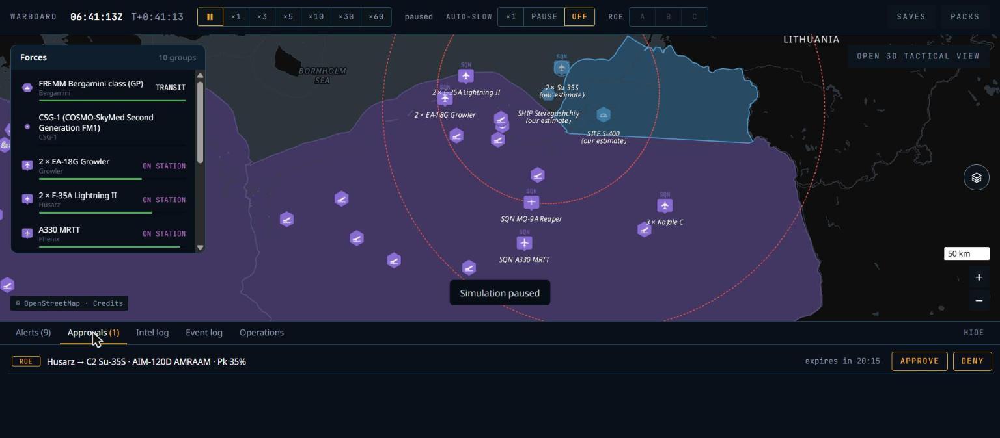
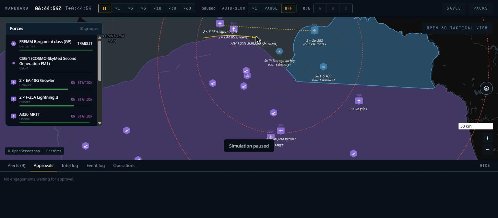
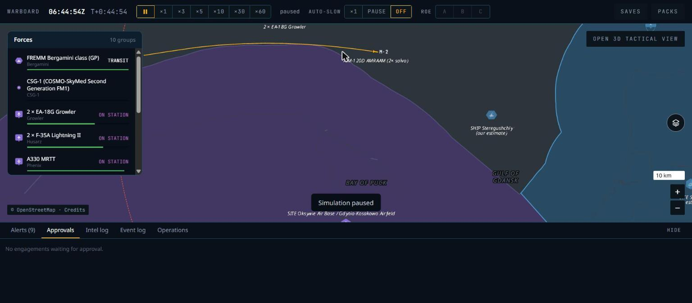

# P5 — Weapons, air combat and ROE: phase report

Date: 3 Nov 2026. Status: **done locally; CI to be confirmed on the next push** (Claude Code makes no commits or pushes, CLAUDE.md rule 10).

## What was built

| Area | Result |
|---|---|
| Content schema (`wb-content`, pack schema 3 → 4) | Weapon profiles (boost, sustain, coast τ at sea level and high altitude, min/max speed and range, max g), guidance (midcourse, terminal seeker, seeker range, ECCM), `pk_base` by target class, countermeasure resistance, CEP, warhead; stations and loadouts; countermeasures; realism `weapons` (calibration conditions, PN gain, loft, fuze and lethal radii, close fraction), `endgame` (manoeuvre ratio and floor, Pk clamp, aspect table, `nominal_speed_fraction`), `countermeasures`, `damage`, `roe` (return-fire memory, approval window, threat CPA and horizon, `territory_sigma`). |
| Loadouts and bases | Stations filled from loadout templates, locked while airborne; rearm from base stock with a `RearmShort` event; `SetLoadout` at a base starts a turnaround. |
| Flight (`weapons.rs`, `flyout.rs`) | Boost, sustain and coast `V·e^(−Δt/τ(alt))`, manoeuvre energy loss, proportional navigation, loft while the seeker is off, datalink midcourse, seeker field of view and range, self-destruct after a lost track; fuze at the closest point of approach inside the tick. Flyout tables per weapon from the real flight model (ADR-028) drive launch doctrine (max range, no-escape zone, close). |
| Endgame and countermeasures (`endgame.rs`) | Awareness (picture or warning receiver), beam reaction, chaff/flare release inside `release_range_m`; `Pk = pk_base × f_energy × f_aspect × f_maneuver × f_cm × f_ew × f_env`, `Decoyed` when only the countermeasures turned a hit into a miss; Rayleigh CEP for unguided weapons. `V_nom` defined (ADR-032). |
| Damage (`damage.rs`) | Damage points and subsystem hits on ships and ground units, aircraft abort when damaged, unit destruction, base components with repair times, munitions store losses. Events to the damaged side only (ADR-027). |
| ROE (`roe.rs`, `engage.rs`) | Alpha / Bravo / Charlie with side → group → unit inheritance; Bravo engages in own territory when the error ellipse × `territory_sigma` lies inside (ADR-033) or as return fire; self-defence for ships and ground units (ADR-031); Intercept and Strike orders pre-approved (ADR-029); approval queue with expiry, `ApproveEngagement` / `DenyEngagement`; border crossings; `test_territory` without packs (ADR-030). |
| Events | `WeaponLaunched` (reason, salvo, `M-n`/`INT-n` tag), `WeaponTerminated` with every factor and `intercept`, `IncomingWeapon`, `Damage`, `UnitDestroyed`, `BaseComponentDamaged/Repaired`, `RoeRequest`, `RoeDecision`, `BorderCrossing`; auto-slow on approval requests and launches against us. |
| API | SideView v3: the weapons section carries our own weapons (salvo, shooter, target contact, tag, relation ours/interceptor; doc 06 §3); weapon type names as TYPE strings; `RELATION` and weapon symbol codes in `symbols.ts`. `roe::approvals` / `Engine.approvals()` (`ApprovalView`, own units and own contact ids only). |
| UI | Amber missile glyph with a 1.5 px trail, `M-n` tags from zoom 7 (merged when they overlap), salvo label `<type> (<n>× salvo)` at the centroid, dashed amber shooter→target lines; interceptors as cyan dashed trails with a ring-dot head, `INT-n` tags and `SHIP FREMM class (5× interceptors)` group labels; Approvals tab with count, countdown, APPROVE / DENY and click-to-locate; event lines for every P5 event with an `ROE` chip, alerts for incoming weapons, damage, losses and requests. |
| CLI | `wb golden` combat metrics: `launches` (filters `outside_territory`, `at_weapons`, `at_non_weapons`, `return_fire`, `first`), `self_defence_launches`, `roe_requests`, `approvals`, `outcome_fraction`, `pk`, `first_launch_after_crossing_s`; every fuzed termination must carry endgame factors. |
| Demo war | The F-35s launch from max range, so under the default Charlie they ask to engage the Su-35S pair and the Approvals tab is exercised. |

## Acceptance results (local: Windows 11, AMD Ryzen 7 7445HS, Rust 1.99.1 release, Node 24.15.0)

| Criterion | Result |
|---|---|
| G6 AIM-120D vs aware fighter: max range beaming ≥ 70 % out of energy or miss; half range head-on Pk 0.6–0.85 | **Pass** (500 seeds, first shot): beaming **1.00** out of energy; head-on Pk **0.70**. |
| G8 ROE Bravo, hostile flight along the border: never engaged outside; engaged within 60 s of crossing; return fire allowed | **Pass** (20 seeds): **0** launches at a target truly outside; first launch at most **22.4 s** after the true crossing; when the flight stays outside and fires first, the F-35s fire back (median 4 return-fire launches). |
| G9 ROE Charlie under missile attack: self-defence intercepts without approval; other shots queued | **Pass** (5 seeds): 16 self-defence launches, all at weapons, none at the aircraft or corvette; 4 approval requests, 0 approvals. |
| Every termination event carries factors | **Pass**: `wb golden` asserts endgame factors on every hit, miss and decoy in G6–G9; the event carries speed, time of flight, launch range, distance flown, miss distance, awareness and countermeasures for every outcome. |
| G1–G5, G7 | **Pass**, unchanged. |
| Truth canary | **Pass**, now also over the approval queue. |
| Native = WASM | **Pass** (`scripts/determinism-check.sh`): every scenario, G1–G9, save/reload native, WASM and native save → WASM, the demo saved at tick 1,800. |
| Benchmarks | `patrol-2000` **1.14 ms** per tick; `sensors-2000` **3.06 ms** per tick (budget 6 ms). |
| `cargo fmt`, `clippy -D warnings`, `cargo test --workspace`, `cargo deny check` | Pass. |
| `pnpm gen`, `pnpm -r typecheck`, `pnpm -r lint`, `pnpm -r build` | Pass. |

### Browser run (Chrome via Claude in Chrome, 1536 × 674 viewport)

The demo war at ×60 with auto-slow off:

1. At T+0:31 the Approvals tab showed `(1)`: `Husarz → C2 Su-35S · AIM-120D AMRAAM · Pk 35%`, `expires in 20:15`, APPROVE / DENY.
2. APPROVE: the row read `APPROVED`, and the F-35 lead fired two AIM-120D the next time it was in range.
3. The event log showed the full chain: request, `Request 3 approved`, `Husarz 1 fired M-1 aim-120d at C2 (Su-35S) (approved)`, `M-1 aim-120d: miss`, `M-2 aim-120d: hit`. A second approval gave M-3 hit and M-4 self destruct after its target was gone.

## Screenshots and differences from the references

| Screenshot | Compare with |
|---|---|
|  `P5-approvals.jpg` | doc 10 §8 (no reference) |
|  `P5-salvo.jpg` | `04-interceptors.png`, `01-strike-route-baltic.png` |
|  `P5-missile-tags.jpg` | `04-interceptors.png` |

**Salvo vs 04**
1. Same:
   - amber missile with an amber trail;
   - the salvo label `AIM-120D AMRAAM (2× salvo)` under it in italic grey;
   - a dashed amber line from the shooter to the target.
2. Different:
   - 04's missiles are glowing white-amber streaks; ours are a 20 px amber glyph, small at zoom 7–9;
   - an AIM-120D shot crosses its whole range in a minute or two, so a screenshot shows one or two missiles, not a 12-missile ship salvo. A ship salvo (G10, P6) is the like-for-like comparison.
3. Interceptors were not seen in the browser: the demo has no attack on our ships. They follow the same code path as our missiles (relation `INTERCEPTOR`), and G9 exercises them in the engine.
4. Tags that overlap merge into one label (`M-8 M-6` in 04). This was added after the screenshot: the pair in `P5-missile-tags.jpg` shows only `M-2`, and the merge has not been seen in the browser yet.

**Approvals**: a ROE chip in `state.warn`, mono countdown, outlined amber command buttons. Clicking the text locates the contact.

## Decisions and deviations

- **ADRs (accepted after review):**
  - ADR-027: weapon and damage events go to one side;
  - ADR-028: flyout tables;
  - ADR-029: Intercept and Strike are pre-approved;
  - ADR-030: test territory without packs;
  - ADR-031: self-defence for ships and ground units only.

  ADR-027 to ADR-031 were cited by the code but missing from `docs/07-adrs.md`; they were written from the code at the end of the phase.
  - ADR-032: endgame `V_nom` (doc 02 §11 did not define it; the first build used `V_max`, giving Pk 0.14 at half range).
  - ADR-033: Bravo needs the error ellipse inside our territory.
- **G6 counts first shots only** (new `filter: first`): follow-up shots after a miss come from other ranges than the band describes.
- **AIM-120D `pk_base` vs fighters 0.75 → 0.8** (listed estimate). With chaff, the ceiling was 0.68, too close to the band's 0.6.
- **SideView weapons section** gained `shooter`, `target` and `tag` columns (doc 06 §3 updated, view v3). It carries our own weapons only; other sides' weapons are contacts.
- **`WeaponTerminated` carries `intercept`**, so the log reads `INT-n` for interceptors.
- **Demo F-35s use max-range doctrine.** NATO's default is the no-escape zone, which against a Su-35S (Mach 2.25) is so small that their patrol never reaches it and no request was raised.

## Known gaps

- Effects (launch flash, intercept burst, hit burst) and the targeted-unit halo (doc 10 §5) are not drawn; the view's effects section is still empty. Moved to P6.
- Enemy weapons are drawn as contacts, not yet with the red glyph and `type / speed` label of doc 10 §5. Moved to P6.
- Missile trails restart when the map layer is rebuilt (page reload or hot reload); they are not part of the view.
- Seeker jamming (`f_ew`) is 1 until P6.
- `SAVE_VERSION` stays 1 although the snapshot format changed (4). P4 saves are refused anyway, with a reason, because their content hash differs from the P5 pack; a save format bump would make the reason clearer.

## Decisions after review (3 Nov 2026)

1. **ADR-027–033** accepted as written.
2. **`territory_sigma`** stays 3: "never engaged outside" wins over a faster first shot.
3. **NATO default doctrine** stays no-escape zone; P9 revisits it with the AI doctrine.
4. **Effects** (launch, intercept and hit flashes, the targeted halo) and the red enemy-weapon labels move to P6, with the naval engagements.
