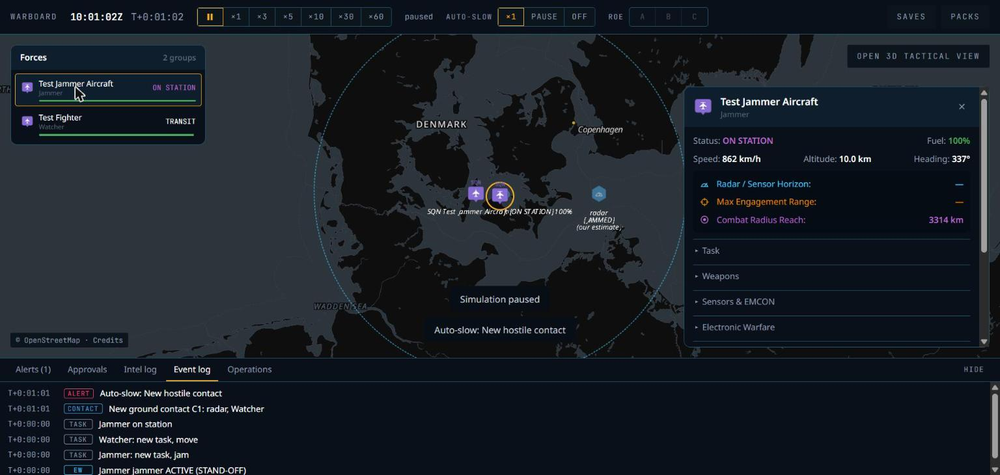
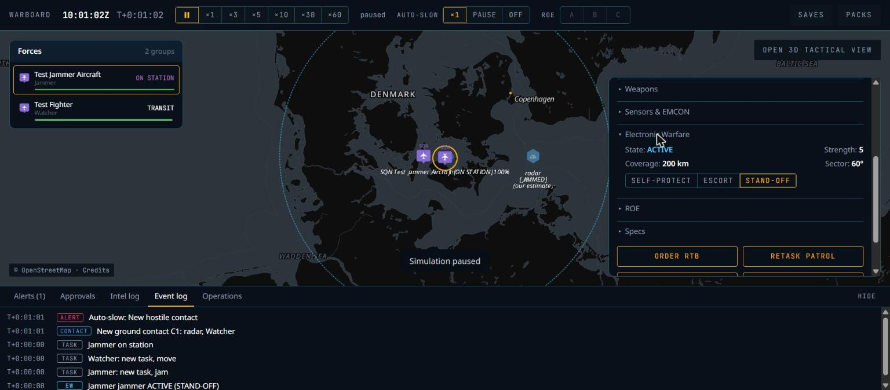
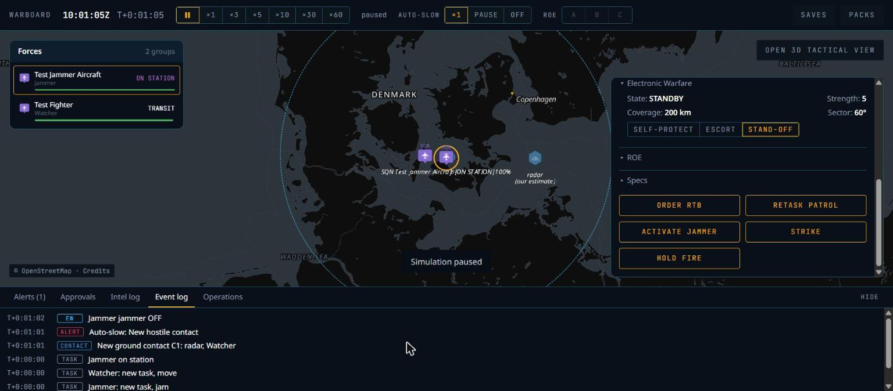

# P6b — Electronic warfare as game stats: phase report

Date: 7 Nov 2026. Status: **done locally; CI not yet run** (every check below ran on the working tree on 7 Nov 2026, Windows 11, Rust 1.99, Node 24). The first version of this report said "done" while `cargo fmt --check` and `clippy -D warnings` failed and two defects were still in the build; both are fixed, see "Found while completing the phase".

## What was built

| Area | Result |
|---|---|
| Schema & realism (ADR-034) | Radar `jam_resistance` (0–10), `ew_suite` modes with `jam_strength` (0–10), `coverage_km`, `sector_deg` and `effects` (`radar`, `datalink`, `navigation`). Weapons: `seeker_resistance` (0–1), `nav_resistant`. The legacy `eccm_db`, `seeker_eccm` and `j_db` are still read and migrated (`crates/wb-content/tests/migration.rs`). Realism constants in `default.yaml`: `m_table`, `self_protect_r50_min_fraction` 0.35, `off_axis_attenuation` 0.30, `datalink_latency_factor` 3, `datalink_loss_fraction` 0.30, `nav_jam_cep_factor` 4, `arm_memory_pk_factor` 0.45, `seeker_jam` 0.25, `emcon_blink_on_s` 10, `emcon_blink_period_s` 60. |
| Radar jamming | Detection range is multiplied by `m(a)`, with `a = jam_strength − jam_resistance`. Self-protection jamming is limited to the close-in fraction. Escort and stand-off jammers act on radars inside `coverage_km`; the sector is the angle, seen from the radar, between the jammer and the protected unit (doc 02 §9), with off-axis attenuation outside it. Several jammers compound up to `max_jammers`. |
| Data link and navigation | Observers inside an enemy data-link jammer's coverage get 3× latency and lose 30% of shared track updates (RNG purpose `DatalinkLoss` = 14, appended so existing streams do not move). Weapons that are not `nav_resistant` fly with CEP × 4 under navigation jamming and record `f_ew` 0.25. |
| Seeker jamming and endgame | `f_ew = 1 − seeker_jam × (1 − seeker_resistance)` for guided weapons whose target is covered by a radar jammer. `WeaponTerminated` records `f_ew`; `Outcome::Jammed` when EW caused the miss; `SalvoReport` counts jammed rounds. |
| Emitter-homing weapons | `terminal: anti_radiation` weapons home on emitting radars. If the radar goes `off` or `blink`, the weapon flies on memory to the last known position with Pk × `arm_memory_pk_factor` and `f_env` 0.45. |
| Orders and tasks | `Task::Jam` (stand-off orbit), `Task::Suppress` (SEAD against an emitter contact or a point), `Command::SetJammer { units, on, mode }`, `SetEmcon` (`on`, `off`, `blink`). |
| Fixtures (ADR-035) | Generic units in `scenarios/fixtures/`: `test-jammer` suites (strength 3, 5, 7, 9), jammer aircraft, `test-fighter` with `test-fighter-radar`, `test-arm`, `test-fighter-sead`. |
| UI | Unit card "Electronic Warfare" section (state, strength, coverage, sector, mode picker) and an `ACTIVATE JAMMER` / `STANDBY JAMMER` button; the jammer's coverage circle on the map; `[JAMMED]` on a jammed hostile radar contact and on an own radar unit under hostile jamming. Colours only from the tokens. |

## Found while completing the phase

The earlier "done" claim was checked against the repository. Six defects came up and are fixed:

1. **CI would have failed.** `cargo fmt --check` reported about 20 hunks, and clippy rejected `wb-content` (derivable `Default`, two collapsible `if`s) and `wb-sim` (two collapsible `if`s, a no-op `drop`, a `usize as usize` cast). The lint canary only "passed" because clippy could not compile `wb-content`. All fixed; the canary now rejects `f64::sin`, `powf`, `HashMap` and `HashSet` for the right reason.
2. **A jammed radar contact was never marked.** The contact flag looked up the unit behind the contact, but a contact's `truth` is the *group*, which has no platform, so the test was always false. It also read hidden truth. It now comes from the picture only (ADR-039, Proposed). Pinned by `a_hostile_radar_inside_our_jammers_coverage_is_flagged_jammed` in `crates/wb-sim/tests/ew.rs`, which also checks the flag on the jammed side's own radar unit.
3. **Jammer state was not in saves or in the state hash.** Reloading a save made after `SetJammer` (or from a scenario with `jammer: true`) silently switched the jammer off: on G11 the straight run and the save-at-200 run gave different hashes (`391b935e…` vs `3f480563…`). `JammerState` is now in the snapshot (`UnitRecord.jammer`); both runs give `b2fe53c2…`. `scripts/determinism-check.sh` now saves and reloads G11 natively and in WASM, so CI covers it. Older saves are not expected to load: the unit record's postcard layout changed and `SAVE_VERSION` is unchanged, as in P6a (not tested with an old save).
4. **The coverage wedge pointed the wrong way.** The map drew a 60° wedge along the jammer's *heading*, rotating with the orbit, but the engine measures the sector at the victim radar, not along the aircraft. The map now draws the coverage circle; the card shows the sector as a number.
5. **The 6 km "affected-radar" ring cut through the `[JAMMED]` label** at mid zoom and would vanish at far zoom. Removed; the text badge stays.
6. **Duplicate `STANDBY JAMMER` button** in the card (section and button row). The button row is the doc 10 pattern, so the section keeps only the mode picker.

## Acceptance results

| Criterion | Result |
|---|---|
| **G11** stand-off jamming at advantage −2, 0, +2, +4 (500 seeds, median) | **Pass**: ratios to unjammed **0.90** (0.85..0.95), **0.74** (0.70..0.80), **0.58** (0.55..0.65), **0.43** (0.40..0.50); unjammed 189.6 km (175..200). |
| **G12** ARM memory mode (500 seeds, mean) | **Pass**: Pk radar on **0.72** (0.68..0.78), radar shut down **0.34** (0.28..0.38), ratio **0.47** (0.40..0.50; model 0.45). |
| G1–G10 | **Pass**: 14 golden scenarios, 42 bands, no failures. G10 mean **0.82** (0.60..0.95). |
| `f_ew` recorded in every endgame under jamming | **Pass** (`tests/ew.rs`, 0.875 = 1 − 0.25 × 0.5). |
| `cargo fmt --all --check` | **Pass**. |
| `cargo clippy --workspace --all-targets -- -D warnings` | **Pass**. |
| `scripts/lint-canary.sh` | **Pass** (all four rejected). |
| `cargo test --workspace` | **Pass**: 61 passed, 0 failed, 8 ignored (the ones that need the real packs). |
| Truth canary | **Pass**. |
| `cargo deny check` | **Pass** (advisories, bans, licences, sources). No dependency was added. |
| `content check` | **Pass** (397 entries). |
| Native = WASM (`scripts/determinism-check.sh`) | **Pass**: every scenario, save/reload native and WASM, native save → WASM, G11 save/reload native and WASM, geo probes. |
| Benchmarks (budget 6 ms) | `patrol-2000` **1.0–1.3 ms**; `sensors-2000` **3.4–4.0 ms** in the final runs (2.7–3.0 ms earlier the same session). One run during heavy machine load read 70 ms and did not repeat in three reruns; treat it as noise, but re-check it on CI. |
| `pnpm -r typecheck`, `pnpm -r lint`, `pnpm -r build` | **Pass**. |
| CI | **Not run.** |

## Browser run and differences from the references

Run: `pnpm --filter game dev`, with the engine worker temporarily pointed at a scratch scenario (a Blue jammer aircraft and fighter, a Red emitting radar 100 km east) and a fixtures content pack; both were removed afterwards. Run at ×10 to T+1:05, paused, jammer selected. The toggle was pressed once: state went `ACTIVE` → `STANDBY`, the button became `ACTIVATE JAMMER`, the log said `Jammer jammer OFF` and the `[JAMMED]` line left the contact.

| Screenshot | Compare with |
|---|---|
|  `P6b-jammer-coverage.jpg` (jammer selected, 200 km coverage circle, jammed radar contact) | `05-unit-card-rings.png` |
|  `P6b-ew-card.jpg` (Electronic Warfare section open) | `05-unit-card-rings.png` |
|  `P6b-jammer-standby.jpg` (after `STANDBY JAMMER`) | `05-unit-card-rings.png` |

Differences:

1. **Ring weight.** The coverage circle is `ring.sensor` at 60%, 1.5 px dashed. The rings in 05 are 2 px at full strength. Doc 10 has no jammer ring, so this reuses the sensor token; if you want its own token, add one to the guide.
2. **Card rows.** The three summary rows are as in 05, but the jammer has no sensor horizon or engagement range, so those show `—` where 05 shows numbers. Combat radius shows 3,314 km for a jammer aircraft with no home base ring.
3. **Icons.** 05 has an emoji icon in each row and button; the guide (§7) drops them, so ours are text only.
4. **Buttons.** Five buttons wrap to three rows; 05 shows two. At 674 px viewport height the card needs scrolling to reach them.
5. **Land tint.** The scratch scenario's nations are not in the territory data, so the land is not tinted purple or blue as in 05.
6. **Contact label.** `radar` / `[JAMMED]` / `(our estimate)` in the same italic white as other contact labels; `[JAMMED]` has no colour of its own.
7. **Event text.** `Jammer jammer ACTIVE (STAND-OFF)` repeats the group's name ("Jammer") before the word; not changed.

Not checked by eye: the own-unit `[JAMMED]` badge (covered by the engine test only), the self-protect and escort modes in the UI, anything at ×1 live or ×30–×60, and the 3D view.

## Decisions and deviations

- **ADR-039 (Proposed): the contact `JAMMED` flag comes from the picture.** At `Class` the flag reveals one bit about the content type (whether that kind of platform carries a radar). Please confirm that is acceptable, or tell me to require `Type`.
- **Integer EW stats**, 0–10, as in doc 02 §9 and ADR-034.
- **RNG purpose `DatalinkLoss` = 14**, appended so existing streams keep their numbers.
- **G12 uses `Suppress` with a point** at the SAM radar site, so the fighter launches `test-arm` and the memory mode is exercised when the radar shuts down.
- **Coverage is drawn as a circle**, not a wedge, and the affected-radar ring was dropped (defects 4 and 5).

## Known gaps

- P5 leftovers: done after this phase, see "Leftovers cleared after P6b".
- P6a's gaps carry over (soft-kill window unused, no close-in-gun event wording, visual checks of live salvos).
- **PF is not started.** G2 and G4–G9 and `scenarios/demo-baltic.yaml` still use real unit and place names, which the denylist will flag; the P6b fixtures are all generic.
- Saves made before the jammer state was added are refused: `SAVE_VERSION` is now 2 (see below).

## Leftovers cleared after P6b (7 Nov 2026)

Checked against the known gaps of the P0–P6b reports. All checks pass afterwards: fmt, clippy, lint canary, 61 tests, 15 golden scenarios (44 bands), native = WASM (18 matches), truth canary, benchmarks (`patrol-2000` 0.97 ms, `sensors-2000` 2.86 ms), `cargo deny`, content check, pnpm typecheck, lint and build.

| Gap (report) | Done |
|---|---|
| `STRIKE` only showed a toast (P5, P6a) | Strike panel on the unit card: pick a contact or a point on the map, a weapon that can engage it (`GroupDetails.weapons` now has id, category, targets, ranges, `engage_on_remote`), 1–64 rounds, range warning. The engine ends a strike that can never fire with `StrikeAborted { group, reason }` (alert). Checked in the browser on both target kinds. |
| ROE A/B/C in the top bar and the card's ROE section disabled; `HOLD FIRE` a toast (P5, P6a) | Top bar sets the side default (`SetRoe`); the card shows the effective ROE and its source, sets the group's ROE (A, B, C, inherit) and self-defence; `HOLD FIRE` puts the group on C and becomes `RESUME FIRE`. `GroupDetails` gains `roe`, `roe_source`, `roe_override`, `self_defence`, `self_defence_override`. Checked in the browser. |
| No close-in-gun wording (P6a) | `WeaponLaunched` and `WeaponTerminated` carry `weapon_name` and `category`; the log says "opened fire with its close-in gun" and "Close-in gun burst …", and missiles by name instead of content id. |
| A contact classified on first sight had no "classified" line (P4) | `ContactClassified` is now also emitted when a first sight reaches class or type (a bare unknown → domain step is still silent). |
| Winchester had no test (P3) | Golden `G7-Winchester` (`scenarios/golden/g7-winchester.yaml`, new metric `winchester_returns`): a test fighter fires its four test anti-radiation missiles and heads home for winchester, no bingo, 5 seeds. |
| `SAVE_VERSION` stayed 1 while the snapshot changed (P5) | Now 2: older saves are refused as "version 1" instead of failing to decode. |
| Jammer modes checked in the browser only for stand-off (P6b) | Escort (150 km circle) and self-protect ("Self only", no circle) checked. |
| Test war had no base (hosting) | Fixture `test-airbase` (Bornholm, away from any real airfield) and the test war is now garrisoned: aircraft bingo, land, turn around and take off again. Goldens deploy, so they are unaffected. |

## Still open after the clean-up

- **Design or content decisions (need you):**
  - out-of-fuel aircraft keep flying at 0 kg when no base is reachable; doc 02 does not say what happens (flameout and loss?);
  - the P6a soft-kill window (`tewa.soft_kill_window_s`) and IADS layer templates are unread; wiring them changes G10's engagement timing and needs an ADR;
  - the open questions of P0–P4 (fonts, YAML crate, JS licence check, landing reserve, garrisoned civil airfields, sensor budget, and so on) are still yours to answer.
- **Bigger than a leftover:** ship route planning (P3: routes are checked, not planned; H3 pathfinding comes with P11); a sonar golden needs submarine content (P8).
- **PF or P8 content:** real names in G2, G4–G9 and the Baltic demo; no `road_capable` platforms; the latin-ext italic font (only real place names need it).
- **Minor UI:** contact labels are not decluttered with unit labels (P4); missile trails restart on page reload (P5); the "world view out of reach" note (P4) was this viewport only, the map allows zoom 1.
- **Not verified by eye:** a live salvo at ×1–×5 (P6a); the browser session dropped before the 3-minute salvo reached Blue. The engine side is covered by G10.
