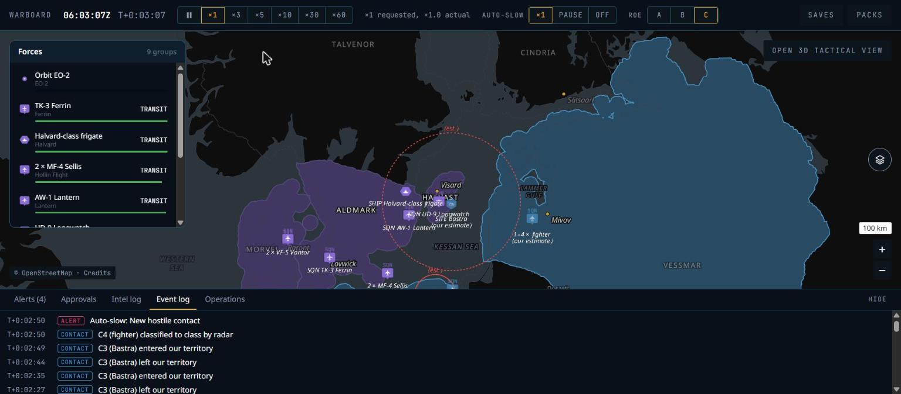
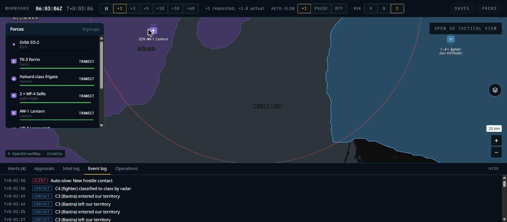

# PF — Fictional setting: phase report

Date: 8 Nov 2026. Status: **done locally; CI not yet run** (every check below ran on the working tree on 8 Nov 2026, Windows 11, Rust 1.99.1, Node 24.15.0, Docker 29.6.2).

PF makes the setting fictional (doc 11, ADR-036): real Earth terrain, invented nations, borders, places, bases and systems. It ran in five steps: schema and guard rails, starter catalogue, goldens and scenarios, geodata, then rules, docs and the denylist.

## What was built

| Area | Result |
|---|---|
| Content schema (ADR-041) | `design: { archetype, note }` replaces provenance; archetype bands give warnings, not errors. New kinds: `nation`, `world`, `archetype`, `places` (ADR-042). Nation ids are three lower-case letters. Pack schema 6. |
| Starter catalogue | 141 entries replacing the real seed set: 47 archetypes, 8 nations with doctrines and inventories, 21 platforms, 3 systems, 15 sensors, 12 weapons plus a gun shell, 2 EW suites, 2 countermeasures, 2 data links, 12 loadouts, 2 satellites with authored orbits (doc 11 §3.2). Content 0.2.0. |
| Fixtures and goldens | G1–G9 rebuilt on the generic fixtures (ADR-035) with unchanged bands; new fixtures for stealth, heavy, ESM and tanker aircraft, SAR and EO satellites, a radar AAM, a guided bomb and an enemy air base. Three goldens renamed. |
| Real content removed | 397 files (316 real bases, real platforms, sensors, weapons, countries, inventories, doctrines, a real data link and jammer), the `legacy` archetype, the real-world demo war, the curated real port list. |
| Borders (`geodata/borders.py`, `territory.py`) | Nations grow from the seeds in `content/world/theatre-north.yaml` over the `europe` H3 cells: one queue, cost ÷ weight, terrain factors and seeded noise, a reach limit; then smoothing, small-piece merging and overrides. 12 nm belts from the nearest coast (equidistance where belts meet). Coverage-simplified polygons; a `borders` line layer (`land`, `sea`). The `world` pack reuses the theatre's polygons. Terrain now runs before territory. Packs 2.0.0. |
| Overlap check | Built into the territory step: 3.5 % of 8,715 km of land border within 5 km of a Natural Earth admin-0 line (limit 15 %). Natural Earth is not in any pack. |
| Places | `content/world/places.yaml`: 18 authored labels (seas, gulfs, straits, islands, regions) and 38 proposed by `geodata places` (nation labels, capitals, cities on the largest urban areas, names from `geodata/names.yaml`). |
| Bases | `geodata bases`: 45 bases in `content/bases/<nation>/`, 2–6 air bases (flat open land ≥ 40 km from land borders) and 1–3 naval bases (sheltered coast facing own waters) per nation. Inventories base their aircraft and ships there. |
| Placement | Air and naval bases are `preset` (must match a content base); other sites keep terrain rules. `spawn_real_bases` → `spawn_preset_bases`. The placement pack test checks own and enemy waters and land again. |
| Scenarios | `quickstart-north-straits.yaml` (the app's default war) and `quickstart-north-islands.yaml`, garrisoned on the new bases. `save-load` and the goldens on fixtures; the benchmarks on the catalogue. `determinism-check.sh` picks each scenario's content pack. |
| Map | Basemap real labels and boundaries hidden; borders from the territory pack (solid on land, dashed at sea); a label layer from the content pack (`map_labels` in wb-wasm): nations, capitals, cities, seas, gulfs, straits, islands, regions. |
| Denylist | `content/denylist.txt` (70 terms). `wb content check` refuses an entry that contains one; `wb content denylist` scans content, scenarios, crates, apps and docs (new CI step) and the built bundle (`pages.yml`). Matching ignores case and needs whole words. |
| Real names elsewhere | Code comments and examples, the sun and distance tests, wb-geo test codes, the `gps` guidance value (now `satnav`), docs and phase reports P1–P6b rewritten; 19 screenshots that showed real names deleted (your decision). |
| Docs | ADR-041 and ADR-042 (Proposed); doc 03 §3, doc 04 §2, doc 05 §7, doc 06 §9, doc 11 §2 and §4; `docs/versions.md`; CLAUDE.md commands and phase status. |

## Acceptance results (doc 08, PF)

| Criterion | Result |
|---|---|
| Denylist clean over content, scenarios, code and docs | **Pass**: `wb content denylist`: 70 terms, 510 files, 0 hits; the built app bundle also 0 hits. A bad fixture proves the content check refuses a denied term. |
| G1–G9 pass on fixtures with their bands | **Pass**: `wb golden scenarios/golden/*.yaml`, all 44 band checks (G1–G12). No band changed. |
| Border overlap check ≤ 15 % | **Pass**: 3.5 %. |
| Theatre North renders with fictional labels only | **Pass**: see the screenshots below. |
| `cargo fmt --check`, `clippy -D warnings`, `cargo test --workspace` | Pass: 62 tests, 9 ignored |
| Pack tests (`wb-geo --test packs -- --ignored`) | Pass, 6: every seed in its nation, the island republic holds its island, the 12 nm limit (9.4 nm owned, 14.2 nm open sea, also in the world pack), a land border, unclaimed land |
| Placement tests with packs (`--include-ignored`) | Pass, 7 |
| Truth canary, lint canaries | Pass |
| Content check, build twice | Pass: 188 entries, same hash `d5f01374…bad9` both times |
| `cargo deny check` | Pass |
| `pnpm gen`, typecheck, lint, build | Pass |
| Determinism check | Pass: 19 matches (scenarios, save/reload, native save → WASM, geo probes), no mismatch |
| Benchmarks | `patrol-2000` 0.94 ms; `sensors-2000` 5.997 ms against 6 ms (see Known gaps) |

## Browser run and differences from the references

Run: `pnpm --filter game dev`, the straits quick start, both packs updated to 2.0.0 through the pack manager.

| Screenshot | Compare with |
|---|---|
|  `PF-theatre-north.jpg` (zoom 4.5) | `06-world-satellites.png`, `01-strike-route.png` |
|  `PF-kessan-sea-z6.jpg` | `01-strike-route.png` |

1. Same: own coalition purple and enemy blue over land and the 12 nm waters; nation names uppercase and letter-spaced; sea names italic uppercase in the muted sea colour; cities italic with a gold dot; halo on every label; no real label anywhere.
2. Borders: land borders solid in `map.border`, maritime and outer belt limits dashed. The references draw real borders, which are more jagged; ours are simplified hexagon outlines and look smoother.
3. Labels are a MapLibre layer under the deck.gl overlay, so a nation name can sit under unit icons (`HALVAST` over the units on its island at zoom 4.5). 01 shows no place names, 06 only a few.
4. Unclaimed land is plain land colour with no outline other than the nations' own edges; the references have no unclaimed land.
5. The ESM-only estimate of the enemy long-range SAM was drawn near the island republic, far from the battalion, and the log flipped "entered / left our territory" while the estimate moved. That is sensor behaviour (a bearing-only estimate), not the map; see Known gaps.

## Decisions and deviations

- **Your decisions**: base rules split (air and naval `preset`, others terrain); golden fixture stats at archetype mid-band, bands unchanged; real content deleted outright; old reports rewritten, and the screenshots with real names deleted.
- **ADR-041** (schema) and **ADR-042** (geodata, places, bases, denylist, `satnav`): Proposed.
- **G4**: the fixture ESM receiver's reference range became 480 km (inside the 200–500 km band) because the fixture SAM radar is weaker than the old one. **G8**: the intruder is a large-RCS heavy-fighter fixture, and fixture fighters carry the test data link (without one, own tracks reached the picture 60 s late). **G10**: the test anti-ship missile stays at Mach 1.2 (an archetype warning, explained in its note).
- **World window and reach** (`extent`, `reach_km`) and **seeded noise** are not in doc 11; without them land beyond the theatre was either all claimed or cut by straight lines (ADR-042, doc 11 §2.2 updated).
- **Places in the content pack** instead of a pack tile set; one `places` entry in `world/`.
- **One base per file** under `content/bases/<nation>/` (doc 11 said one file per nation; the loader takes one entry per file).
- **Quick starts in `scenarios/`**, not `content/scenarios/`.
- **Capitals and cities** sit on the largest urban areas (doc 11 §2.4), so their locations are those of real cities with fictional names. Two generated names were edited by hand.
- **Base sizes** are placeholders (48 / 30 aircraft, 10 / 6 berths) so every inventory fits.

## Known gaps

- **`sensors-2000` sits on its 6 ms budget** (5.997 ms here; 6.05–6.56 ms in other runs today). This machine measured the pre-PF commit at 4.16 ms against 2.86 ms recorded in P6b, so it runs slow today; the PF catalogue is also more sensor-heavy (ESM drone, large-RCS heavy fighter). CI may fail on it.
- **ESM-only estimates** of distant emitters can land far from the emitter and cross territory lines, which floods the log with "entered / left our territory".
- **Generated names** can still resemble real ones; the denylist is a short guard, not a catalogue.
- **The two nations at the theatre's edge** reach far: Kaldoria spans the southern lowlands to the west edge of the window, Talvenor the whole northern peninsula and both shores of the northern gulf. Tune seeds, weights or `reach_km` and rebuild `europe` (about 40 s).
- **Hosting**: the packs on R2 must be uploaded again (2.0.0), and the hosted build still opens the fixtures test war.
- **`geodata/run.sh build world`** needs the `europe` work folder; a fresh machine must build `europe` first.

## Open questions

1. **ADR-041 and ADR-042**: accept as written?
2. **`sensors-2000` budget**: watch CI, or trim the mix, or raise the budget? I would not change the test before seeing CI.
3. **Hosted build**: switch `pages.yml` from the fixtures test war to the straits quick start now that it is fictional?
4. **Map balance**: keep Theatre North as grown, or adjust seeds and weights before P8 builds content on it?
